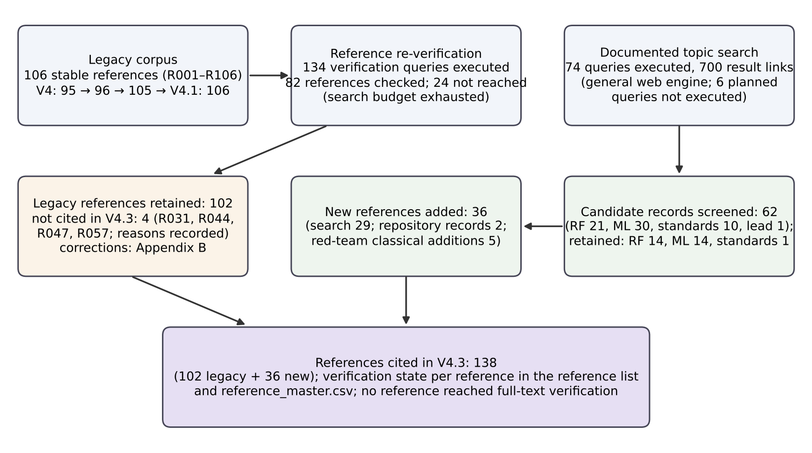
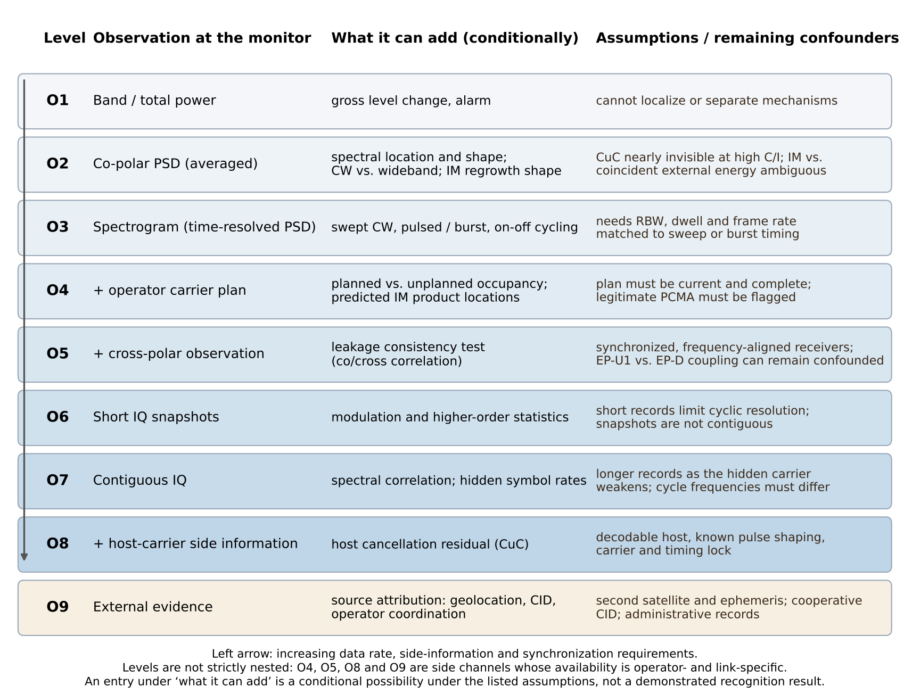
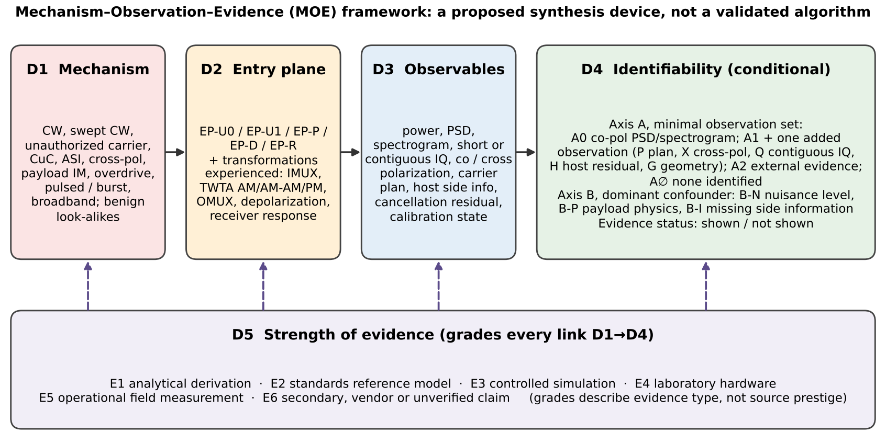

::: {custom-style="Abstract"}
**Abstract.** Operators of geostationary (GEO) bent-pipe satellites detect most radio-frequency interference by monitoring the downlink, yet the operationally costly step is diagnosis: deciding which physical mechanism produced an anomaly, because each mechanism calls for a different response. This structured critical review asks which interference mechanisms can be distinguished from realistically available operator observations, and under which physical and operational assumptions. It combines a documented but access-limited literature search, partial metadata-level re-verification of a 106-entry legacy corpus (82 entries reached, none at full-text level) and of new sources, and a technical audit of the signal models used in the field. The review makes three synthesis contributions. First, an RF entry-plane taxonomy separates interference entering before the input multiplexer, distortion generated inside the payload, cross-polar coupling before and after the nonlinear amplifier, downlink-entry interference and monitoring-receiver impairments, and records the transformations each experiences. Second, a mechanism–observable and identifiability analysis characterizes confusable mechanism pairs by the minimal observation set that could separate them, the dominant confounder (nuisance level, payload physics or missing side information) and whether separation has been shown in the evidence. Third, an evidence-quality framework grades each conclusion by evidence type rather than source prestige. The analysis finds that published satellite learning work is predominantly binary detection under additive signal models, that loaded nonlinear transponders, dual-polarization observation and carrier-plan information are rarely treated jointly, and that unknown-interference rejection is established in generic RF and radar-jamming work, whereas GNSS work mainly adapts to new classes and rejection is largely untested for GEO payloads. These are conclusions about the reviewed evidence, not demonstrations; the review reports no new experimental results.

**Keywords:** GEO satellite; bent-pipe transponder; RF interference; IMUX–TWTA–OMUX; cross-polarization; carrier-under-carrier; cyclostationarity; observability; open-set recognition; evidence quality.
:::

::: {custom-style="Block Text"}
**Status of this manuscript.** This is a literature-review manuscript prepared for independent academic review. It is not an experimental paper and contains no new accuracy, F1, AUROC, FPR@95TPR or payload-gain values. A separate experimental programme is referred to only in Sections 7.4 and 10.3, as research design, not as results. Reference verification states and access limitations are listed in Appendix B and in the accompanying audit files.
:::

# Notation

Signals are complex baseband. Powers in nonlinear-amplifier equations are expressed in a declared normalized reference unless a physical mapping is stated.

| Symbol | Meaning | Unit |
|---|---|---|
| $x_{\mathrm{co}}(t)$, $x_{\mathrm{x}}(t)$ | Composite uplink signals on the co-polar and cross-polar transponder inputs | normalized amplitude |
| $s_k(t)$, $P_k$, $f_k$, $\theta_k(t)$, $K$ | $k$-th planned carrier: unit-power waveform, power weight, centre frequency, phase noise; number of carriers | –, normalized, Hz, rad, – |
| $x_{\mathrm{x},q}(t)$ | Cross-polar transmission of earth station $q$ | normalized amplitude |
| $i_{u,m}(t)$, $i_{d,l}(t)$ | Interferers entering on the uplink (before the IMUX) and on the downlink (after the OMUX) | – |
| $n_u(t)$, $n_d(t)$, $N_0$ | Uplink and downlink/receiver noise; noise power spectral density | –, –, normalized power per Hz |
| $\phi_{\mathrm{LO,co}}(t)$ | Phase noise of the satellite receiver down-converter serving the co-polar channels | rad |
| $h_{\mathrm{IMUX}}$, $h_{\mathrm{OMUX}}$ | Input and output multiplexer impulse responses | – |
| $\mathcal{G}\{\cdot\}$, $A(r)$, $\Phi(r)$, $g_c$ | Memoryless amplifier operator; AM/AM and AM/PM characteristics; channel-amplifier gain (fixed or level-controlled) | –, normalized, rad, – |
| $\alpha_a$, $\beta_a$, $\alpha_\phi$, $\beta_\phi$ | Saleh model coefficients | – |
| $\mathrm{IBO}$, $\mathrm{OBO}$, $c$ | Input and output back-off; constant of the IM3 power law | dB, dB |
| $\kappa_u$, $\kappa_{u,q}$, $\kappa_d$, $\kappa_R$ | Complex cross-polar coupling: common uplink (satellite receive antenna, propagation); station-specific uplink leakage; downlink (satellite transmit antenna, propagation); monitoring feed | – |
| $\mathrm{XPD}$, $\mathrm{XPI}$ | Cross-polar discrimination (co- to cross-polar power received from one transmitted wave) and cross-polar isolation (wanted co-polar power to interference from the orthogonally polarized channel) | dB |
| $\mathcal{R}\{\cdot\}$ | Monitoring-receiver response (gain, flatness, frequency offset, quantization) | – |
| $\rho$, $(C/I)$ | Under-carrier power ratio $\rho = 10^{-(C/I)_{\mathrm{dB}}/10}$; carrier-to-interference ratio | –, dB |
| $S_y(f)$, $S_y^{\alpha}(f)$, $\alpha$, $T_s$, $\beta_{\mathrm{rc}}$ | Power spectral density; spectral correlation function; cycle frequency; symbol period; root-raised-cosine roll-off | normalized power per Hz, same, Hz, s, – |
| $\Lambda$, $\gamma$, $N$ | Detection statistic; threshold; record length in samples | – |
| $\eta$, $\mathcal{W}_i$, $N_r$, $P_j$ | CA-CFAR scale factor; reference cells of bin $i$; their number; cell power | – |
| $m$, $\psi$, $\Psi$, $\mathcal{O}$, $d_{\mathrm{TV}}$, $\epsilon$ | Mechanism; nuisance parameters and their set; observation operator; total-variation distance; error level | – |
| $g_k(x)$, $L$, $v(x)$, $\mu_k$, $\Sigma$, $T_E$ | Logits; number of known classes; embedding; class means; shared covariance; energy temperature | – |
| $Q(x)$, $U(x)$, $\tau$, $t_{95}$ | Known-confidence score (larger = more known-like); unknown score $U(x)=-Q(x)$ (larger = more unknown-like); rejection threshold; test-oracle threshold at 95% TPR | – |
| $\mathcal{D}_{\mathrm{kn}}$, $\mathcal{D}_{\mathrm{unk}}$, $\mathcal{D}^{\mathrm{near}}_{\mathrm{unk}}$ | Known-class and unknown-family test observations; near-family subset | – |

# 1. Introduction, scope and research questions

## 1.1 Operational problem

Interference is a recurrent operating cost for GEO satellite operators. Trade and operator accounts associate it with terminal installation and configuration errors, cross-polarization leakage, equipment faults, adjacent-satellite interference and unauthorized or mis-tuned carriers [R001; R002; R003; R004]. These sources motivate the problem but are not peer-reviewed incidence measurements: they are trade-press articles, vendor material or a newsletter account, and some date from 2005. Percentages quoted in them describe the populations of incidents that particular organizations logged, not risk to service availability, and they are therefore not used here as quantitative evidence. A company-reported 2026 account of sustained, intermittent interference against several commercial GEO satellites [R005] illustrates that deliberate interference can be cycled on and off and retargeted; it is treated as an operational report, not as independent attribution evidence.

Operators find most events by monitoring the downlink: carriers are compared with expected power levels and spectral masks, alarms fire on deviations, and analysts interpret spectrum-analyzer traces [R002; R006]. Detection—deciding that something deviates from the expected state—is necessary but not sufficient. The costly step is diagnosis of the mechanism, because the response differs by mechanism: repointing or re-polarizing a terminal, locating an unauthorized uplink, coordinating with an adjacent-satellite operator, or reducing payload drive. Source identification has also been studied directly; for example, single-satellite techniques match downlink carrier-level fluctuations to known uplink stations [N003] and time- or frequency-difference-of-arrival methods geolocate emitters [N001; N002; R106]. Those methods answer "where" or "which transmitter", whereas this review concerns "which physical mechanism", which may be needed before or alongside localization.

## 1.2 Why the GEO bent-pipe observation is special

Two properties make mechanism recognition harder than it first appears. First, the monitoring station observes the downlink after the uplink composite has passed through the transponder's input multiplexer (IMUX), travelling-wave-tube amplifier (TWTA) and output multiplexer (OMUX). On-board detection studies motivate their architecture precisely by noting that downlink noise and transponder distortion degrade detection on the ground [R007]. The nonlinear amplifier also generates intermodulation that can resemble external interference. Second, the catalogue of interference is not closed: new waveforms and operating patterns appear, and historical trade reporting describes incidents whose sources were never attributed [R001; R005]. An unattributed incident is not necessarily an unseen signal class, but a recognizer forced to assign every input to a known class will mislabel whatever falls outside its catalogue.

## 1.3 Scope, research questions and contribution

The review is a structured critical review supported by a transparent, though access-limited, search methodology (Section 2). GEO bent-pipe payloads are the primary focus. Non-geostationary (NGSO), GNSS and generic RF studies are included as comparisons only when their transfer assumptions can be stated. The main question is:

**RQ1.** Which interference mechanisms can be distinguished using realistically available operator observations, and under which physical and operational assumptions?

Three supporting questions structure the analysis:

**RQ2.** At which RF reference plane does each mechanism enter the end-to-end link, and which payload and propagation transformations does it experience before it is observed?

**RQ3.** What type and strength of evidence supports published detection and recognition claims, and how far can evidence from NGSO, GNSS and generic RF domains be transferred to GEO payload monitoring?

**RQ4.** Which evaluation conventions—positive class, score direction, threshold calibration and data partitioning—are required for claims about unknown-interference rejection to be interpretable?

The intended contribution is a critical synthesis rather than a catalogue. It comprises (i) an RF entry-plane taxonomy that records the transformations each disturbance undergoes (Section 3); (ii) a mechanism–observable analysis and a two-axis conditional identifiability characterization (Sections 4–5); (iii) an evidence-quality framework that grades conclusions by evidence type (Sections 2.5 and 8); and (iv) a research-gap and validation-priority matrix (Section 10). Section 9 combines these into a Mechanism–Observation–Evidence (MOE) framework. The framework is a proposed analytical device, not a validated algorithm. Elements of it are long established: operators already classify interference by cause [R002; R003]; link budgets separate uplink, payload and downlink contributions and ITU-R recommendations define interference in terms of reference-plane quantities [N038; N006; N007]; model-based fault diagnosis formalizes fault signatures and isolability [N036; N037]; and DVB-S2X guidelines decompose cross-polar interference into antenna and propagation terms [R054, §4.4.1.3]. Within the access-limited search of this review, no prior publication was identified that integrates entry plane, payload transformation, operator observability and evidence grade for GEO interference mechanisms; because subscription databases and Chinese-language venues could not be searched (Section 2.6), this is reported as a search outcome, not as a priority claim.

The review is written alongside a separate experimental research programme on payload-aware open-set recognition; the programme's design is referred to only where it illustrates an evaluation requirement (Sections 7.4 and 10.3), and none of its results are reported.

# 2. Literature-search and source-verification methodology

## 2.1 Review type and corpus history

The review follows a structured critical-review design. It does not claim compliance with a systematic-review reporting standard, because the search could not be executed in bibliographic databases with reproducible hit counts (Section 2.6). The starting point was a legacy corpus that grew across earlier versions of this manuscript: 95 references in the original draft, 96 and 105 in two technical revisions, and 106 in the V4.1 editorial revision. Every legacy reference keeps a stable identifier (R001–R106) so that its history remains traceable when publication numbering changes; new references carry identifiers N001 onward. The search strategy that produced the legacy corpus was not logged in a reproducible form in the available files; it is therefore treated as an inherited, non-reproducible corpus that the present audit re-verified rather than as the output of the documented search.

## 2.2 Information sources and access

The documented search was carried out on 26 October 2026. Direct programmatic or interactive access to Crossref, OpenAlex, arXiv, Semantic Scholar, DOI resolvers, IEEE Xplore, ETSI, ITU, Scopus, Web of Science and Google Scholar was blocked by the network policy of the execution environment. The only available instrument was the web-search tool of the execution environment (the WebSearch tool of Anthropic's Claude Code), a server-side general web-search service whose underlying engine is not disclosed to the user. It returns approximately ten result links with page excerpts per query, and its result lists are not deterministic, so the search cannot be reproduced bit for bit; the logged query strings and dates make it repeatable in intent. Where a query was restricted to a publisher domain, this was domain targeting within the general engine, not a search of that database's own interface, and it is logged as such. Subscription databases were not searched and are not claimed to have been searched.

## 2.3 Search strategy

Queries were organized in three streams: (a) GEO RF physics and signal processing (bent-pipe interference, IMUX/TWTA/OMUX and multicarrier intermodulation, adjacent-satellite interference and C/I definitions, monitoring and geolocation); (b) machine learning and uncertainty (satellite interference detection and classification, open-set and out-of-distribution recognition, score critiques, calibration, novelty-threatening prior work); and (c) standards and primary physics (ETSI DVB-S2/S2X documents, Saleh's amplifier model, intermodulation scaling). A fourth activity verified each legacy reference by title, identifier and claim context. Every query, its date, filters, number of returned links, duplicates with the existing corpus, retained candidates and exclusion notes are recorded in the accompanying search log.

## 2.4 Eligibility, screening and verification states

Sources were eligible when they (i) concerned interference generation, propagation, detection, recognition or localization in satellite links, or methods directly transferable to them; (ii) supported or contradicted a specific claim in the review; and (iii) could be identified by persistent metadata. Trade and vendor sources were retained only for operator practice and product capabilities and are labelled as such. Sources were excluded when they were off-topic, duplicated, unidentifiable, or when the only available record was an unattributed summary. Each reference received one verification state:

- `verified_full_text`: the cited passage was inspected in the full text during this audit;
- `verified_publisher_metadata`: a publisher, registry, preprint-server or proceedings record appeared in the search results and its excerpt confirmed the title and year and, where shown, the authors and identifier; the record itself was not opened;
- `verified_primary_dataset_record`: a dataset landing page confirmed the record;
- `secondary_only`: only institutional repositories, citing works or aggregators confirmed it;
- `unverified`: no confirming record was obtained in this audit (including references not reached before the search budget was exhausted);
- `contradicted`: evidence showed the cited metadata or claim to be wrong.

A valid DOI or registry record was never equated with full-text verification. Because no full text could be opened in this environment, no reference reached `verified_full_text` in this audit; earlier full-text inspections recorded by previous revisions (for example, of ETSI TR 102 376-2 [R054]) are reported as inherited evidence, not as checks performed here. The distribution of verification states is given in Table B1 (Appendix B).

## 2.5 Evidence-quality framework

For every major conclusion the review records the type of evidence on which it rests:

- **E1 analytical derivation** — a result that follows from a stated model (for example, the PSD of uncorrelated additive signals);
- **E2 standards reference model** — a channel, amplifier or interference model published in a standard or implementation guideline, which is an engineering reference, not a measurement of a specific payload;
- **E3 controlled simulation** — numerical experiments under a declared signal model;
- **E4 laboratory hardware measurement** — measurements on hardware or testbeds under controlled conditions;
- **E5 operational field measurement** — recordings from operational systems, which contain real effects but usually lack controlled labels;
- **E6 secondary, vendor or unverified claim** — trade press, product literature, or claims whose source could not be verified.

The grades describe the type of support, not the prestige of the outlet. They are not a single ranking: an E5 field recording can establish that an effect occurs while being unable to establish its cause, whereas an E1 derivation can establish a mechanism while saying nothing about its operational prevalence.

## 2.6 Search yield and limitations

{width=6.3in}

As summarized in Figure 1, the streams executed 74 topic queries that returned 700 result links, and the reference-verification activity executed 134 further queries. The search budget of the environment (reported as 200 web-search calls per working turn, shared across all parallel search tasks) was exhausted before all planned queries ran; the logged totals exceed that figure, a discrepancy that could not be resolved from the logs, so counts are reported as logged. As a result, the following planned work was not executed: re-verification of 24 legacy references (R025–R027, R048–R050, R052–R053, R075–R081, R096, R098–R105); searches on polarization physics and cross-polar interference cancellation, primary carrier-in-carrier/PCMA sources, primary cyclostationarity sources, IQ-versus-PSD recognition, sim-to-real transfer and RF datasets; and, most importantly, a dedicated search for prior work that would weaken the novelty narrative (taxonomies of interference observability; payload-aware, dual-polarization or open-set satellite interference recognition). Novelty-relevant sources that surfaced in the other streams are discussed in Sections 7 and 9.4, but the absence of a dedicated novelty search is a material limitation (Section 11). The exact strings of unexecuted and planned queries, including the planned novelty-search queries, are listed in the search log so that the search can be completed.

# 3. GEO bent-pipe transponder RF physics and interference entry planes

## 3.1 Reference chain and its sources

A transparent (bent-pipe) GEO transponder receives the uplink in a wideband receiver, converts it in frequency, selects a channel in the input multiplexer, amplifies it in a channel amplifier—commonly a TWTA operated with input back-off—and filters the result in the output multiplexer before retransmission [R052; R053; R097; N038]. The DVB-S2 system papers and modem studies established the IMUX–TWTA–OMUX cascade, phase-noise masks and predistortion as the reference satellite channel for receiver design [R052; R053]. ETSI EN 302 307-1, in its informative Annex H on examples of possible use of the system, gives example IMUX/OMUX responses and conventional and linearized TWTA AM/AM and AM/PM characteristics (Annex H.7) [R097]; ETSI TR 102 376-2 V1.2.1 (2021) extends these examples for DVB-S2X, including cross-polar interference models (§4.4.1.3) and on-board TWTA characteristics for transponder bandwidths in Ku and Ka band (§4.4.1.4) [R054]. The 2020 DVB document A171-2 is a preceding draft of that technical report and is not cited as the publication of record. These standards-derived examples are engineering reference models (evidence type E2): they make simulations traceable, but they are not measurements of any particular in-orbit payload, and an individual flight transponder may differ in filter shape, amplifier characteristic and gain-control mode.

The cascade has memory even when the amplifier is modelled as memoryless, because the filters on either side of the amplifier have frequency-dependent amplitude and group delay. Volterra models of nonlinear satellite links [N033], pre-compensation and predistortion studies for multicarrier DVB-S2 transponders [R056] and Wiener-type formulations [N005; R055] all treat this filter–nonlinearity–filter structure. For interference recognition this means that a disturbance's observed signature depends on where it enters relative to the filters and the amplifier, not only on its waveform.

## 3.2 A layered signal model with explicit reference planes

The following model is written per polarization and makes every entry point explicit. It is a modelling convention adopted for this review; it extends, rather than reproduces, the single-polarization chains of the cited references. For the co-polar channel, the composite uplink of $K$ planned carriers and $M$ uplink-entry interferers is

$$x_{\mathrm{co}}(t)=\sum_{k=1}^{K}\sqrt{P_k}\,s_k(t)\,e^{\,j\left(2\pi f_k t+\theta_k(t)\right)}+\sum_{m=1}^{M} i_{u,m}(t)+n_u(t) \tag{1}$$

where $s_k(t)$ has unit mean power and $P_k$ is a power weight in the declared normalization. Cross-polar coupling before the payload and the phase noise of the satellite receiver's down-converter give the input of the co-polar channel,

$$u_{\mathrm{co}}(t)=\Big[x_{\mathrm{co}}(t)+\kappa_u\,x_{\mathrm{x}}(t)+\sum_{q\in\mathcal{Q}}\kappa_{u,q}\,x_{\mathrm{x},q}(t)\Big]e^{\,j\phi_{\mathrm{LO,co}}(t)} \tag{2}$$

Here $\kappa_u$ is the common coupling of the satellite receive antenna and uplink propagation, which leaks the whole opposite-polarization uplink $x_{\mathrm{x}}$ at one level, whereas $\kappa_{u,q}$ is the station-specific leakage of an earth station $q$ whose polarization is misaligned and which leaks only its own cross-polar transmission $x_{\mathrm{x},q}$. The down-converter phase noise $\phi_{\mathrm{LO,co}}$ is common to all channels served by that receiver and generally differs between the receivers of the two polarizations. The channel output is

$$z_{\mathrm{co}}(t)=\left(h_{\mathrm{OMUX}}*\mathcal{G}\left\{g_c\cdot\left(h_{\mathrm{IMUX}}*u_{\mathrm{co}}\right)\right\}\right)(t) \tag{3}$$

where $g_c$ is the channel-amplifier gain: fixed in fixed-gain mode, or adapted to the input power under automatic level control. After downlink propagation, the monitoring station observes

$$y_{\mathrm{co}}(t)=\mathcal{R}\left\{z_{\mathrm{co}}(t)+\kappa_d\,z_{\mathrm{x}}(t)+\sum_{l} i_{d,l}(t)+n_d(t)\right\} \tag{4}$$

with analogous equations for the cross-polar channel and separately specified reverse coefficients. Here $\kappa_d$ lumps satellite transmit-antenna isolation and downlink depolarization; $i_{d,l}(t)$ are interferers that enter after the payload; and $\mathcal{R}\{\cdot\}$ is the monitoring receiver, which acts jointly on both polarizations and includes the monitoring feed's own cross-polar coupling $\kappa_R$, gain and flatness, local-oscillator offset and quantization. Separating $\kappa_R$ from $\kappa_d$ matters because monitor-feed leakage is a site-specific artefact that customers do not experience. Scalar couplings remain a simplification: real coupling is frequency-dependent and not necessarily reciprocal. Equations (1)–(4) are evidence type E1 (a stated model), and their parameters must be declared for any simulation that uses them.

For a memoryless amplifier, the operator acts on the envelope of its input. Saleh's frequency-independent model gives

$$\mathcal{G}\{u\}(t)=A\left(|u(t)|\right)e^{\,j\left(\arg u(t)+\Phi(|u(t)|)\right)},\qquad A(r)=\frac{\alpha_a r}{1+\beta_a r^{2}},\qquad \Phi(r)=\frac{\alpha_\phi r^{2}}{1+\beta_\phi r^{2}} \tag{5}$$

The AM/AM curve peaks at $r_{\mathrm{sat}}=1/\sqrt{\beta_a}$ with $A_{\max}=\alpha_a/(2\sqrt{\beta_a})$ (E1, by differentiation). Saleh also gives an equivalent in-phase/quadrature form of the frequency-independent model and a separate frequency-dependent model [R051]; Eq. (5) represents only the frequency-independent amplitude/phase form. The coefficient set $\alpha_a=2.1587$, $\beta_a=1.1517$, $\alpha_\phi=4.0033$, $\beta_\phi=9.1040$ is widely reproduced as Saleh's TWT fit, but in this audit it was confirmed only from secondary software documentation, and one secondary source gives $\alpha_\phi=4.033$; it is therefore used only as an illustrative parameterization, not as a characteristic of any flight TWTA. Published DVB-S2/S2X example curves are distinct amplifier models [R097; R054], and a result obtained with one model should not be presented as a universal TWTA property. The operating point is set by back-off,

$$\mathrm{IBO}=10\log_{10}\frac{P_{\mathrm{in,sat}}}{P_{\mathrm{in}}}\ \mathrm{dB},\qquad \mathrm{OBO}=10\log_{10}\frac{P_{\mathrm{out,sat}}}{P_{\mathrm{out}}}\ \mathrm{dB} \tag{6}$$

where, under multicarrier loading, $P_{\mathrm{in}}$ is the total mean input power and $P_{\mathrm{out}}$ the total mean output power (including intermodulation and amplified noise), both referred to single-carrier saturation. A single-carrier continuous-wave characteristic is not the mean response to a fluctuating multicarrier envelope; quoting compression or phase rotation "at a back-off" therefore requires stating whether the back-off is single-carrier or total multicarrier.

## 3.3 Payload-generated distortion

When several carriers share an amplifier, third-order intermodulation (IM3) products fall at

$$f_{\mathrm{IM3}}\in\{2f_i-f_j:\ i\neq j\}\cup\{f_i+f_j-f_k:\ i,j,k\ \text{pairwise distinct}\} \tag{7}$$

and in the weakly nonlinear (cubic) regime the IM3 output power grows by about 3 dB per dB of drive while the carriers grow by 1 dB, so that

$$P_{\mathrm{IM3,dB}}\approx 3P_{\mathrm{in,dB}}+c\quad\Rightarrow\quad \frac{\partial\,(C/\mathrm{IM}_3)_{\mathrm{dB}}}{\partial\,\mathrm{IBO}}\approx 2\ \mathrm{dB/dB} \tag{8}$$

with $c$ a model-dependent constant. Equation (8) is an asymptotic small-signal result (E1). Classical multicarrier TWT analyses treat the AM/AM and AM/PM contributions to intermodulation together with additive noise [N032; R058]; near saturation, where AM/PM conversion contributes strongly, the slope decreases and a modelled payload can show a markedly lower slope over realistic operating ranges. With modulated carriers, third-order mixing produces occupied IM bands and spectral regrowth rather than discrete lines, and IMUX/OMUX filtering shapes what reaches the downlink [R055; R056]. Multicarrier operation near saturation also suppresses weak carriers relative to strong ones and diverts output power to noise and interference ("power robbing") [R058; N008]. Noise-power-ratio (NPR) tests quantify in-band distortion under noise-like loading, but their outcome depends on the test signal, notch definition and crest factor, so NPR values are not directly transferable to a given carrier plan [N009].

The satellite literature models this chain mainly in order to compensate it—Volterra equalization of multicarrier intermodulation [R055], learned impairment compensation [R059] and predistortion [R053; N005]—rather than as context for recognition; an anti-jamming study observes that existing methods lack modelling of the distortion caused by transponder nonlinearity [R060]. Amplifier nonlinearity is distinctive enough to identify individual transmitters [R063]; by the same token, a recognizer trained on one payload model may learn model-specific cues, which argues for varying payload parameters across the range expected among flight units rather than fixing a single model.

Two consequences matter for recognition. First, IM products have deterministic frequency structure given the carrier plan, so plan-predicted locations are diagnostic evidence, and their levels change coherently with carrier activity. Second, external uplink interferers also traverse the amplifier: they add drive, can generate their own mixing products with the carriers, and can push a fixed-gain channel toward compression, whereas under automatic level control the same additional input power appears instead as reduced output for the wanted carriers. These statements are physical inferences from Eqs. (1)–(8) (E1); their magnitude depends on gain mode, loading and amplifier model and has not been measured across operational payloads in the reviewed evidence.

## 3.4 RF entry-plane taxonomy

The decomposition of a satellite link into uplink, payload and downlink contributions is classical: link budgets add uplink carrier-to-noise and carrier-to-interference ratios, carrier-to-intermodulation and downlink terms, and ITU-R calculations define interference through such reference-plane quantities [N038; N006; N007]. The taxonomy below reuses those planes but asks a different question—what each disturbance looks like to a ground monitor after the transformations it undergoes—and adds the receiver plane that link budgets usually omit. Five planes are distinguished (Figure 2, Table 1):

- **EP-U0, ground-transmitter plane:** the earth-station chain, where many interference causes originate—antenna mispointing, feed or polarization misalignment, excess EIRP, wrong frequency—but which the operator does not observe directly;
- **EP-U1, uplink-entry plane:** everything that reaches the satellite receive antenna, including uplink cross-polar coupling ($\kappa_u$, $\kappa_{u,q}$) and uplink adjacent-satellite emissions;
- **EP-P, payload-internal plane (receiver and down-converter → IMUX → amplifier → OMUX):** distortion and impairments generated inside the payload—nonlinearity of the wideband receiver, down-converter phase noise, intermodulation, compression, AM/PM, weak-carrier suppression—and passive intermodulation generated in transmit hardware that falls into the receive band;
- **EP-D, downlink-entry plane (after the OMUX):** downlink cross-polar coupling ($\kappa_d$), downlink adjacent-satellite signals received by the monitoring antenna, and terrestrial emitters near the monitoring site, none of which traverse the payload;
- **EP-R, monitoring-receiver plane:** monitoring-feed cross-polar coupling ($\kappa_R$), receiver noise, gain and flatness calibration, spurious responses, clipping and quantization, local-oscillator offsets and the synchronization of co- and cross-polar channels.

![Figure 2. Conceptual bent-pipe observation chain with RF entry planes, drawn from Eqs. (1)–(4). Editorial diagram, not a measured or reconstructed signal. Payload blocks follow the DVB-S2/S2X reference chain [R052; R097; R054]; polarization couplings, entry planes and the monitoring receiver are this review's modelling convention.](figures/figure2_entry_planes.png){width=6.5in}

The taxonomy separates two questions that operator statistics often merge: where a disturbance *originates* (for example, a mispointed terminal at EP-U0) and where it *enters* the observed signal path (EP-U1 for that terminal's uplink). It also separates disturbances that are externally caused but manifest internally—an uplink that is too strong drives the amplifier into compression at EP-P—from distortion that the payload produces under nominal loading.

**Table 1.** RF entry-plane and payload-transformation taxonomy (proposed synthesis). "Transformations" lists what acts on the disturbance between entry and observation. Evidence grades follow Section 2.5; "other domain" marks evidence transferred from outside GEO payload monitoring.

| Disturbance | Typical origin | Entry plane | Transformations before observation | Internal / external | Evidence basis |
|---|---|---|---|---|---|
| CW, swept CW, unauthorized or mis-tuned carrier | Faulty or unauthorized earth station; terrestrial emitter near the monitor | EP-U1 (or EP-D for terrestrial emitters at the monitoring site) | EP-U1: receiver, IMUX, amplifier compression, AM/PM and mixing with carriers, OMUX, downlink, monitor receiver; EP-D: monitor receiver only | External | E1; E6 operator accounts [R002; R003] |
| Carrier-under-carrier | Earth station transmitting under an occupied carrier | EP-U1 | As above; weak-signal suppression possible near saturation | External | E1; E6 vendor practice [R015; R017] |
| Adjacent-satellite interference (uplink) | Off-axis emission of an earth station of another network | EP-U1 | As above | External | E1; E2 [N006; N012] |
| Adjacent-satellite interference (downlink) | Neighbouring satellite's downlink into monitor-antenna sidelobes | EP-D | Downlink path; monitor receiver only | External | E1; E2 antenna patterns [N039] |
| Cross-polar coupling (uplink, common) | Satellite receive-antenna isolation; uplink depolarization | EP-U1 ($\kappa_u$) | Co-polar payload chain, including mixing with co-polar carriers | External | E2 [R054, §4.4.1.3]; E1 |
| Cross-polar leakage (uplink, station-specific) | Polarization misalignment of one earth station | EP-U0 cause; EP-U1 entry ($\kappa_{u,q}$) | As above, affecting only that station's carriers | External | E1; E6 [R002] |
| Cross-polar coupling (downlink) | Satellite transmit isolation; rain/ice depolarization | EP-D ($\kappa_d$) | Downlink path; monitor receiver | External | E2 [R054, §4.4.1.3]; E3 [R064] |
| Payload intermodulation | Multicarrier loading of a shared amplifier | EP-P | OMUX; downlink; monitor receiver | Internal | E1; E2 [R097]; E3 [R055] |
| Overdrive / compression | Excess total input (external cause), or commanded gain setting (operational cause) | Cause at EP-U0/EP-U1 or EP-P (command); manifests at EP-P | Compression, increased regrowth and IM, weak-carrier suppression | Mixed | E1; E3 [R058; N032] |
| Wideband-receiver nonlinearity | Strong uplink signal driving the satellite receiver or down-converter | EP-P (before the IMUX) | Products may fall in several channels; then IMUX, amplifier, OMUX | Internal (externally triggered) | E1 (physical inference; primary sources not searched) |
| Passive intermodulation (PIM) | High-power transmit hardware (OMUX, waveguide, shared antenna) | EP-P, entering on the receive side | Treated by the payload like uplink-entry energy | Internal | E1 (physical inference; primary sources not searched) |
| Pulsed or burst emitters | Radar, TDMA or intermittent sources | EP-U1 or EP-D | Depends on entry plane | External | E1; E5 other domain (GNSS temporal features) [R034; R035] |
| Broadband noise-like interference | Jamming, wideband or aggregate terrestrial emitters | EP-U1 or EP-D | Uplink: power robbing, compression; downlink: additive | External | E1; E3 [N004]; E1/E3 [N008] |
| Receiver and feed artefacts | Monitoring chain, including feed cross-polar leakage | EP-R ($\kappa_R$) | Receiver response only | Observation-side | E1 |

# 4. Interference mechanisms and their observable signatures

This section describes each mechanism by physical origin, entry plane, expected signature in the observables of Section 5, and known look-alikes. Signatures are stated as conditional expectations under the model of Section 3 (E1) unless a source is given. Table 2 condenses the descriptions into a mechanism-versus-observable matrix.

**Continuous-wave (CW) and swept CW.** An unmodulated or slowly modulated tone appears as a narrow spectral line; a swept tone appears in a spectrogram as a moving line whose visibility depends on the sweep rate relative to the resolution bandwidth and frame rate. Entering at EP-U1, a tone is shaped by the IMUX and, with sufficient power, mixes with the carriers in the amplifier, producing additional products at plan-dependent frequencies; a terrestrial tone near the monitoring site enters at EP-D and shows no payload interaction. Look-alikes include beacons, pilots, IM lines predicted by Eq. (7) and a modulated carrier that has collapsed to a tone because of an equipment fault; distinguishing them requires the plan and, for the last case, a view of the transmitting chain or of the opposite polarization [R002].

**Unauthorized, mis-tuned and adjacent-satellite carriers.** These add modulated energy outside the planned occupancy or overlapping it. Their spectra can be almost identical: what differs is consistency with the operator's plan and the transmitter's identity and location. Carrier identification (CID) resolves identity when the transmitter carries it [R013; N011], and geolocation can resolve location [R106; N001; N002], but neither is available from the downlink spectrum alone. Adjacent-satellite interference can enter on the uplink, when an earth station of a neighbouring network emits off-axis toward the victim satellite within or beyond off-axis EIRP masks [N012], or on the downlink, when a neighbouring satellite's signal is received through the monitoring antenna's sidelobes [N039]. Uplink ASI traverses the payload, is band-limited by the victim's IMUX and is visible at every monitoring site served by the victim's downlink beam. Because neighbouring networks reuse the same band plans, uplink ASI frequently falls on occupied carriers and then behaves like carrier-under-carrier rather than like a visible unplanned carrier. Downlink ASI depends on the gain of the receiving antenna toward the neighbouring satellite: a large monitoring antenna may strongly reject what small customer terminals receive, so downlink ASI suffered by customers can be unobservable at the operator's monitor.

**Carrier-under-carrier (CuC).** An unwanted carrier fully overlapping an authorized one is the clearest limit of PSD-based detection. In paired-carrier multiple access (PCMA), two carriers deliberately share a band, and blind detection of the weaker carrier is a recognized hard problem [R066; R067]. Unintended CuC inherits that difficulty, and commercial monitors that advertise CuC detection document, where they document anything, host-carrier cancellation or PCMA cancellation followed by inspection of the residual [R015; R016; R017; R003]. Benign look-alikes are significant: a legitimate PCMA link and a DVB-CID metacarrier transmitted below its host both place energy under an authorized carrier by design [N011].

**Cross-polarization interference.** Leakage of a carrier from the opposite polarization appears in the co-polar spectrum as unexpected energy at a frequency occupied on the other polarization. Sources include earth-station polarization misalignment, insufficient antenna isolation, and rain or ice depolarization [R064; R065; R054, §4.4.1.3]. The DVB-S2X guidelines model aggregate cross-polar interference as a power sum of satellite-antenna isolation (XPI), terminal isolation and depolarization (XPD) terms, which the guideline describes as typical near-worst-case values for its scenarios; the resulting aggregate examples are about 24 dB C/I for a Ku-band linear-polarization scenario and about 17 dB for a Ka-band circular-polarization scenario in deep fading [R054, §4.4.1.3] (E2; values confirmed at search-excerpt level in this audit and by full-text inspection reported in a previous revision). These are scenario values, not band thresholds, and an aggregate C/I model is not a carrier-level mechanism classifier. The structure of leakage is diagnostic: a misaligned earth station leaks only its own carriers, whereas antenna or propagation coupling leaks the whole opposite transponder at a common level. Downlink coupling copies the opposite transponder's output—including its intermodulation, noise floor and OMUX shape—without truncation by the co-polar IMUX, while uplink coupling passes through the co-polar payload and is distorted with its carriers.

**Payload intermodulation and overdrive.** Intermodulation is generated inside the payload under nominal multicarrier loading (Section 3.3); overdrive denotes operation so close to saturation that compression, regrowth and weak-carrier suppression become pronounced. The externally caused case—an uplink interferer or an over-powered carrier adding drive—and the operational case—an incorrect commanded gain—produce related signatures through different causes. Payload IM is predictable from the plan, and its regrowth extends to plan-predictable offsets beyond carrier edges; a broadband noise-like uplink interferer raises the floor more uniformly across the IMUX passband and also adds drive, so the two can co-occur.

**Pulsed and burst-like interference.** Radar and other intermittent emitters produce time-gated energy whose detectability depends on duty cycle and on the time resolution of the observation; TDMA return links and on/off-cycled jamming [R005] create time structure that a time-averaged PSD hides. GNSS interference studies provide extensive evidence on pulsed and chirp classes in real recordings [R034; R035; R033], but GNSS signals lie below the noise floor and are received without a bent-pipe payload, so that evidence transfers only to the temporal-feature component of the problem.

**Broadband interference.** Noise-like jamming, wideband emitters and aggregate terrestrial interference raise the noise floor over a band. Entering on the uplink it also consumes amplifier output power [N004; N008]; entering at the monitoring site it does not. Its spectral shape can resemble amplifier regrowth, and its level change can resemble a fade or a receiver gain change.

**Benign structures that resemble interference.** Legitimate PCMA links, CID metacarriers, beacons, pilots and framing structure, TDMA bursts, carriers being activated or retuned, propagation fades and depolarization, sun-transit (solar-conjunction) noise rise at the monitoring antenna, and monitoring-receiver spurs or feed leakage can all trigger anomaly alarms. A diagnosis framework therefore needs negative classes and side information as much as it needs interference classes.

**Table 2.** Mechanism-versus-observable matrix (proposed synthesis). Ratings describe the power of an observable to *discriminate* the mechanism from its principal look-alikes in Table 3, not merely to reveal that energy is present: ● primary discriminating evidence under the stated assumptions; ○ partial or conditional discrimination; – not expected to discriminate (the observable may still reveal presence). Entries are hypotheses derived from Sections 3–4 (E1 unless otherwise noted), not demonstrations of necessity or sufficiency.

| Mechanism | Co-pol PSD | Spectrogram | Carrier plan | Cross-pol obs. | Contiguous IQ / cyclic | Host side info / residual | External evidence |
|---|---|---|---|---|---|---|---|
| CW | ● | ○ | ● | ○ | ○ | – | ○ |
| Swept CW | ○ | ● | ○ | – | ○ | – | ○ |
| Unauthorized / mis-tuned carrier | ○ | ○ | ● | ○ | ○ | – | ● (CID, geolocation) |
| Carrier-under-carrier | – | – | ○ | – | ● | ● | ○ |
| ASI, uplink entry | ○ | ○ | ○ | – | ○ | ○ | ● (geolocation, multi-site, coordination) |
| ASI, downlink entry | ○ | ○ | ○ | – | ○ | – | ● (antenna geometry, multi-site) |
| Cross-pol, uplink coupling | ○ | ○ | ● (cross-pol plan) | ● | ○ | – | ○ |
| Cross-pol, downlink coupling | ○ | ○ | ● (cross-pol plan) | ● | ○ | – | ○ |
| Payload IM (nominal) | ○ | ○ | ● | – | ○ | ○ | ○ (drive records) |
| Overdrive / compression | ○ | ○ | ● | – | ○ | ○ | ○ (telemetry) |
| Pulsed / burst | ○ | ● | ○ | – | ○ | – | ○ |
| Broadband | ○ | ○ | ○ | ○ | – | – | ○ (beacon, calibration) |
| Benign PCMA / CID | – | – | ● | – | ● | ○ | ● (plan, CID decoding) |

# 5. Operator observation constraints and physical identifiability

## 5.1 What an operator can realistically observe

The operator's observation is the output of Eq. (4) through a specific receiver and antenna, not the simulator's internal state. Figure 3 groups observation types by kind and by side-information needs. Swept spectrum-analyzer traces and band-power measurements are ubiquitous in operator practice [R002; R006]; short IQ captures are available in many digital monitoring systems; contiguous wideband IQ over long records, synchronized co- and cross-polar receivers, current carrier plans with modulation parameters, decodable host carriers and second monitoring sites are each conditional capabilities that cannot be assumed for every station. Plans can be stale or incomplete, legitimate PCMA links must be flagged in them, and the absolute level calibration of a monitor may drift. The monitoring antenna also differs from customer terminals in gain and sidelobe discrimination, so what the operator sees is not necessarily what customers suffer.

{width=6.5in}

Equally important is what an operator cannot observe. Activity masks of which carriers are on, realized back-off, realized XPD, realized C/I, event labels and parameters, and transmitted symbols are simulator ground truth. A recognizer evaluated with any of them as an input is not evaluated under operator conditions; an oracle canceller that subtracts the true host waveform can serve only as a labelled upper bound. These distinctions follow directly from the observation model (E1) and are the basis of the leakage rules in Section 7.6.

## 5.2 Conditional identifiability: two axes and an evidence status

Let $m$ denote a mechanism, $\psi\in\Psi$ the nuisance parameters (loading, back-off, coupling, power, host level, receiver state) and $\mathcal{O}$ the observation operator that maps the received field to what the operator records over a record of length $N$. Exact equality of distributions is too weak a criterion, because with continuous nuisances almost any two mechanisms differ in some negligible way. The review therefore calls $m_1$ and $m_2$ *distinguishable under* $\mathcal{O}$ at record length $N$ and error level $\epsilon$ if

$$\inf_{\psi_1,\psi_2\in\Psi}\ d_{\mathrm{TV}}\!\left(P^{(N)}_{\mathcal{O}\mid m_1,\psi_1},\,P^{(N)}_{\mathcal{O}\mid m_2,\psi_2}\right)\ \ge\ 1-2\epsilon \tag{9}$$

which is equivalent to the existence of a test whose worst-case error over the nuisance set does not exceed $\epsilon$ for equal priors. This is the same notion that model-based fault diagnosis calls isolability, where fault-signature and isolability analyses play the role of Tables 2 and 3 [N036; N037]. Each confusable pair is then characterized on two axes and an evidence status:

- **Axis A, minimal observation set:** A0, co-polar PSD or spectrogram suffices; A1, one added operator-side observation is needed, named by its code—P (carrier plan), X (cross-polar observation), Q (contiguous IQ), H (host side information or cancellation residual), G (second site or antenna geometry); A2, evidence external to the monitored signal is needed (geolocation, CID decoding, coordination records, telemetry); A∅, no observation set identified in the reviewed evidence.
- **Axis B, dominant confounder:** B-N, nuisance level and noise (host level, calibration, record length); B-P, payload physics that maps different inputs to similar outputs over part of the nuisance range; B-I, missing, stale or inconsistent side information.
- **Evidence status:** whether separability has been shown in the reviewed literature, and with which evidence grade.

Axis A is a property of the observation model; axis B names what defeats separation when the minimal set is unavailable or degraded; the evidence status records what has been demonstrated. Absence of a published demonstration is not a mathematical result.

## 5.3 Worked analytical examples

**Carrier-under-carrier in second-order statistics.** For a host carrier $s_h$, an under-carrier $s_u$ at power ratio $\rho$, and independent stationary noise, with uncorrelated zero-mean signals,

$$y(t)=s_h(t)+\sqrt{\rho}\,s_u(t)+n(t)\quad\Rightarrow\quad S_y(f)=S_h(f)+\rho\,S_u(f)+N_0 \tag{10}$$

For identical spectral shapes and $(C/I)=20$ dB, the composite PSD exceeds the host PSD by $10\log_{10}(1+0.01)\approx0.043$ dB (E1). The size of this change is not what limits detection: the standard deviation of a periodogram bin in decibels is about 4.34 dB, so averaging $K$ looks over $M$ in-band bins reduces it to roughly $4.34/\sqrt{KM}$ dB, and $KM\approx10^4$ already resolves 0.043 dB. What limits detection is nuisance uncertainty. If the host level is unknown, $S_h(1+\rho)$ is indistinguishable from a slightly stronger host, so with identical shapes the pair is not identifiable from the PSD at any C/I; if the host level is known, the under-carrier is detectable from the PSD only when $10\log_{10}(1+\rho)$ exceeds the combined uncertainty of host EIRP and monitor calibration, typically a few tenths of a decibel or more. Different spectral shapes can produce larger changes in particular bins. Equation (10) applies to additive combination; an uplink under-carrier passes through the nonlinear chain of Eqs. (2)–(3), where weak-signal suppression depends on loading and operating point. Classical results on energy detection under noise uncertainty make the same point in general form: below an "SNR wall" set by the uncertainty, no record length suffices [N035].

**Cyclic features.** The spectral correlation function

$$S_y^{\alpha}(f)=\lim_{T\to\infty}\,T^{-1}\,\mathbb{E}\left[Y_T\!\left(f+\tfrac{\alpha}{2}\right)Y_T^{*}\!\left(f-\tfrac{\alpha}{2}\right)\right] \tag{11}$$

of an ideal linearly modulated signal with independent zero-mean symbols has non-conjugate second-order cycle frequencies at integer multiples of $1/T_s$; with a root-raised-cosine pulse of roll-off $0<\beta_{\mathrm{rc}}<1$ only $\alpha\in\{0,\pm1/T_s\}$ have non-zero support (E1; [R011]). Stationary noise has zero expected SCF at non-zero cycle frequencies, but finite-record estimates retain variance from noise and from the host. If the under-carrier's cycle frequency lies outside the host's cyclic support, the ideal additive expectation there contains only the under-carrier term, and level uncertainty of a stationary background does not create a false cyclic feature—this is why cyclic statistics can escape the SNR wall of energy detection. Under the further assumption that host and noise act as an approximately Gaussian background at the tested cycle frequency, the deflection of a cyclic-correlation statistic grows in proportion to $N\rho_{\mathrm{eff}}^2$, where $\rho_{\mathrm{eff}}$ is the under-carrier power relative to host plus noise, so the required record length scales roughly as $\rho_{\mathrm{eff}}^{-2}$; equal symbol rates, framing and pilot structure, conjugate cyclic features and payload nonlinear cross-terms violate these assumptions. Cyclic features therefore make CuC potentially distinguishable with contiguous IQ (A1-Q) when cycle frequencies differ, but they are neither necessary nor sufficient in general.

**Host cancellation and the required cancellation depth.** If the host can be demodulated, re-modulated and subtracted, the residual energy

$$\Lambda=\frac{1}{N}\sum_{n=0}^{N-1}\left|y[n]-\hat{s}[n]\right|^{2}\ \underset{\mathcal{H}_0}{\overset{\mathcal{H}_1}{\gtrless}}\ \gamma \tag{12}$$

is compared with a threshold set for a target false-alarm probability. On-board studies analysed this statistic with cancellation of known pilot symbols [R008] and with cancellation of the decoded desired signal for weak interference [R009]; both operate before the payload and downlink, not at a ground monitor. A reconstruction $\hat{s}=(1+\varepsilon)e^{j\vartheta}s_h$ leaves a residual host power fraction $|1-(1+\varepsilon)e^{j\vartheta}|^2\approx\varepsilon^2+\vartheta^2$ for small errors (E1). A 1° rms phase error alone leaves about −35 dB, and a 0.1 dB amplitude error about −39 dB. Detecting an under-carrier at $(C/I)=20$ dB therefore requires host suppression of at least 20 dB plus margin, so payload AM/PM, OMUX group delay, down-converter phase noise and the monitor's own impairments, which all appear as reconstruction error, directly limit ground-side CuC detectability (A1-H with B-P failure modes).

**Cross-polar leakage tests.** With both polarizations observed, downlink coupling is a scaled copy of the opposite transponder output and can be tested by correlating $y_{\mathrm{co}}$ with $y_{\mathrm{x}}$. Uplink coupling appears in $y_{\mathrm{co}}$ as a nonlinearly distorted copy truncated by the co-polar IMUX. Because the two polarization receivers on board generally have different down-converter phase noise, uplink-coupled and downlink-coupled components also correlate differently with the opposite channel. The pattern of leakage across carriers separates station-specific misalignment from common antenna or propagation coupling, given the cross-polar plan (A1-X with P). The tests require synchronized, frequency-aligned observations and adequate reference-channel SNR. When common-mode uplink and downlink coupling are both present at comparable levels, no separating observation set was identified in the reviewed evidence (A∅). Adaptive cross-polarization interference cancellation for satellite receivers, based on LMS, decision-directed or CMA adaptation, and wideband dual-polarization receiver implementations show that synchronized dual-polarization processing is technically feasible [R103; N014]; their purpose is signal recovery rather than mechanism recognition.

**Payload IM versus external energy.** A recognizer that knows the plan can test whether energy lies at the frequencies of Eq. (7) and whether its level co-varies with carrier activity; one that sees an unannotated spectrum cannot. Response to drive would add evidence, but a monitoring station rarely controls or knows the uplink drive, so the plan is the practical observable. External interferers can coincide with IM frequencies and also generate mixing products, so the pair is A1-P with a B-P confounder.

**Table 3.** Operational observability and identifiability matrix for confusable pairs (proposed synthesis). Axis A gives the minimal observation set (A0, A1-P/X/Q/H/G, A2, A∅); axis B the dominant confounder (B-N, B-P, B-I); see Section 5.2. "Not shown" means no reviewed study demonstrates separation for a GEO monitor.

| Confusable pair | From co-pol PSD/spectrogram alone | Axis A (minimal observation) | Axis B | Key assumptions / failure modes | Evidence status |
|---|---|---|---|---|---|
| CuC vs. clean | No if host level is a nuisance; otherwise only if $10\log_{10}(1+\rho)$ exceeds level uncertainty | A1-Q (cyclic) or A1-H (cancellation residual) | B-N; B-P | Distinct cycle frequency; decodable host; cancellation depth vs. C/I | Not shown behind a payload; E3 on-board plane only [R008; R009]; E1 [R011; N035] |
| CuC vs. legitimate PCMA or CID | No | A1-P (plan flag) or A2 (CID decoding) | B-I | Plan completeness; CID present | Not shown; E2 [N011] |
| Payload IM vs. narrowband external energy at an IM frequency | Partly (shape) | A1-P | B-P | Coincident frequencies; interferer–carrier mixing | Not shown; E1, E2 [R097] |
| Overdrive vs. broadband uplink interference | Partly | A1-P (plan-referenced regrowth beyond carrier edges) | B-P; B-I (gain mode unknown) | Both raise floor and add drive | Not shown; E1 |
| Uplink ASI vs. unauthorized carrier (matched level and waveform) | No | A2 (geolocation, CID, coordination) | B-I | External evidence latency | Localization shown operationally (E5 [N031]; E1 [N001]); recognition not shown |
| Uplink vs. downlink ASI | Possibly (payload cues) | A1-G (second site, repointing, antenna geometry) | B-P at a single fixed site and high back-off | Weak payload signature at high back-off | Not shown; E1 |
| Cross-pol leakage vs. unauthorized carrier at same frequency | No | A1-X, or A1-P with the cross-polar plan | B-I | Synchronized receivers; SNR | Not shown for recognition; feasibility of dual-pol processing E3/E4 [R103; N014] |
| Station-specific vs. common uplink cross-pol coupling | No | A1-X with P (leakage pattern across carriers) | B-I | Cross-polar plan available | Not shown; E1 |
| Uplink vs. downlink common-mode coupling | No | A1-X (IMUX truncation, copied IM and noise floor, LO differences) when one dominates; A∅ when both are comparable | B-P | Simultaneous couplings | Not shown; E1 |
| Monitor-feed leakage vs. true cross-pol interference | No | A1-G (feed rotation, second station) | B-I (calibration state) | Feed characterization | Not shown; E1 |
| CW vs. beacon, pilot or IM line | No | A1-P | B-I (plan accuracy) | Plan accuracy | Not shown; E1 |
| Swept CW vs. pulsed emitter | Yes, with adequate time resolution | A0 (spectrogram) | B-N (RBW, dwell, frame rate) | Time resolution | E5 other domain (GNSS temporal features) [R035] |
| Pulsed interference vs. TDMA traffic | No | A1-P (burst schedule; RRC-shaped bursts at planned frequencies) or A1-Q (modulation) | B-I | Traffic schedule knowledge | Not shown; E1 |
| Fade, receiver gain change or sun transit vs. broadband interference | Partly | A1-P with beacon/calibration reference; A2 (sun-transit prediction) | B-I (calibration) | Calibration state | Not shown; E1 |

# 6. Signal-processing approaches

## 6.1 Energy detection and adaptive thresholds

Classical interference detection treats the problem as hypothesis testing on received energy. Operator practice compares carriers with expected levels and spectral masks [R002; R006]; the classical adaptive-threshold detector from radar, cell-averaging constant-false-alarm-rate (CA-CFAR) detection [R010], is a natural baseline for unexpected spectral peaks. For a spectral bin $i$ with $N_r$ reference cells $\mathcal{W}_i$ of powers $P_j$ and square-law detection in independent, exponentially distributed noise,

$$\gamma_i=\eta\cdot\frac{1}{N_r}\sum_{j\in\mathcal{W}_i}P_j,\qquad \eta=N_r\left(P_{\mathrm{FA}}^{-1/N_r}-1\right) \tag{13}$$

Equation (13) holds for single-look periodogram cells in homogeneous noise (E1). Welch-averaged cells follow a Gamma law and need the multi-look expression; in a loaded transponder the reference cells must be chosen from a plan-masked region rather than across carriers, and even then spectral leakage, window correlation and non-uniform residual floors make empirical false-alarm calibration necessary. Simpler schemes target a single interference type, for example tone detection in the subchannels of an on-board digital channelizer [R012]. A per-bin false-alarm probability must also be distinguished from the probability of at least one alarm per frame or monitoring interval. Energy and CFAR detectors answer whether energy is present where it should not be; they do not by themselves identify a mechanism.

## 6.2 Cancellation-based detection

Cancellation converts a hidden-signal problem into a residual-energy problem (Eq. 12). On-board studies show that subtracting known or decoded components makes low-power interference detectable under noise and signal-power uncertainty, and that imperfect cancellation sets a detection floor [R008; R009]. Overviews of high-throughput satellite signal processing motivate on-board detection precisely because ground detection suffers from downlink noise and transponder distortion [R007]. Ground monitoring products describe host-carrier cancellation and PCMA cancellation for carrier-under-carrier analysis [R015; R003], and vendor documentation of such functions states operating constraints on the relative level of the hidden signal and on the accuracy of host parameters (E6). The evidence base for ground-side cancellation depth behind a nonlinear payload is thin: cancellation performance is analysed on board or in receivers, and vendor claims are not independently benchmarked.

## 6.3 Cyclostationary and spectral-correlation methods

Cyclostationary analysis exploits the periodic second-order statistics of modulated signals; it can separate signals that overlap in frequency when their cycle frequencies differ and is more robust than energy detection at low SNR, at a higher computational cost and with a need for long contiguous records [R011]. Deep networks trained on spectral-correlation inputs have been reported to improve signal identification on real captures [R043]. Section 5.3 states the conditions under which cyclic features help with carrier-under-carrier detection. Two practical cautions follow from the observation model: spectral-correlation estimates require genuinely contiguous IQ, so concatenated short snapshots cannot substitute for a continuous record; and the payload's nonlinearity creates cross-terms and conjugate structure that are absent from the additive model of Eq. (11). No reviewed study evaluates cyclic detection of an under-carrier after a loaded bent-pipe payload (evidence status for that combination: not shown). Primary cyclostationarity sources beyond [R011] could not be re-verified in this audit (Section 2.6).

## 6.4 Multichannel, polarization and localization methods

Dual-polarization processing has been developed for signal recovery: adaptive XPIC [R103] and transparent cross-polarization compensation in wideband dual-polarization receivers [N014]. Cross-polar interference is quantified at link level by aggregate models [R054, §4.4.1.3] and analysed for dual-polarized high-capacity systems [R064; R065]. Localization methods—time and frequency difference of arrival with two satellites [N001; R106], single-satellite frequency-of-arrival approaches [N002], operational transmitter-location systems [N031], and source identification by matching downlink level variations to known carriers [N003]—address where an interferer is or which known transmitter it is. Cooperative identification through CID [R013; N011; R014] resolves identity when the transmitter embeds it. These methods supply the external evidence that Table 3 identifies as necessary for separating, for example, uplink adjacent-satellite interference from an unauthorized carrier.

## 6.5 Time–frequency and representation choices

Spectrogram and time–frequency representations expose swept, pulsed and intermittent structure [R046], and wideband spectrogram datasets move recognition from single-signal snippets to scenes with many concurrent signals [R040; R041]. Raw IQ preserves phase and cyclic information that a PSD discards; a PSD is cheaper, robust to small timing errors and closer to legacy operator practice. The choice of representation is therefore an observability decision, not merely an architectural one: a PSD-only recognizer cannot, under Eq. (10), be expected to detect a high-C/I under-carrier, whatever its capacity. Interpretable comparators remain important: gradient-boosted trees over expert spectral and cyclic features [R091] and sequential change detectors such as CUSUM and generalized likelihood-ratio tests, proposed for terrestrial interference in satellite-to-device links under array and idle-interval assumptions that differ from a GEO monitor [R098].

# 7. Machine learning for known and unknown interference recognition

## 7.1 Detection, classification and diagnosis

Learning-based satellite interference work has been predominantly detection. An autoencoder and LSTM study on real Ku-band DVB-S2 captures with digitally added terrestrial interferers flagged interference by reconstruction error and classified a small set of terrestrial interferer types [R018]. Spectrum prediction on real operator recordings flagged deviations from a predicted interference-free spectrum [R019]. Operator-oriented machine-learning studies proposed anomaly detection for satellite operations [R004; R006]. On the simulated side, an on-board CNN localized interference to subbands of a GSO uplink [R020], and a sequence of reconstruction-based detectors for NGSO-to-GSO interference culminated in transformer and variational models compared with energy detection [R021; R022; R023]. Later work continued this line with attention-based detectors [N016] and semi-supervised pre-training with a multi-task head, reporting cross-constellation and cross-dataset tests [R024]. Closed-set classifiers recognize several interference types, mostly in simulated additive-noise channels [R025; R026; R027] (these three records could not be re-verified in this audit), and on-board studies examine deployment on space-qualified AI accelerators [R028]. Surveys of AI for satellite communication list interference management among its applications [R029; R030].

Three qualifications apply. First, the real-capture studies [R006; R018; R019] necessarily contain payload effects, but those effects are uncontrolled and unlabelled; the gap is the absence of a controlled multicarrier payload comparison, not the universal absence of payload effects. Second, most simulated studies use additive desired-plus-interference models without a loaded nonlinear transponder, multiplexer filtering, cross-polar coupling or carrier-plan information. Third, recognition of a source is not recognition of a mechanism: single-satellite source identification by matching known carriers [N003] already performs a form of diagnosis from downlink observables, and class-incremental learning has been proposed for recognizing new satellite interference types [N017]. The defensible gap is therefore narrower than "no diagnosis", and it is stated here per dimension rather than as a conjunction of design features. Within the reviewed evidence: (i) recognition targets are interference waveforms or source identities rather than mechanisms defined by entry plane; (ii) no study varies payload loading or operating point under control while measuring recognition; (iii) cross-polar observations are used for signal recovery rather than recognition; (iv) carrier-plan information appears as detection masks rather than as recognition input; and (v) unknown interference is handled by detection or class-incremental learning rather than by rejection with known-only calibration. Each item is an evidence statement subject to the search limits of Section 2.6.

## 7.2 Evidence from GNSS and generic RF learning

The most developed real-data interference-classification programme is in GNSS. It includes multimodal fusion with uncertainty estimates [R032], low-cost monitoring stations [R033], few-shot learning for new interference classes [R034], evaluation under discrepancies between controlled and field data [R035], disentangled representations [R036], documented simulated datasets [R037], jamming classification from terrestrial and LEO stations [R038], one-class temporal detection [R099] and adaptation across monitoring stations [R100]. GNSS signals lie below the noise floor, the interferer catalogue is dominated by chirp, pulsed and narrowband jammers, and no bent-pipe payload intervenes, so this evidence transfers to evaluation practice—condition-based splits, explicit protocols for new classes and uncertainty-aware decisions—rather than to GEO physics. Notably, the GNSS line addresses unseen classes by few-shot adaptation rather than by rejection with known-only calibration.

Generic RF learning supplies architectures and evidence about representation and transfer: residual networks classify radio signals and degrade when trained in simulation and tested over the air [R039]; spectrum-based end-to-end learning supports monitoring applications [R042]; small CNNs can suffice for some interference-classification tasks [R045]; residual and spectrogram-transformer architectures are common backbones [R048; R049]; and feature-wise conditioning [R050] is one way in which side information such as a carrier plan could be injected into a model. Evidence on synthetic-to-real transfer is mixed rather than uniformly negative: embedding-based domain generalization improves robustness of RF recognition [R089], and a recent study reports that vision-language models trained on synthetic spectrograms generalize to real over-the-air signals [R090]. Transfer from simulation should therefore be treated as an empirical question for each observation chain, not assumed in either direction.

## 7.3 Open-set recognition and out-of-distribution detection

Open-set recognition, formalized in terms of the risk of labelling open space [N034], and out-of-distribution (OOD) detection allow a model to reject inputs that belong to no known class [R068; R069]. Post-hoc scores are computed on a trained classifier: maximum softmax probability (MSP) [R070], ODIN's temperature scaling and input perturbation [R071], the energy score [R072] and the Mahalanobis score [R073]. OpenMax recalibrates activation-vector tails of a trained network [R074], and reciprocal-point learning introduces training-time objectives [R075]. Outlier exposure trains against an auxiliary outlier set and is therefore a different information regime from known-only training [R101]. With logits $g_k(x)$ over $L$ known classes, embedding $v(x)$, class means $\mu_k$ and shared covariance $\Sigma$ estimated on training data, a threshold $\tau$ on a known-confidence score $Q(x)$ yields

$$\hat{y}(x)=\begin{cases}\arg\max_k g_k(x), & Q(x)\ge\tau\\ \text{unknown}, & Q(x)<\tau\end{cases} \tag{14}$$

$$Q_{\mathrm{MSP}}(x)=\max_k\frac{e^{g_k(x)}}{\sum_j e^{g_j(x)}},\qquad Q_{E}(x)=T_E\log\sum_k e^{g_k(x)/T_E},\qquad Q_{M}(x)=-\min_k\left(v-\mu_k\right)^{\top}\Sigma^{-1}\left(v-\mu_k\right) \tag{15}$$

$Q_E$ is the negative free energy $-E(x)$, which is larger for known data in the convention of [R072]; it is not a probability. $Q_M$ is a single-embedding simplification of the multi-layer method of [R073]. Throughout this review, the corresponding unknown score is $U(x)=-Q(x)$, so that larger values are more unknown-like.

Two evaluation results are central. A well-trained closed-set classifier scored with MSP or maximum logit can match or exceed many specialized open-set methods [R076]; open-set performance is therefore tied to closed-set accuracy, which the open-set classification rate (OSCR) measures jointly [R077]:

$$\mathrm{CCR}(\tau)=\frac{\left|\{x\in\mathcal{D}_{\mathrm{kn}}:\ \hat{y}(x)=y,\ Q(x)\ge\tau\}\right|}{|\mathcal{D}_{\mathrm{kn}}|},\qquad \mathrm{UAR}(\tau)=\frac{\left|\{x\in\mathcal{D}_{\mathrm{unk}}:\ Q(x)\ge\tau\}\right|}{|\mathcal{D}_{\mathrm{unk}}|},\qquad \mathrm{OSCR}=\int\mathrm{CCR}\,d\,\mathrm{UAR} \tag{16}$$

Here UAR is the unknown acceptance rate, which [R077] calls the false-positive rate because it treats acceptance of an unknown as a false positive. That naming conflicts with the unknown-positive convention below, so the two quantities are named differently in this review. The second result concerns difficulty: OOD and open-set benchmarks show that near-OOD unknowns, which are semantically or physically close to known classes, are much harder than far-OOD ones, and that benchmark construction can contaminate unknown sets with known-class content [N022; N024; N025; N026]. Critiques of individual scores are directly relevant to interference recognition: Mahalanobis-based detection can succeed for reasons unrelated to class information and is sensitive to architecture [N019], and it often fails for near-OOD inputs unless modified [N020]; non-parametric nearest-neighbour scores avoid distributional assumptions [N021]; and a position paper argues that OOD methods built on supervised classifiers have irreducible failure modes [N023]. 

## 7.4 Metric conventions and threshold calibration

Open-set results are ambiguous unless the positive class, score direction and threshold source are declared. FPR at 95% TPR (FPR95) is used in the OOD literature both with in-distribution samples as the positive class and with OOD samples as the positive class. This review adopts the unknown-positive convention, which is also the convention fixed for the primary analysis of the separate programme described in Section 10.3. With $\mathcal{D}_{\mathrm{unk}}^{\mathrm{near}}$ the test observations of unknown families declared in advance as near to the known classes,

$$t_{95}=\max\left\{t:\ \frac{1}{|\mathcal{D}^{\mathrm{near}}_{\mathrm{unk}}|}\sum_{x\in\mathcal{D}^{\mathrm{near}}_{\mathrm{unk}}}\mathbb{1}[U(x)\ge t]\ \ge\ 0.95\right\},\qquad \mathrm{FPR@95TPR}=\frac{1}{|\mathcal{D}_{\mathrm{kn}}|}\sum_{x\in\mathcal{D}_{\mathrm{kn}}}\mathbb{1}[U(x)\ge t_{95}] \tag{17}$$

Pooling is sample-weighted: all near-family observations are combined before $t_{95}$ is computed, so per-family values should be reported alongside. The TPR denominator is the number of near-family unknown test observations and the FPR denominator is the number of known test observations; both denominators and the sample and group counts must be reported. Because $t_{95}$ is computed on test unknowns, FPR@95TPR is a single operating point at a test-oracle threshold—not a threshold-free summary, which AUROC is—and it must not be used to set an operating threshold. Its values are not comparable with in-distribution-positive FPR95 values reported in much of the OOD literature [R071; R072], which measure the fraction of unknowns accepted rather than the fraction of known observations flagged. It is distinct from four other quantities: (i) an operating rejection threshold set at 95% known-class acceptance on known-only calibration data; (ii) a detection-alarm threshold set for a target false-alarm probability (for example 5%) on interference-free calibration scenes; (iii) AUROC, which summarizes all thresholds; and (iv) OSCR (Eq. 16), which couples rejection with correct classification. Ordinary closed-set accuracy and macro-F1,

$$\text{macro-}F_1=\frac{1}{L}\sum_{k=1}^{L}\frac{2\,\mathrm{Prec}_k\,\mathrm{Rec}_k}{\mathrm{Prec}_k+\mathrm{Rec}_k},\qquad P_D(P_{\mathrm{FA}})=\Pr\{\Lambda>\gamma\mid\mathcal{H}_1\},\ \ \gamma:\Pr\{\Lambda>\gamma\mid\mathcal{H}_0\}=P_{\mathrm{FA}} \tag{18}$$

measure known-class recognition and detection respectively. Which score (MSP, energy or Mahalanobis) is primary is an experimental design decision; in the separate programme it remains open and must be fixed without reference to test data. Calibration matters as much as ranking: modern networks are often miscalibrated in distribution [N027], post-hoc calibration degrades under dataset shift [N028], and selective-classification risk bounds assume independent and identically distributed calibration data [N029]. A threshold frozen on calibration data from one payload operating point is therefore not guaranteed to hold at another.

## 7.5 Open-set work in RF, jamming and satellites

Open-set methods have spread through RF recognition: modulation classification with extreme-value calibration, reconstruction, few-shot and adversarial-robustness studies [R078; R079; R080; R081] (records not re-verified in this audit); RF fingerprinting with prototype learning [R082]; deep models combined with expert features [R083]; and jamming and radar-jamming recognition with prototypes, OpenMax-type calibration, multi-label heads and domain-specific networks [R084; R085; R086; R087; R088]. None of these concerns a satellite transponder, and the satellite works of Section 7.1 are either anomaly detectors, which flag deviations but do not name causes, or closed-set classifiers, which name causes but do not reject unknown ones. Agon's out-of-distribution tests address covariate shift across constellations and datasets rather than unknown interference families [R024]. Compound events are a further open issue: interference often co-occurs with fades or other interference, and single-label classifiers either reject such inputs or assign them to one component; multi-label open-set heads [R086] and explicit coexistence classes [R025] are partial answers.

## 7.6 Leakage and partitioning

Simulated RF data invite leakage when scenario realizations, overlapping windows, parent captures or carrier-plan instances cross partition boundaries, or when preprocessing statistics are fitted on evaluation data [R105; R096]. Partitioning must be by scenario or recording before windowing; dataset-level normalization must be fitted on training data only and frozen; and repeated windows from one scenario are not independent replicates for confidence intervals. Inputs that encode simulator truth (Section 5.1) are a domain-specific form of target leakage.

# 8. Datasets and the strength of existing evidence

## 8.1 Public datasets and their transfer assumptions

Table 4 summarizes datasets relevant to GEO interference recognition. None is an operator-labelled GEO dataset with controlled payload state; each supports a narrower check.

**Table 4.** Public datasets and records relevant to this review. Licence and access statements are those found in this audit and must be re-checked at use.

| Dataset or record | Content and domain | What it can support | Transfer limitation | Licence / access state | Verification |
|---|---|---|---|---|---|
| SnT SmartSpace "Satellite On-board Interference" [R092] | Simulated on-board GSO uplink FFT representations | Comparison with on-board detection work [R020] | Simulated, additive, no payload chain | Research-only, non-commercial statement on project pages; no standard licence seen | Primary dataset page |
| SnT SmartSpace "NGSO to GSO's Users Interference" [R093] | Simulated NGSO-to-GSO downlink interference | Detection benchmark for [R021–R024; N016] | Downlink user-terminal geometry; additive | As above | Primary dataset page |
| GNSS Interference Spectrum Highway Dataset 1 [R094] | Real GNSS spectrum snapshots, interference and clean classes | Temporal and spectral feature transfer; mismatched external samples | GNSS L-band, below-noise signal, no payload | Conflicting licence readings (CC BY-NC-SA 4.0 vs. other statements); unresolved | Primary dataset page (metadata) |
| Fraunhofer Zenodo records: Highway 2, Low-Cost Laboratory, Jammertest 2025 [R095] | Real GNSS interference recordings | As above | As above | Per record; at least one CC BY-NC-SA 4.0; repository-level reports of structured-metadata vs. README conflicts | Primary records (titles) |
| OpenDPD [R061; R062] | Measured wideband solid-state PA input–output data and modelling code | Amplifier-model mismatch tests | Solid-state PAs, not space TWTAs | Code and data licences must be checked separately | Publisher metadata |
| TorchSig / Sig53 / wideband sets [R040; R041; R104] | Synthetic RF signal generation and datasets | Representation pre-training, generator studies | Generic RF, no payload | Project licence; mutable documentation | Publisher metadata / documentation |
| Over-the-air RadioML study data [R039] | Synthetic and over-the-air modulation data | Sim-to-real evidence for modulation recognition | Not interference mechanisms | As distributed | Publisher metadata |
| S-ICDF [R037] | Sionna-simulated dynamic interference with direction finding | Documented-generator practice | Simulated GNSS-band scenarios | As distributed | Publisher metadata |
| Intelsat 37e C-band recording [R102] | IQ recording of a modem test through a GEO satellite channel | Nominal-waveform sanity check through an operational satellite path | Not labelled interference; transponder architecture (analog bent pipe or digital channelizer) not established | Zenodo record | Not re-verified in this audit |

## 8.2 Method-versus-evidence quality

Table 5 grades method families by the strongest evidence type found in the reviewed literature and states the gap to GEO payload-aware mechanism recognition.

**Table 5.** Method-versus-evidence-quality matrix (proposed synthesis). Grades: E1 analytical; E2 standards model; E3 controlled simulation; E4 laboratory hardware; E5 operational field data; E6 secondary/vendor/unverified.

| Method family | Strongest evidence found | Setting of that evidence | What it establishes | Gap for GEO mechanism diagnosis |
|---|---|---|---|---|
| Energy / CA-CFAR detection | E1; E3 | Radar and generic detection theory [R010]; satellite baselines [R023] | Detection at controlled false-alarm rate | No mechanism label; false-alarm calibration in loaded transponders is empirical |
| Signal or pilot cancellation + energy test | E1; E3 (on-board plane) | On-board satellite detection [R008; R009] | Weak-interference detection with known or decoded components | Ground-side cancellation behind nonlinear payload not evaluated; vendor claims E6 [R015] |
| Blind PCMA detection / estimation | E1; E3 | PCMA receivers [R066; R067] | Feasibility limits for overlapping carriers | Not evaluated as interference diagnosis after a loaded payload |
| Cyclostationary / SCF features | E1; E5 other domain | Theory [R011]; real captures for signal identification [R043] | Separation by cycle frequency | No evaluation of under-carrier detection behind a payload |
| XPIC / dual-pol processing | E3; E4 | Satellite receivers [R103; N014] | Feasibility of synchronized dual-pol processing | Purpose is recovery, not recognition |
| Aggregate cross-polar models | E2 | DVB-S2X guidelines [R054, §4.4.1.3] | Link-level C/I budgets | Not carrier-level, not diagnostic |
| Geolocation and source identification | E1; E5 | TDOA/FDOA [N001; R106]; single-satellite methods [N002; N003]; operational systems [N031] | Where / which transmitter | Does not name mechanism; needs external infrastructure |
| Reconstruction-based DL detection | E3; E4; E5 | NGSO–GSO simulation [R021–R023] (E3); testbed [R024] (E4); real captures [R018; R019] (E5) | Binary detection gains over energy baselines as reported by authors | Additive models; detection only; payload uncontrolled |
| Closed-set DL classification | E3 | Simulated AWGN interference sets [R025–R027] | Class separability under the simulator | No payload, no rejection |
| Open-set / OOD rejection | E3 (other domains) | Jamming and radar [R084–R088]; vision benchmarks [N022; N025] | Rejection behaviour, near-OOD difficulty | Untested on GEO payload interference families |
| New-class adaptation (few-shot) | E4/E5 other domain | GNSS interference [R034] | Adaptation to new classes from few labels | Adaptation rather than rejection; different physics |
| Real GNSS interference ML | E4/E5 other domain | Laboratory (E4) and field (E5) recordings [R032–R035] | Real-data classification and shift effects | Different physics; no payload |

## 8.3 Reported results of the closest studies

Source-reported results are not tabulated, because tasks, data and metrics differ across studies and several key figures could not be re-inspected in this audit. Qualitatively, the on-board CNN study reports that reduced-dimension FFT magnitude inputs gave the best subband-localization accuracy in its simulated setting [R020]; the TMLCN study reports detection gains of its generative models over an energy detector on the public NGSO–GSO dataset [R023]; Agon reports AUC and F1 improvements over re-evaluated reconstruction baselines on that dataset and on its own NGSO–NGSO simulation [R024] (its exact figures were checked against the primary text in a previous revision but not here); and the GNSS highway work reports high closed-set accuracy on real recordings [R034; R094]. Across these studies, satellite results concern detection under additive or uncontrolled payload conditions, and open-set results concern rejection of unknown jamming without a satellite payload.

# 9. Original synthesis: the Mechanism–Observation–Evidence framework

## 9.1 Structure of the framework

The MOE framework links five dimensions (Figure 4). Dimension 1 names the physical mechanism, separating external causes from payload-generated distortion and listing benign look-alikes. Dimension 2 places the mechanism at an entry plane and records the transformations it experiences (Table 1). Dimension 3 lists the observables an operator can realistically obtain and the assumptions attached to each (Figure 3). Dimension 4 characterizes each confusable pair by its minimal observation set, dominant confounder and evidence status (Section 5.2, Table 3). Dimension 5 grades the evidence behind every link (Section 2.5, Table 5). The principal synthesis product is the combined mechanism–observation–evidence matrix, condensed in Appendix D and provided in full as a machine-readable companion file; Tables 1–3 and 5 are views of it.

{width=6.5in}

The framework is useful in three ways. It turns statements such as "cross-polar interference is hard to detect" into testable conditional claims: hard for which observation, at which entry plane, under which nuisance range and with what evidence. It prevents evidence from one setting being silently transferred to another, because every link carries an evidence grade and a setting. And it separates questions that operational statistics merge: the frequency of a cause, the plane at which it enters and the observability of its signature.

## 9.2 Principal synthesis findings

The following findings answer RQ1–RQ4. Each is a conclusion about the reviewed evidence and the stated models, with its evidence grade.

**S1 — Detection dominates; mechanism diagnosis is under-studied.** Published satellite learning work is predominantly binary detection or closed-set classification under additive or uncontrolled payload conditions (Section 7.1; E3/E5). Source identification and localization exist (Section 6.4; E1/E5) but answer different questions.

**S2 — Entry plane can alter the signature.** The same waveform can produce different observations depending on whether it enters before the payload or after it, because uplink entry exposes it to filtering, amplifier mixing, compression and power robbing (Section 3; E1/E2); the size of the effect depends on back-off, loading and filter position. Uplink and downlink cross-polar coupling, and uplink and downlink adjacent-satellite interference, are therefore different observation problems, not one mechanism each.

**S3 — A co-polar PSD is insufficient for several operationally important pairs.** Carrier-under-carrier at high C/I, cross-polar leakage versus an unauthorized carrier, and payload IM versus coincident external energy cannot be separated from a single averaged co-polar spectrum under the models of Section 5 (E1). Each requires an added observation: contiguous IQ or host side information, the opposite polarization, or the carrier plan. For carrier-under-carrier the binding limit is host-level and calibration uncertainty rather than the small size of the spectral change (Section 5.3).

**S4 — Some pairs are confounded by information an operator may not have.** Uplink adjacent-satellite interference versus an unauthorized carrier with matched level and waveform, legitimate PCMA or CID versus carrier-under-carrier, and pulsed interference versus TDMA traffic require external evidence or complete plans (axis A2 or A1-P with B-I confounders; E1). A recognizer should expose such confusions rather than hide them in a single label.

**S5 — Payload physics creates its own look-alikes.** Intermodulation and compression produce plan-dependent spectral structure and interact with external drive (B-P confounders; E1/E2/E3). The magnitude of these effects depends on amplifier model, gain mode and loading; standards curves and analytical models are references, not measurements of a particular payload.

**S6 — Unknown rejection is established elsewhere but largely untested for GEO payloads.** Post-hoc and training-time open-set methods are established in generic, RF and radar-jamming settings, with well-documented near-OOD and calibration weaknesses, while GNSS work mainly adapts to new classes from few labels (Sections 7.2–7.4; E3 in other domains). Their behaviour on GEO interference families behind a payload is not shown in the reviewed evidence.

**S7 — Metric conventions are a source of irreproducibility.** FPR95, OSCR's false-positive rate and operational acceptance thresholds use different positive classes and denominators; comparisons are interpretable only when these are stated (Section 7.4; E1).

**S8 — Evidence quality is uneven and partly commercial.** Operator incidence statistics and carrier-under-carrier capabilities rest largely on trade and vendor sources (E6); payload models rest on standards examples (E2); learning results rest on simulation (E3) or uncontrolled real captures (E5). No reviewed study provides E4 or E5 evidence for mechanism-level recognition behind a characterized GEO payload.

## 9.3 Transfer assumptions from related domains

Evidence from NGSO coexistence, GNSS and generic RF studies is informative only through explicit transfer assumptions. NGSO-to-GSO detection studies model user-terminal downlinks with additive interference; their results transfer to detection architecture and to the value of time-domain inputs, not to payload-aware diagnosis. GNSS studies provide real-data evaluation practice and temporal interference features, but differ in signal-to-noise regime, interference catalogue and absence of a payload. Generic RF open-set and OOD studies provide scores and failure modes, but their unknown classes are defined by modulation, emitter or jamming waveform rather than by mechanism and entry plane. Measured solid-state amplifier data support mismatch tests of amplifier modelling assumptions, not TWTA ground truth.

## 9.4 Novelty positioning and contrary evidence

The framework's components are not individually new, and the review does not claim priority for them. Operators classify interference by cause; link budgets already decompose a satellite link into uplink, payload and downlink contributions, and ITU-R recommendations define interference through reference-plane quantities such as C/I and noise-temperature apportionment [N038; N006; N007]; model-based fault diagnosis formalizes fault signatures and isolability, which Tables 2 and 3 adapt [N036; N037]; DVB-S2X guidelines decompose cross-polar interference into antenna and propagation terms [R054, §4.4.1.3]; and identifiability is a standard statistical concept. Several sources found in this audit narrow possible novelty claims. Single-satellite identification of an interferer by comparison with known carriers already performs source diagnosis from downlink observables [N003]. Payload simulators built from measured transponder test data predate this work [N015]. Class-incremental learning has been proposed for recognizing new satellite interference signal types [N017], and a patent describes detecting interferers generated by cross-polarization interference in a received frame [N018]. Open-set jamming recognition is now an active field [R084–R088]. The defensible contribution of the review is therefore the mapping of these established link planes and isolability reasoning onto what a GEO ground monitor can actually observe, with the evidence grade made explicit. The mapping changes operational conclusions in concrete cases: because a large monitoring antenna rejects neighbouring satellites far better than customer terminals do, a clean monitor reading does not exonerate downlink adjacent-satellite interference at customer sites; and because a misaligned earth station leaks only its own carriers, the pattern of cross-polar leakage across carriers points either to repolarizing one terminal or to investigating satellite or propagation coupling. Because the dedicated novelty search could not be executed (Section 2.6) and Chinese-language and subscription venues were not searched, even this integrated claim is stated as "not identified in the reviewed evidence", not as "first".

# 10. Open scientific problems and validation priorities

## 10.1 Research-gap and validation-priority matrix

Table 6 converts the identifiability classes into validation priorities. Priority reflects the combination of operational importance (as suggested, not measured, by E6 operator accounts), the size of the evidence gap and the feasibility of producing stronger evidence.

**Table 6.** Research-gap and future-validation-priority matrix (proposed synthesis).

| Gap | Related axes (Sec. 5.2) | Current strongest evidence | Evidence needed next | Feasibility constraints | Priority |
|---|---|---|---|---|---|
| Carrier-under-carrier detection behind a loaded payload | A1-Q/H; B-N, B-P | E1 (Eqs. 10–12); E6 vendor | E3 with declared payload and receiver; E4 with hardware-in-the-loop | Contiguous IQ; host decodability; cancellation depth | High |
| Cross-polar leakage versus unplanned carriers; uplink vs. downlink coupling | A1-X/P; A∅ for comparable common-mode couplings | E1; E2 aggregate models | E3 with separate $\kappa_u$, $\kappa_{u,q}$, $\kappa_d$, $\kappa_R$; E5 dual-pol recordings | Synchronized dual-pol receivers | High |
| Payload IM and overdrive versus external energy | A1-P; B-P | E1; E2 curves | E3 across amplifier models and gain modes; E4 transponder tests | Access to payload characterization | High |
| Uplink ASI versus unauthorized carrier; uplink vs. downlink ASI | A2, A1-G; B-I | E1 | Level-matched controlled contrasts; multi-site observation; fusion with geolocation | External evidence latency | Medium |
| Unknown-family rejection for GEO interference | – (evaluation gap) | E3/E5 in other domains | Pre-registered near/far families, known-only calibration, per-family reporting | Defining physically meaningful unknown families | High |
| Robustness to stale or incorrect carrier plans | – (side-information gap; B-I) | None specific | Plan-error sensitivity studies with physically consistent receiver-level perturbations | Realistic plan-error models | Medium |
| Threshold transfer across payload operating points | – | E3/E5 calibration-shift evidence from other domains [N028] | Calibration-shift curves versus back-off and loading | Labelled operating-point metadata | Medium |
| Compound and co-occurring events | A∅ | Partial (multi-label jamming [R086]) | Multi-label protocols with explicit composition rules | Label semantics | Medium |
| Operator-labelled GEO interference data | – | E5 uncontrolled captures [R018; R019] | Curated, licensed, labelled recordings with payload metadata | Confidentiality; licensing | High, long term |

## 10.2 Requirements for interpretable future evidence

The review's analysis implies minimum requirements for future studies, independent of any particular model. Observables must be restricted to what an operator can obtain, with simulator truth excluded from inputs. Partitions must be by scenario group, with preprocessing fitted on training data only. Thresholds must be calibrated on known-class calibration data (and, for detection alarms, on interference-free calibration scenes) and frozen before test access. Open-set results must report positive class, denominators, sample and group counts and per-family breakdowns, and must keep FPR@95TPR, operational acceptance, clean-alarm calibration, AUROC and OSCR distinct. Payload and receiver models, carrier plans, normalization, frequency grids and seeds must be recorded together with any result.

## 10.3 Relation to the separate experimental programme

A separate experimental programme, not reported here, was designed to address some of these gaps; it is mentioned only to illustrate the requirements above and to avoid conflating its design with evidence.

*Stage A (historical, single polarization, closed set).* Stage A is a single-polarization, five-class closed-set study (clean, CW, swept CW, unauthorized carrier, overdrive) with CA-CFAR comparisons, using a default amplifier digitized from the informative EN 302 307-1 example curves rather than the Saleh model, and IMUX/OMUX filters derived from the TR 102 376-2 tables. Its payload-gap design compares a model trained on a linear chain (M-lin) with one trained on the nonlinear chain (M-nl4) on the same eligible nonlinear test observations over the four classes common to both; the five-class model that includes overdrive (M-nl5) is evaluated separately and must not be substituted into the four-class comparison, because overdrive is undefined in a linear chain. For a higher-is-better metric $\mathcal{M}$ and nonlinear test data $\mathcal{D}^{\mathrm{nl}}_{\omega}$ restricted to the four common classes at condition $\omega$,

$$\Delta^{(4)}_{\mathrm{payload}}(\omega)=\mathcal{M}\left(\text{M-nl4};\,\mathcal{D}^{\mathrm{nl}}_{\omega}\right)-\mathcal{M}\left(\text{M-lin};\,\mathcal{D}^{\mathrm{nl}}_{\omega}\right) \tag{19}$$

The quantity measures a simulator-internal training benefit, not a real-world effect. Pilot records of Stage A exist; they are described by the project itself as pipeline trials rather than results, and any pilot figures remain reported, not independently reproduced. No Stage A figure is used as evidence in this review.

*Stage B (dual polarization, open set).* Stage B studies conditional dual-polarization observation, an observation-based co-polar cancellation residual (restricted to monitored co-polar IQ and permitted plan quantities), carrier-plan masks and open-set rejection with known-only calibration, with test-only unknown families defined in advance and a level-matched contrast between uplink adjacent-satellite interference and unauthorized carriers. Its approved primary analysis target is the near-family pooled unknown-positive FPR@95TPR of Eq. (17); its primary scorer has not been designated. At the time of writing no Stage B production training or held-out evaluation has been authorized or executed, and the benchmark is not complete. Stage A and Stage B are not a single validated benchmark and are not merged here.

# 11. Limitations of the review

The review has seven principal limitations. (1) Access: bibliographic databases, publisher full texts, standards portals and DOI resolvers were not reachable; all verification in this audit is at search-excerpt or metadata level, and no reference reached `verified_full_text`. Previous revisions' full-text inspections are reported as inherited. (2) Search completeness: the search budget was exhausted before the dedicated novelty-threat search, primary-source searches on polarization physics, PCMA and cyclostationarity, and dataset searches ran; 24 legacy references were not reached for re-verification. (3) Language and venue bias: an English-language general search engine under-represents Chinese-language and subscription-only venues, where relevant satellite interference recognition work may exist. (4) Legacy corpus: the search that produced the legacy corpus is not reproducible from available records. (5) Analytical scope: identifiability classes are derived from stated models and published evidence; they are not proofs and do not include estimator-specific detection bounds. (6) Search accounting: the logs record more queries in total than the 200-call limit reported by the environment; the difference could not be resolved from the logs (verification tasks may have recorded split or retried queries separately), so counts are reported as logged, and the general web-search service is not deterministic. (7) Review process: drafting, verification support and the red-team pass were performed with a large language model, the red-team pass by a separate instance given the draft but not the drafting rationale; this is not an independent human peer review.

# 12. Conclusions of the literature synthesis

Detecting that a GEO transponder's downlink deviates from its expected state is well supported by classical and learned methods. Diagnosing which mechanism caused the deviation is a different and less studied problem, because the observed signature depends on where the disturbance enters the link, on the nonlinear payload it may traverse, and on which observations the operator actually has. Organizing the literature by mechanism, entry plane, observable, conditional identifiability and evidence grade shows that several operationally important distinctions cannot be made from a co-polar power spectrum alone, that some depend on information external to the spectrum, and that the payload itself produces confounding structure. Open-set methods that could reject unknown interference are mature in other domains but are untested for GEO payload interference families, and their evaluation requires explicit metric conventions. The MOE framework is offered as a structure for stating such claims conditionally and for prioritizing the controlled simulation, laboratory and field evidence that the field currently lacks.

# Declaration of generative-AI assistance

A large language model (Anthropic Claude, used through Claude Code) assisted with the literature search, reference-metadata verification, drafting, editing, diagram preparation and an adversarial internal review of this manuscript. The verification states reported for every reference describe what that process could and could not confirm. The author remains responsible for the content and for the confirmation of unresolved items before submission.

# References (stable identifiers)

Citations in this source use stable identifiers (R = legacy corpus, N = added in V4.3). The publication copy numbers them in order of first citation as listed below.

- **R001** → [1] J. Bates, "Satellite operators target interference problem," *Via Satellite*, Aug. 2005. [Online]. Available: https://www.satellitetoday.com/connectivity/2005/08/01/satellite-operators-target-interference-problem/ *(verification: verified_publisher_metadata)*

- **R002** → [2] M. Coleman, "Tackling satellite interference," *Microwave Journal*, 2012. [Online]. Available: https://www.microwavejournal.com/articles/18088-tackling-satellite-interference *(verification: verified_publisher_metadata)*

- **R003** → [3] Kratos, "Complete VSAT interference mitigation," product fact sheet, n.d. [Online]. Available: https://www.kratosspace.com/-/media/communications/pdf/fact-sheet---complete-vsat-interference-mitigation.pdf (carrier-under-carrier and PCMA-cancellation capabilities are stated in other Kratos Monics/SatGuard product documents). *(verification: verified_publisher_metadata)*

- **R004** → [4] M. Á. Vázquez, P. Henarejos, A. I. Pérez-Neira, E. Grechi, A. Voight, J. C. Gil, I. Pappalardo, F. Di Credico, and R. M. Lancellotti, "On the use of AI for satellite communications," *IEEE ComSoc SSC Newsletter*, 2019, arXiv:2007.10110. *(verification: verified_publisher_metadata)*

- **R005** → [5] Kratos, "Kratos KnownSpace detects sustained Iran origin RF interference targeting GEO communications," company report, 2026. [Online]. Available: https://www.kratosspace.com/sdatracker/kratos-knownspace-detects-sustained-iran-origin-rf-interference-targeting-geo-communications *(verification: secondary_only)*

- **R006** → [6] M. Á. Vázquez, P. Henarejos, I. Pappalardo, E. Grechi, J. Fort, J. C. Gil, and R. M. Lancellotti, "Machine learning for satellite communications operations," *IEEE Commun. Mag.*, vol. 59, no. 2, pp. 22–27, 2021, doi: 10.1109/MCOM.001.2000367. *(verification: secondary_only)*

- **N003** → [7] I. Glendinning, M. Nölle, C. Hausleitner, and E. Greilinger, "Identification of the source of an interferer by comparison with known carriers using a single satellite," arXiv:1805.06567, 2018 (journal version: *Int. J. Satell. Commun. Netw.*, 2019). *(verification: verified_publisher_metadata)*

- **N001** → [8] K. C. Ho and Y. T. Chan, "Geolocation of a known altitude object from TDOA and FDOA measurements," *IEEE Trans. Aerosp. Electron. Syst.*, vol. 33, no. 3, pp. 770–783, 1997, doi: 10.1109/7.599239. *(verification: verified_publisher_metadata)*

- **N002** → [9] A. Kalantari, S. Maleki, S. Chatzinotas, and B. Ottersten, "Frequency of arrival-based interference localization using a single satellite," in *Proc. ASMS/SPSC*, 2016, arXiv:1608.00350. *(verification: verified_publisher_metadata)*

- **R106** → [10] C. Hao, D. Feng, Q. Zhang, and X.-G. Xia, "Interference geolocation in satellite communications systems: An overview," *IEEE Veh. Technol. Mag.*, vol. 16, no. 1, pp. 66–74, Mar. 2021, doi: 10.1109/MVT.2020.3002525. *(verification: verified_publisher_metadata)*

- **R007** → [11] A. I. Pérez-Neira, M. Á. Vázquez, S. Maleki, M. R. B. Shankar, and S. Chatzinotas, "Signal processing for high-throughput satellites: Challenges in new interference-limited scenarios," *IEEE Signal Process. Mag.*, vol. 36, no. 4, pp. 112–131, 2019, doi: 10.1109/MSP.2019.2894391 (preprint arXiv:1802.03958). *(verification: verified_publisher_metadata)*

- **N038** → [12] G. Maral, M. Bousquet, and Z. Sun, *Satellite Communications Systems: Systems, Techniques and Technology*, 6th ed. Chichester, U.K.: Wiley, 2020. *(verification: unverified)*

- **N006** → [13] ITU-R, "Carrier-to-interference calculations between networks in the fixed-satellite service," Recommendation ITU-R S.741-2, Sep. 1994. *(verification: verified_publisher_metadata)*

- **N007** → [14] ITU-R, "Apportionment of the allowable error performance degradations to fixed-satellite service (FSS) hypothetical reference digital paths arising from time invariant interference for systems operating below 30 GHz," Recommendation ITU-R S.1432-1, Apr. 2006. *(verification: verified_publisher_metadata)*

- **N036** → [15] M. Basseville and I. V. Nikiforov, *Detection of Abrupt Changes: Theory and Application*. Englewood Cliffs, NJ, USA: Prentice Hall, 1993. *(verification: unverified)*

- **N037** → [16] J. J. Gertler, *Fault Detection and Diagnosis in Engineering Systems*. New York, NY, USA: Marcel Dekker, 1998. *(verification: unverified)*

- **R054** → [17] ETSI, "Digital Video Broadcasting (DVB); Implementation guidelines for the second generation system for Broadcasting, Interactive Services, News Gathering and other broadband satellite applications; Part 2: S2 Extensions (DVB-S2X)," ETSI TR 102 376-2 V1.2.1, Jan. 2021 (the 2020 DVB document A171-2 is a preceding draft). *(verification: verified_publisher_metadata)*

- **R052** → [18] A. Morello and V. Mignone, "DVB-S2: The second generation standard for satellite broad-band services," *Proc. IEEE*, vol. 94, no. 1, pp. 210–227, 2006, doi: 10.1109/JPROC.2005.861013. *(verification: unverified)*

- **R053** → [19] E. Casini, R. De Gaudenzi, and A. Ginesi, "DVB-S2 modem algorithms design and performance over typical satellite channels," *Int. J. Satell. Commun. Netw.*, vol. 22, no. 3, pp. 281–318, 2004, doi: 10.1002/sat.791. *(verification: unverified)*

- **R097** → [20] ETSI, "Digital Video Broadcasting (DVB); Second generation framing structure, channel coding and modulation systems for Broadcasting, Interactive Services, News Gathering and other broadband satellite applications; Part 1: DVB-S2," ETSI EN 302 307-1 V1.4.1, Nov. 2014, Annex H. *(verification: verified_publisher_metadata)*

- **N033** → [21] S. Benedetto, E. Biglieri, and R. Daffara, "Modeling and performance evaluation of nonlinear satellite links—A Volterra series approach," *IEEE Trans. Aerosp. Electron. Syst.*, vol. AES-15, no. 4, pp. 494–507, Jul. 1979. *(verification: secondary_only)*

- **R056** → [22] M. Allegue-Martínez *et al.*, "Digital linear pre-compensation technique to enhance predistortion performance in multicarrier DVB-S2 satellite communication systems," *Electron. Lett.*, vol. 50, no. 13, pp. 957–959, 2014, doi: 10.1049/el.2014.1172. *(verification: secondary_only)*

- **N005** → [23] A. Mehboob, K. J. Layton, G. Lechner, and W. G. Cowley, "Wiener predistorter for nonlinear satellite downlinks," *Int. J. Satell. Commun. Netw.*, vol. 41, no. 4, pp. 392–405, 2023, doi: 10.1002/sat.1474. *(verification: verified_publisher_metadata)*

- **R055** → [24] B. F. Beidas, "Intermodulation distortion in multicarrier satellite systems: Analysis and turbo Volterra equalization," *IEEE Trans. Commun.*, vol. 59, no. 6, pp. 1580–1590, 2011, doi: 10.1109/TCOMM.2011.042111.100320. *(verification: unverified)*

- **R051** → [25] A. A. M. Saleh, "Frequency-independent and frequency-dependent nonlinear models of TWT amplifiers," *IEEE Trans. Commun.*, vol. 29, no. 11, pp. 1715–1720, Nov. 1981, doi: 10.1109/TCOM.1981.1094911. *(verification: secondary_only)*

- **N032** → [26] O. Shimbo, "Effects of intermodulation, AM-PM conversion, and additive noise in multicarrier TWT systems," *Proc. IEEE*, vol. 59, no. 2, pp. 230–238, Feb. 1971. *(verification: secondary_only)*

- **R058** → [27] J. C. Fuenzalida, O. Shimbo, and W. L. Cook, "Time-domain analysis of intermodulation effects caused by nonlinear amplifiers," *COMSAT Tech. Rev.*, vol. 3, no. 1, pp. 89–143, 1973. *(verification: verified_publisher_metadata)*

- **N008** → [28] R. Peters, P. Woolner, and E. Ekelman, "Analytic calculation of noise power robbing, NPR, and polarization isolation degradation," NASA Technical Reports Server, document 20080023297, 2008. *(verification: verified_publisher_metadata)*

- **N009** → [29] Rohde & Schwarz, "Noise power ratio (NPR) measurement," technical web resource, n.d. [Online]. Available: https://www.rohde-schwarz.com/nl/_258365.html *(verification: verified_publisher_metadata)*

- **R059** → [30] Y. Luo, A. Jayaprakash, G. Chen, C. Huang, Q. Luo, and P. Xiao, "Widely linear augmented extreme learning machine based impairments compensation for satellite communications," *IEEE Trans. Veh. Technol.*, 2025, doi: 10.1109/TVT.2025.3581439 (preprint arXiv:2506.14557). *(verification: verified_publisher_metadata)*

- **R060** → [31] X. Sun *et al.*, "Kernel-FastICA-based nonlinear blind source separation for anti-jamming satellite communications," *Sensors*, vol. 25, no. 12, art. 3743, 2025, doi: 10.3390/s25123743. *(verification: verified_publisher_metadata)*

- **R063** → [32] S. Hanna and D. Čabrić, "Deep learning based transmitter identification using power amplifier nonlinearity," arXiv:1811.04521, 2018 (conference version: IEEE ICNC 2019). *(verification: verified_publisher_metadata)*

- **R015** → [33] Rohde & Schwarz, "R&S GSACSM communications system monitoring," product page, n.d. [Online]. Available: https://www.rohde-schwarz.com/us/products/aerospace-defense-security/secure-communications-options/rs-gsacsm-communications-system-monitoring_63493-636288.html *(verification: verified_publisher_metadata)*

- **R017** → [34] Calian, "Decimator carrier-under-carrier detection," product page, n.d. [Online]. Available: https://www.calian.com/advanced-technologies/space-satcom/decimator-carrier-under-carrier-detection/ *(verification: verified_publisher_metadata)*

- **N012** → [35] ITU-R, Recommendation ITU-R S.728-1, "Maximum permissible level of off-axis e.i.r.p. density from very small aperture terminals (VSATs)," Oct. 1995. *(verification: secondary_only)*

- **N039** → [36] ITU-R, "Reference radiation pattern of earth station antennas in the fixed-satellite service for use in coordination and interference assessment in the frequency range from 2 to 31 GHz," Recommendation ITU-R S.465-6, Jan. 2010. *(verification: secondary_only)*

- **R064** → [37] A. S. Karasuwa, J. D. Eastment, and I. E. Otung, "Cross-polarisation discrimination-induced interference in dual-polarised high-capacity satellite communication systems," *J. Eng.*, vol. 2016, no. 6, pp. 162–170, 2016, doi: 10.1049/joe.2015.0178. *(verification: verified_publisher_metadata)*

- **R034** → [38] F. Ott, L. Heublein, N. L. Raichur, T. Feigl, J. Hansen, A. Rügamer, and C. Mutschler, "Few-shot learning with uncertainty-based quadruplet selection for interference classification in GNSS data," in *Proc. ICL-GNSS*, 2024, doi: 10.1109/ICL-GNSS60721.2024.10578525. *(verification: verified_publisher_metadata)*

- **R035** → [39] L. Heublein, N. L. Raichur, T. Feigl, T. Brieger, F. Heuer *et al.*, "Evaluation of (un-)supervised machine learning methods for GNSS interference classification with real-world data discrepancies," in *Proc. ION GNSS+*, 2024, pp. 1260–1293 (preprint arXiv:2503.23775). *(verification: verified_publisher_metadata)*

- **N004** → [40] A. Pastukh, V. Tikhvinskiy, E. Devyatkin, and A. Kostin, "Interference analysis of 5G NR base stations to fixed satellite service bent-pipe transponders in the 6425–7125 MHz frequency band," *Sensors*, vol. 23, no. 1, art. 172, 2023, doi: 10.3390/s23010172. *(verification: verified_publisher_metadata)*

- **R013** → [41] ITU-R, "Carrier identification system for FSS occasional use earth station transmissions," Recommendation ITU-R S.2062-0, Sep. 2014. *(verification: verified_publisher_metadata)*

- **N011** → [42] ETSI, "Digital Video Broadcasting (DVB); Framing structure, channel coding and modulation of a carrier identification system (DVB-CID) for satellite transmission," ETSI TS 103 129 V1.1.2. *(verification: secondary_only)*

- **R066** → [43] P. Mo, X. Fan, and L. You, "A novel and blind detection scheme for asymmetric PCMA system," in *Proc. ICCSNT*, 2013, pp. 854–857, doi: 10.1109/ICCSNT.2013.6967240. *(verification: secondary_only)*

- **R067** → [44] X. Liu, X. Tao, X. Chen, and N. Ge, "Information theory analysis of blind detection for PCMA satellite communication systems," in *Proc. IEEE VTC-Fall*, 2013, pp. 1–5, doi: 10.1109/VTCFall.2013.6692242. *(verification: unverified)*

- **R016** → [45] Integrasys, "VectorSat interference detection," product information, n.d. [Online]. Available: https://www.integrasys-space.com/interference-detection *(verification: secondary_only)*

- **R065** → [46] E. Satorius, T. Jedrey, and C. Wang, "Impact of cross-polarization interference on dual polarization communication systems," *IPN Progress Report* 42-213, Jet Propulsion Laboratory, May 2018. *(verification: unverified)*

- **R033** → [47] J. R. van der Merwe *et al.*, "Low-cost COTS GNSS interference monitoring, detection, and classification system," *Sensors*, vol. 23, no. 7, art. 3452, 2023, doi: 10.3390/s23073452. *(verification: verified_publisher_metadata)*

- **N035** → [48] R. Tandra and A. Sahai, "SNR walls for signal detection," *IEEE J. Sel. Topics Signal Process.*, vol. 2, no. 1, pp. 4–17, Feb. 2008, doi: 10.1109/JSTSP.2007.914879. *(verification: unverified)*

- **R011** → [49] W. A. Gardner, "Exploitation of spectral redundancy in cyclostationary signals," *IEEE Signal Process. Mag.*, vol. 8, no. 2, pp. 14–36, Apr. 1991, doi: 10.1109/79.81007. *(verification: secondary_only)*

- **R008** → [50] C. Politis, S. Maleki, C. Tsinos, S. Chatzinotas, and B. Ottersten, "On-board the satellite interference detection with imperfect signal cancellation," in *Proc. IEEE SPAWC*, 2016, pp. 1–5, doi: 10.1109/SPAWC.2016.7536813. *(verification: verified_publisher_metadata)*

- **R009** → [51] C. Politis, S. Maleki, C. Tsinos, S. Chatzinotas, and B. Ottersten, "Weak interference detection with signal cancellation in satellite communications," in *Proc. IEEE ICASSP*, 2017, pp. 6289–6293, doi: 10.1109/ICASSP.2017.7953366. *(verification: verified_publisher_metadata)*

- **R103** → [52] P. Zhao, N. Chen, Y. Li, and C. Feng, "Cross-polarization interference cancellation in satellite communication," in *Proc. EEI*, 2023, pp. 391–395, doi: 10.1109/EEI59236.2023.10212784. *(verification: unverified)*

- **N014** → [53] S. Dimitrov *et al.*, "Design and implementation of transparent cross-polarization interference compensation in a wideband dual-polarization satellite receiver," *Int. J. Satell. Commun. Netw.*, vol. 42, no. 6, pp. 481–492, 2024, doi: 10.1002/sat.1533. *(verification: verified_publisher_metadata)*

- **N031** → [54] D. P. Haworth, N. G. Smith, R. Bardelli, and T. Clement, "Interference localization for EUTELSAT satellites—the first European transmitter location system," *Int. J. Satell. Commun.*, vol. 15, no. 4, pp. 155–183, 1997. *(verification: secondary_only)*

- **R010** → [55] H. M. Finn and R. S. Johnson, "Adaptive detection mode with threshold control as a function of spatially sampled clutter-level estimates," *RCA Review*, vol. 29, no. 3, pp. 414–464, Sep. 1968. *(verification: secondary_only)*

- **R012** → [56] B. Kim, H. Yu, and S. Noh, "Cognitive interference cancellation with digital channelizer for satellite communication," *Sensors*, vol. 20, no. 2, art. 355, 2020, doi: 10.3390/s20020355. *(verification: verified_publisher_metadata)*

- **R043** → [57] K. Tekbıyık, Ö. Akbunar, A. R. Ekti, A. Görçin, G. K. Kurt, and K. A. Qaraqe, "Spectrum sensing and signal identification with deep learning based on spectral correlation function," *IEEE Trans. Veh. Technol.*, vol. 70, no. 10, pp. 10514–10527, 2021, doi: 10.1109/TVT.2021.3109236. *(verification: verified_publisher_metadata)*

- **R014** → [58] B. Potter, "Preventing adjacent satellite interference," *Via Satellite*, Mar. 2014. [Online]. Available: https://www.satellitetoday.com/technology/2014/03/26/preventing-adjacent-satellite-interference/ (vendor-authored trade article). *(verification: verified_publisher_metadata)*

- **R046** → [59] C. Xu, J. Ren, W. Yu, Y. Jin, Z. Cao, X. Wu, and W. Jiang, "Time-frequency analysis based deep interference classification for frequency hopping system," arXiv:2108.10056v2, 2022 (title and authors of v2; v1 differs). *(verification: verified_publisher_metadata)*

- **R040** → [60] L. Boegner, M. Gulati, G. Vanhoy, P. Vallance, B. Comar, S. Kokalj-Filipovic, C. Lennon, and R. D. Miller, "Large scale radio frequency signal classification," in *Proc. GNU Radio Conf.*, 2022, arXiv:2207.09918. *(verification: verified_publisher_metadata)*

- **R041** → [61] L. Boegner *et al.*, "Large scale radio frequency wideband signal detection & recognition," arXiv:2211.10335, 2022. *(verification: verified_publisher_metadata)*

- **R091** → [62] T. Chen and C. Guestrin, "XGBoost: A scalable tree boosting system," in *Proc. ACM SIGKDD*, 2016, pp. 785–794, doi: 10.1145/2939672.2939785. *(verification: verified_publisher_metadata)*

- **R098** → [63] R. Liu, W. Zhu, S. Sun, and W. Zhang, "Low-latency terrestrial interference detection for satellite-to-device communications," arXiv:2506.12908, 2025. *(verification: unverified)*

- **R018** → [64] P. Henarejos, M. Á. Vázquez, and A. I. Pérez-Neira, "Deep learning for experimental hybrid terrestrial and satellite interference management," in *Proc. IEEE SPAWC*, 2019, pp. 1–5, doi: 10.1109/SPAWC.2019.8815532, arXiv:1906.03012. *(verification: verified_publisher_metadata)*

- **R019** → [65] L. Pellaco, N. Singh, and J. Jaldén, "Spectrum prediction and interference detection for satellite communications," in *Proc. 37th Int. Commun. Satellite Syst. Conf. (ICSSC)*, 2019, arXiv:1912.04716. *(verification: verified_publisher_metadata)*

- **R020** → [66] S. Daoud, G. Eappen, F. Ortiz, E. Lagunas, W. Martins, and S. Chatzinotas, "CNN-based on-board interference detection in satellite systems: An analysis of dataset impact on performance," in *Proc. IEEE ICASSP Workshops (ICASSPW)*, 2023, pp. 1–5, doi: 10.1109/ICASSPW59220.2023.10193395. *(verification: verified_publisher_metadata)*

- **R021** → [67] A. Saifaldawla, F. Ortiz-Gomez, E. Lagunas, S. Daoud, and S. Chatzinotas, "NGSO-to-GSO satellite interference detection based on autoencoder," in *Proc. IEEE PIMRC*, 2023, pp. 1–7, doi: 10.1109/PIMRC56721.2023.10293839. *(verification: secondary_only)*

- **R022** → [68] A. Saifaldawla, F. Ortiz, E. Lagunas, and S. Chatzinotas, "Convolutional autoencoders for non-geostationary satellite interference detection," in *Proc. IEEE ICC Workshops*, 2024, pp. 1334–1339, doi: 10.1109/ICCWorkshops59551.2024.10615457. *(verification: secondary_only)*

- **R023** → [69] A. Saifaldawla, F. Ortiz, E. Lagunas, A. B. M. Adam, and S. Chatzinotas, "GenAI-based models for NGSO satellites interference detection," *IEEE Trans. Mach. Learn. Commun. Netw.*, vol. 2, pp. 904–924, 2024, doi: 10.1109/TMLCN.2024.3418933. *(verification: verified_publisher_metadata)*

- **N016** → [70] C. Yang, B. Yang, K. Qiu, Z. Chen, and Y. Gao, "DualAttWaveNet: Multiscale attention networks for satellite interference detection," arXiv:2504.17187, 2025. *(verification: verified_publisher_metadata)*

- **R024** → [71] B. Yang, C. Yang, Z. Chen, K. Qiu, and Y. Gao, "Agon: A semi-supervised framework for robust satellite interference detection," arXiv:2606.14147, 2026 (preprint). *(verification: unverified)*

- **R025** → [72] H. Yu, R. Zhang, and R. Ding, "Interference recognition based on machine learning for satellite communications," in *Proc. Int. Conf. Machine Learning Technologies (ICMLT)*, 2018, pp. 18–23, doi: 10.1145/3231884.3231901. *(verification: unverified)*

- **R026** → [73] X. Han, "Artificial intelligence-based interference signal recognition for satellite communications," in *Proc. ACSAT*, 2024, pp. 279–282, doi: 10.1109/ACSAT63853.2024.10823708. *(verification: unverified)*

- **R027** → [74] H. Xiong, "Research on interference detection and identification algorithms for satellite communication systems," in *Proc. ICECAI*, 2025, pp. 84–87, doi: 10.1109/ICECAI66283.2025.11170987. *(verification: unverified)*

- **R028** → [75] F. Ortiz, V. Monzon Baeza, L. M. Garces-Socarras, J. A. Vásquez-Peralvo, J. L. Gonzalez *et al.*, "Onboard processing in satellite communications using AI accelerators," *Aerospace*, vol. 10, no. 2, art. 101, 2023, doi: 10.3390/aerospace10020101. *(verification: secondary_only)*

- **R029** → [76] F. Fourati and M.-S. Alouini, "Artificial intelligence for satellite communication: A review," *Intelligent and Converged Networks*, vol. 2, no. 3, pp. 213–243, 2021, doi: 10.23919/ICN.2021.0015. *(verification: verified_publisher_metadata)*

- **R030** → [77] G. Fontanesi, F. Ortiz, E. Lagunas *et al.*, "Artificial intelligence for satellite communication: A survey," *IEEE Commun. Surveys Tuts.*, 2025, doi: 10.1109/COMST.2025.3534617. *(verification: verified_publisher_metadata)*

- **N017** → [78] "An efficient way for satellite interference signal recognition via incremental learning," IEEE conference paper, IEEE Xplore document 8909134. *(verification: secondary_only)*

- **R032** → [79] T. Brieger, N. L. Raichur, D. Jdidi, F. Ott, T. Feigl, J. R. van der Merwe *et al.*, "Multimodal learning for reliable interference classification in GNSS signals," in *Proc. ION GNSS+*, 2022, pp. 3210–3234, doi: 10.33012/2022.18586. *(verification: secondary_only)*

- **R036** → [80] L. Heublein *et al.*, "VAE-based feature disentanglement for data augmentation and compression in generalized GNSS interference classification," in *Proc. ICL-GNSS*, 2025, doi: 10.1109/ICL-GNSS65520.2025.11046129 (preprint arXiv:2504.10556). *(verification: verified_publisher_metadata)*

- **R037** → [81] C. Wielenberg, L. Heublein, J. Ott *et al.*, "The S-ICDF dataset: Sionna-simulated dynamic interference characterization and direction finding," arXiv:2607.03411, 2026 (preprint). *(verification: verified_publisher_metadata)*

- **R038** → [82] I. Ebrahimi Mehr and F. Dovis, "A deep neural network approach for classification of GNSS interference and jammer," *IEEE Trans. Aerosp. Electron. Syst.*, vol. 61, no. 2, 2025, doi: 10.1109/TAES.2024.3462662. *(verification: secondary_only)*

- **R099** → [83] V. Ivanov, M. Scaramuzza, and R. C. Wilson, "Deep temporal semi-supervised one-class classification for GNSS radio frequency interference detection," *J. Navigation*, vol. 77, no. 1, pp. 59–81, 2024, doi: 10.1017/S0373463324000134. *(verification: unverified)*

- **R100** → [84] L. Heublein, T. Feigl, A. Rügamer, and F. Ott, "Achieving generalization in orchestrating GNSS interference monitoring stations through pseudo-labeling," in *Proc. POSNAV*, 2024, arXiv:2410.14686. *(verification: unverified)*

- **R039** → [85] T. J. O'Shea, T. Roy, and T. C. Clancy, "Over-the-air deep learning based radio signal classification," *IEEE J. Sel. Topics Signal Process.*, vol. 12, no. 1, pp. 168–179, 2018, doi: 10.1109/JSTSP.2018.2797022. *(verification: secondary_only)*

- **R042** → [86] M. Kulin, T. Kazaz, I. Moerman, and E. De Poorter, "End-to-end learning from spectrum data: A deep learning approach for wireless signal identification in spectrum monitoring applications," *IEEE Access*, vol. 6, pp. 18484–18501, 2018, doi: 10.1109/ACCESS.2018.2818794. *(verification: verified_publisher_metadata)*

- **R045** → [87] T. Oyedare, V. K. Shah, D. J. Jakubisin, and J. H. Reed, "Keep it simple: CNN model complexity studies for interference classification tasks," in *Proc. IEEE INFOCOM Workshops*, 2023, pp. 1–6, arXiv:2303.03326. *(verification: verified_publisher_metadata)*

- **R048** → [88] K. He, X. Zhang, S. Ren, and J. Sun, "Deep residual learning for image recognition," in *Proc. IEEE CVPR*, 2016, arXiv:1512.03385. *(verification: unverified)*

- **R049** → [89] Y. Gong, Y.-A. Chung, and J. Glass, "AST: Audio spectrogram transformer," in *Proc. Interspeech*, 2021, arXiv:2104.01778. *(verification: unverified)*

- **R050** → [90] E. Perez, F. Strub, H. de Vries, V. Dumoulin, and A. Courville, "FiLM: Visual reasoning with a general conditioning layer," in *Proc. AAAI*, 2018, arXiv:1709.07871. *(verification: unverified)*

- **R089** → [91] L. Henneke and F. Kurth, "Approaching domain generalization with embeddings for robust discrimination and recognition of RF communication signals," arXiv:2510.23186, 2025. *(verification: verified_publisher_metadata)*

- **R090** → [92] A. Bara, L. Bariah, H. Zou, B. Mefgouda, and M. Debbah, "RF-Analyzer: Can vision-language models learn RF understanding from synthetic data?," arXiv:2605.04676, 2026. *(verification: verified_publisher_metadata)*

- **N034** → [93] W. J. Scheirer, A. de Rezende Rocha, A. Sapkota, and T. E. Boult, "Toward open set recognition," *IEEE Trans. Pattern Anal. Mach. Intell.*, vol. 35, no. 7, pp. 1757–1772, 2013, doi: 10.1109/TPAMI.2012.256. *(verification: unverified)*

- **R068** → [94] C. Geng, S.-J. Huang, and S. Chen, "Recent advances in open set recognition: A survey," *IEEE Trans. Pattern Anal. Mach. Intell.*, vol. 43, no. 10, pp. 3614–3631, 2021, doi: 10.1109/TPAMI.2020.2981604. *(verification: verified_publisher_metadata)*

- **R069** → [95] J. Yang, K. Zhou, Y. Li, and Z. Liu, "Generalized out-of-distribution detection: A survey," *Int. J. Comput. Vis.*, vol. 132, no. 12, pp. 5635–5662, 2024, doi: 10.1007/s11263-024-02117-4. *(verification: verified_publisher_metadata)*

- **R070** → [96] D. Hendrycks and K. Gimpel, "A baseline for detecting misclassified and out-of-distribution examples in neural networks," in *Proc. ICLR*, 2017, arXiv:1610.02136. *(verification: verified_publisher_metadata)*

- **R071** → [97] S. Liang, Y. Li, and R. Srikant, "Enhancing the reliability of out-of-distribution image detection in neural networks," in *Proc. ICLR*, 2018, arXiv:1706.02690. *(verification: verified_publisher_metadata)*

- **R072** → [98] W. Liu, X. Wang, J. D. Owens, and Y. Li, "Energy-based out-of-distribution detection," in *Proc. NeurIPS*, 2020, arXiv:2010.03759. *(verification: verified_publisher_metadata)*

- **R073** → [99] K. Lee, K. Lee, H. Lee, and J. Shin, "A simple unified framework for detecting out-of-distribution samples and adversarial attacks," in *Proc. NeurIPS*, 2018, arXiv:1807.03888. *(verification: verified_publisher_metadata)*

- **R074** → [100] A. Bendale and T. E. Boult, "Towards open set deep networks," in *Proc. IEEE CVPR*, 2016, pp. 1563–1572, doi: 10.1109/CVPR.2016.173. *(verification: verified_publisher_metadata)*

- **R075** → [101] G. Chen, P. Peng, X. Wang, and Y. Tian, "Adversarial reciprocal points learning for open set recognition," *IEEE Trans. Pattern Anal. Mach. Intell.*, 2021, doi: 10.1109/TPAMI.2021.3106743. *(verification: unverified)*

- **R101** → [102] D. Hendrycks, M. Mazeika, and T. Dietterich, "Deep anomaly detection with outlier exposure," in *Proc. ICLR*, 2019, arXiv:1812.04606. *(verification: unverified)*

- **R076** → [103] S. Vaze, K. Han, A. Vedaldi, and A. Zisserman, "Open-set recognition: A good closed-set classifier is all you need?," in *Proc. ICLR*, 2022, arXiv:2110.06207. *(verification: unverified)*

- **R077** → [104] A. R. Dhamija, M. Günther, and T. E. Boult, "Reducing network agnostophobia," in *Proc. NeurIPS*, 2018, arXiv:1811.04110. *(verification: unverified)*

- **N022** → [105] J. Zhang *et al.*, "OpenOOD v1.5: Enhanced benchmark for out-of-distribution detection," arXiv:2306.09301, 2023. *(verification: verified_publisher_metadata)*

- **N024** → [106] J. Bitterwolf *et al.*, "In or out? Fixing ImageNet out-of-distribution detection evaluation," in *Proc. ICML*, PMLR vol. 202, 2023, pp. 2471–2506. *(verification: verified_publisher_metadata)*

- **N025** → [107] A. Palechor, A. Bhoumik, and M. Günther, "Large-scale open-set classification protocols for ImageNet," in *Proc. IEEE/CVF WACV*, 2023, pp. 42–51. *(verification: verified_publisher_metadata)*

- **N026** → [108] H. Wang, S. Vaze, and K. Han, "Dissecting out-of-distribution detection and open-set recognition: A critical analysis of methods and benchmarks," arXiv:2408.16757, 2024. *(verification: verified_publisher_metadata)*

- **N019** → [109] R. Kamoi and K. Kobayashi, "Why is the Mahalanobis distance effective for anomaly detection?," arXiv:2003.00402, 2020. *(verification: verified_publisher_metadata)*

- **N020** → [110] J. Ren, S. Fort, J. Liu, A. G. Roy, S. Padhy, and B. Lakshminarayanan, "A simple fix to Mahalanobis distance for improving near-OOD detection," arXiv:2106.09022, 2021. *(verification: verified_publisher_metadata)*

- **N021** → [111] Y. Sun, Y. Ming, X. Zhu, and Y. Li, "Out-of-distribution detection with deep nearest neighbors," in *Proc. ICML*, PMLR, 2022, pp. 20827–20840. *(verification: verified_publisher_metadata)*

- **N023** → [112] Y. L. Li, D. Lu, P. Kirichenko, S. Qiu, T. G. J. Rudner, C. B. Bruss, and A. G. Wilson, "Position: Supervised classifiers answer the wrong questions for OOD detection," in *Proc. ICML*, PMLR vol. 267, 2025 (extended version arXiv:2507.01831). *(verification: verified_publisher_metadata)*

- **N027** → [113] C. Guo, G. Pleiss, Y. Sun, and K. Q. Weinberger, "On calibration of modern neural networks," in *Proc. ICML*, PMLR vol. 70, 2017, pp. 1321–1330. *(verification: verified_publisher_metadata)*

- **N028** → [114] Y. Ovadia, E. Fertig, J. Ren, Z. Nado, D. Sculley, S. Nowozin, J. Dillon, B. Lakshminarayanan, and J. Snoek, "Can you trust your model's uncertainty? Evaluating predictive uncertainty under dataset shift," in *Proc. NeurIPS*, 2019. *(verification: verified_publisher_metadata)*

- **N029** → [115] Y. Geifman and R. El-Yaniv, "Selective classification for deep neural networks," in *Proc. NeurIPS*, 2017, arXiv:1705.08500. *(verification: verified_publisher_metadata)*

- **R078** → [116] Y. Guo, H. Jiang, J. Wu, and J. Zhou, "Open set modulation recognition based on dual-channel LSTM model," arXiv:2002.12037, 2020. *(verification: unverified)*

- **R079** → [117] Z. Zhang, M. Zhu, J. Liu, Y. Li, and S. Wang, "Class information guided reconstruction for automatic modulation open-set recognition," arXiv:2312.13023, 2023. *(verification: unverified)*

- **R080** → [118] H. Zhang, F. Zhou, Q. Wu, and C. Yuen, "FSOS-AMC: Few-shot open-set learning for automatic modulation classification," arXiv:2410.10265, 2024. *(verification: unverified)*

- **R081** → [119] Y. Yang, S. Zhang, K. Li, Q. Tian, and Y. Lin, "Adversarial threats to automatic modulation open set recognition in wireless networks," arXiv:2405.05022, 2024. *(verification: unverified)*

- **R082** → [120] W. Wang, H. Liao, and L. Gan, "Open-set RF fingerprinting via improved prototype learning," arXiv:2306.13895, 2023. *(verification: verified_publisher_metadata)*

- **R083** → [121] S. R. Shebert, B. H. Kirk, and R. M. Buehrer, "Open set wireless signal classification: Augmenting deep learning with expert feature classifiers," arXiv:2302.03749, 2023. *(verification: verified_publisher_metadata)*

- **R084** → [122] X. Chen, Z. Zhao, X. Ye, S. Zheng, C. Lou, and X. Yang, "Efficient open-set recognition for interference signals based on convolutional prototype learning," *Appl. Sci.*, vol. 12, no. 9, art. 4380, 2022, doi: 10.3390/app12094380. *(verification: unverified)*

- **R085** → [123] Y. Zhou, S. Shang, X. Song, S. Zhang, T. You *et al.*, "Intelligent radar jamming recognition in open set environment based on deep learning networks," *Remote Sens.*, vol. 14, no. 24, art. 6220, 2022, doi: 10.3390/rs14246220. *(verification: verified_publisher_metadata)*

- **R086** → [124] Y. Xiao, R. Zhang, X. Yu, and Y. Jiang, "Open-set recognition of compound jamming signal based on multi-task multi-label learning," *IET Radar Sonar Navig.*, vol. 18, no. 8, pp. 1235–1246, 2024, doi: 10.1049/rsn2.12561. *(verification: verified_publisher_metadata)*

- **R087** → [125] M. Ouyang, "An open-set jamming signal recognition method based on domain-specific network," *IET Commun.*, vol. 20, no. 1, art. e70198, 2026, doi: 10.1049/cmu2.70198. *(verification: unverified)*

- **R088** → [126] Y. Liu, S. Han, Z. Lin, C. Guo, Q. Zhao, W. Chen, and T. Qiu, "An open-set recognition method for active radar jamming signals based on multi-dimensional prototype feature constraints and adversarial reciprocal point learning," Preprints.org, 2025, doi: 10.20944/preprints202503.2079.v1 (not peer-reviewed). *(verification: unverified)*

- **R105** → [127] S. Kaufman, S. Rosset, C. Perlich, and O. Stitelman, "Leakage in data mining: Formulation, detection, and avoidance," *ACM Trans. Knowl. Discov. Data*, vol. 6, no. 4, art. 15, 2012, doi: 10.1145/2382577.2382579. *(verification: unverified)*

- **R096** → [128] scikit-learn developers, "Common pitfalls and recommended practices," scikit-learn user guide, accessed Oct. 23, 2026. [Online]. Available: https://scikit-learn.org/stable/common_pitfalls.html *(verification: unverified)*

- **R092** → [129] SnT SmartSpace project, University of Luxembourg, "Satellite On-board Interference," dataset, n.d. [Online]. Available: https://fnr-smartspace-project.uni.lu/satellite-on-board-interference-detection/ (research-only, non-commercial use statement). *(verification: verified_primary_dataset_record)*

- **R093** → [130] SnT SmartSpace project, University of Luxembourg, "NGSO to GSO's Users Interference," dataset, n.d. [Online]. Available: https://fnr-smartspace-project.uni.lu/ngso-to-gsos-users-interference/ (research-only, non-commercial use statement). *(verification: verified_primary_dataset_record)*

- **R094** → [131] F. Ott, L. Heublein, N. L. Raichur, and A. Rügamer, "GNSS Interference Spectrum Highway Dataset 1," IEEE DataPort, Oct. 31, 2024, doi: 10.21227/xpm9-tt28 (licence statements conflicting; see Appendix B). *(verification: verified_primary_dataset_record)*

- **R095** → [132] Fraunhofer IIS, GNSS interference datasets on Zenodo: "Spectrum Highway Dataset 2 for Interference Classification in GNSS Data," record 21336653; "Spectrum & Low-Cost (LC) Laboratory Dataset for Interference Classification in GNSS Data," record 21333335; "Jammertest 2025 GNSS Interference Dataset," record 21332689 (creators and licences per record). *(verification: verified_primary_dataset_record)*

- **R061** → [133] Y. Wu, G. D. Singh, M. Beikmirza, L. C. N. de Vreede, M. Alavi, and C. Gao, "OpenDPD: An open-source end-to-end learning & benchmarking framework for wideband power amplifier modeling and digital pre-distortion," in *Proc. IEEE ISCAS*, 2024, doi: 10.1109/ISCAS58744.2024.10558162. *(verification: verified_publisher_metadata)*

- **R062** → [134] Y. Wu, A. Li, and C. Gao, "OpenDPDv2: A unified learning and optimization framework for neural network digital predistortion," arXiv:2507.06849, 2025. *(verification: verified_publisher_metadata)*

- **R104** → [135] TorchDSP, "TorchSig," software documentation (README), accessed Oct. 23, 2026. [Online]. Available: https://github.com/TorchDSP/torchsig *(verification: unverified)*

- **R102** → [136] D. Estévez, "Test of gr4-packet-modem through an Intelsat 37e C-band transponder," Zenodo dataset, v1, Sep. 2024, doi: 10.5281/zenodo.13371136. *(verification: unverified)*

- **N015** → [137] O. Ulubey, S. Gulgonul, and A. Kara, "Characterization of satellite transponder impairments based on simulations with test data," in *Proc. 7th Int. Conf. Recent Advances in Space Technologies (RAST)*, Istanbul, 2015, pp. 373–378, doi: 10.1109/RAST.2015.7208372. *(verification: secondary_only)*

- **N018** → [138] "Method and device for determining if at least one interferer generated by cross polarization interference is present in received frame," U.S. Patent 9,929,797. *(verification: unverified)*

# Appendix A. Search strategy summary

The complete log, with every executed and unexecuted query, is provided as `literature_search_log.csv`. Table A1 summarizes it.

**Table A1.** Search streams executed on 26 October 2026 with a general web-search engine (domain targeting within the engine where stated; no bibliographic database interface was available).

| Stream | Topics | Queries executed | Result links returned | Not executed (budget) | New candidates retained |
|---|---|---|---|---|---|
| RF physics and signal processing | bent-pipe entry, monitoring, geolocation; IMUX/TWTA/OMUX, IM, NPR, power robbing; ASI and C/I conventions | 22 | 210 | 2 | 14 |
| Machine learning and uncertainty | satellite interference ML; open-set/OOD; score critiques; calibration; novelty threats (partial) | 31 | 290 | 1 | 14 |
| Standards and primary physics | ETSI TR 102 376-2; EN 302 307-1 Annex H; Saleh model; IM scaling | 19 | 182 | 2 | 1 |
| Lead-session checks | PCMA / carrier-under-carrier; ETSI cross-polar model; Gardner | 2 | 18 | 1 | 0 |
| Repository records | standards and protocol records already in the project repository | – | – | – | 2 |
| Red-team additions | classical references named by the internal red-team review (domain knowledge, not searched) | – | – | – | 5 |
| Reference verification | title/identifier/claim checks for legacy references | 134 | – | 24 references not reached | – |

Inclusion required topical relevance to interference generation, propagation, detection, recognition or localization in satellite links, or a directly transferable method; a specific supporting or contradicting role for a claim; and identifiable persistent metadata. Exclusions were recorded per query (off-topic, duplicate, unidentifiable, aggregator-only or unattributed summaries, non-scholarly pages without product or standards relevance).

# Appendix B. Reference verification summary

**Table B1.** Verification state of the 138 references cited in this manuscript (102 retained from the legacy corpus, 36 added). No reference reached `verified_full_text` because no full text could be opened in the execution environment.

| Verification state | Retained legacy | New | Total |
|---|---|---|---|
| `verified_full_text` | 0 | 0 | 0 |
| `verified_publisher_metadata` | 53 | 22 | 75 |
| `verified_primary_dataset_record` | 4 | 0 | 4 |
| `secondary_only` | 14 | 8 | 22 |
| `unverified` | 31 | 6 | 37 |
| `contradicted` | 0 | 0 | 0 |
| **Total** | 102 | 36 | 138 |

Material corrections made to legacy references in this audit include: replacement of preprints by published versions where a published version was located (R007, R029, R030, R036, R043, R059); correction of the mechanism attributed to R008 (pilot-symbol rather than decoded-signal cancellation); removal of a fixed DVB-CID level statement that the sources give as a symbol-rate-dependent range; a corrected title for R038, whose original citation was contradicted and is now listed with the state of its corrected record; the splitting of a combined dataset citation into three Zenodo records with exact titles (R095); exact titles for the SmartSpace datasets (R092, R093); and the reversal of the claim attributed to R090, whose abstract reports successful synthetic-to-real generalization. Four legacy references (R031, R044, R047, R057) are not cited in V4.3, and three candidate additions were dropped after the internal red-team review because their metadata were incomplete or their support was indirect (N010, N013, N030); the reasons are recorded in `reference_master.csv`. Eight classical or standard references added after the red-team review (N032–N039; N032 and N033 had already appeared in the RF search as secondary records) are cited for standard results and are marked with the state actually reached; five of them (N034–N038) were added from domain knowledge and could not be checked in this audit. Licence statements found for datasets are summarized in Table 4 and remain an external dependency: the IEEE DataPort record R094 and the Fraunhofer records R095 show inconsistent or missing licence statements across pages, the SmartSpace pages state research-only, non-commercial use without a standard licence, and OpenDPD code and data licences must be checked separately.

# Appendix C. Companion files

The following machine-readable files accompany this manuscript: `literature_search_log.csv` (queries, dates, filters, returned links, duplicates, candidates, exclusions); `reference_master.csv` (stable identifiers, previous numbers, final citations, verification states, evidence links and notes); `claim_evidence_matrix.csv` (major claims, supporting references, evidence grades and verification levels); `mechanism_observation_evidence_matrix.csv` (the principal synthesis matrix, condensed in Table D1); `rf_and_mathematics_validation.md` (physics, equation and metric audit); `red_team_issue_register.csv`; and `v4_2_to_v4_3_change_log.md`.

# Appendix D. Condensed Mechanism–Observation–Evidence matrix

**Table D1.** Condensed MOE matrix (proposed synthesis; the full matrix with per-observable ratings and references is the companion file `mechanism_observation_evidence_matrix.csv`). Codes as in Section 5.2 and Table 2.

| Mechanism | Entry plane | Main discriminating observations | Principal confusers (axis A; axis B) | Evidence status / grade |
|---|---|---|---|---|
| CW / swept CW | EP-U1 (EP-D if terrestrial at the monitor) | Co-pol PSD, spectrogram, plan | Beacon, pilot, IM line (A1-P; B-I); pulsed emitter (A0; B-N) | Not shown for GEO; E1 |
| Unauthorized / mis-tuned carrier | EP-U1 | Plan, external evidence | Uplink ASI (A2; B-I); cross-pol leakage (A1-X; B-I) | Localization shown operationally (E5); recognition not shown |
| Carrier-under-carrier | EP-U1 | Contiguous IQ (cyclic), host cancellation residual | Clean (A1-Q/H; B-N, B-P); PCMA/CID (A1-P or A2; B-I) | Not shown behind a payload; E1, E3 on-board |
| ASI, uplink entry | EP-U1 | External evidence, multi-site observation | Unauthorized carrier (A2; B-I); downlink ASI (A1-G; B-P) | Not shown; E1, E2 |
| ASI, downlink entry | EP-D | Antenna geometry, multi-site observation | Uplink ASI (A1-G; B-P) | Not shown; E1 |
| Cross-pol coupling (uplink common / station-specific) | EP-U1 | Cross-pol observation, cross-pol plan | Unauthorized carrier (A1-X; B-I); downlink coupling (A1-X or A∅; B-P) | Not shown for recognition; E2, E3/E4 feasibility |
| Cross-pol coupling (downlink) | EP-D | Cross-pol observation, cross-pol plan | Uplink coupling (A1-X or A∅; B-P); monitor-feed leakage (A1-G; B-I) | Not shown; E2 |
| Payload intermodulation | EP-P | Plan, co-variation with carrier activity | Narrowband external energy at IM frequency (A1-P; B-P) | Not shown; E1, E2, E3 |
| Overdrive / compression | Cause EP-U0/EP-U1/EP-P; manifests EP-P | Plan-referenced regrowth, telemetry | Broadband uplink interference (A1-P; B-P, B-I) | Not shown; E1, E3 |
| Pulsed / burst | EP-U1 or EP-D | Spectrogram, plan (burst schedule) | TDMA traffic (A1-P/Q; B-I); swept CW (A0; B-N) | E5 other domain (temporal features) |
| Broadband | EP-U1 or EP-D | Plan, beacon and calibration references | Fade, gain change, sun transit (A1-P/A2; B-I); overdrive (A1-P; B-P) | Not shown; E1, E3 |
| Benign PCMA / CID | EP-U1 | Plan flag, CID decoding, IQ | Carrier-under-carrier (A1-P or A2; B-I) | Not shown; E2 |
