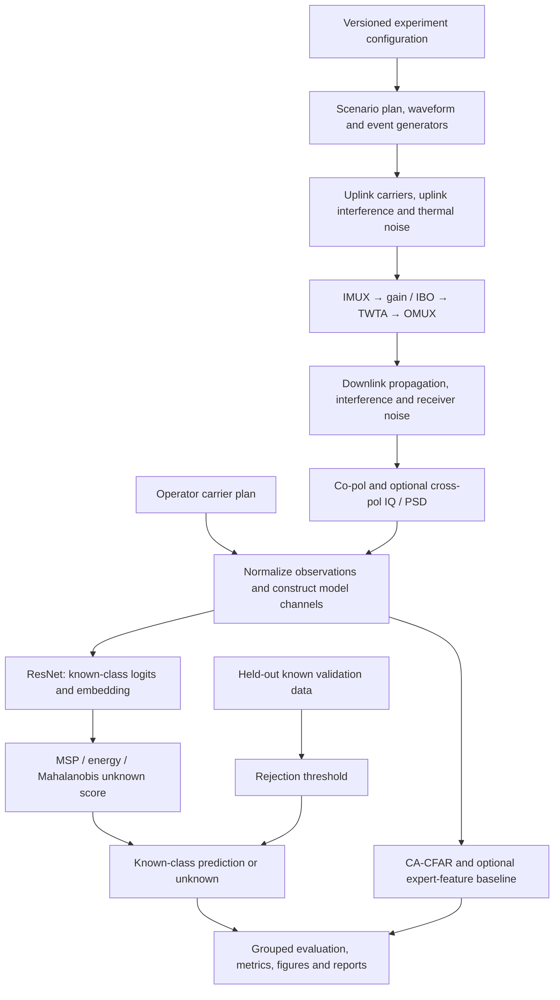

# Implementation structure and build sequence

Date: 2026-10-20. Status: proposed architecture, not an implementation-completion claim.

Implementation update: M0 and the first M1 slice are now implemented; see
[P11](P11_openset_development.md) for scope, commands, validation and limitations.
The M2 development extension is now implemented in [P13](P13_extended_openset.md).
The dual-polarization and instrument-calibration part of M3 is implemented in
[P14](P14_dual_polarization.md); phase noise and the remaining taxonomy are still outstanding.

This plan combines the supplied project proposal with the actual code and the
open-set protocol on GitHub main (`2840063`). The local source baseline is
`3bc090b`; the two newer remote commits add documentation only. The existing
`docs/research/open_set_protocol.md` on remote main remains the research protocol
baseline. The uploaded proposal's novelty claims and physical class labels are
research hypotheses to assess, not established results.

## 1. Existing foundation

Retain the two current packages and extend them incrementally:

| Component | Current implementation | Planned extension |
|---|---|---|
| Carrier plans and waveforms | `geosim/plan.py`, `waveform.py`: multicarrier constellation symbols and SRRC shaping | Versioned loading configuration; optional DVB-S2 PL framing later |
| Payload | `geosim/payload.py`: IMUX, memoryless AM/AM-AM/PM, OMUX | Explicit phase-noise and polarization stages; measured-PA adapter later |
| Scenario execution | `geosim/scenario.py`: one-polarization end-to-end simulation | Injection points, dual-pol composition, stable observation contract |
| Event generators | `geosim/interferers.py`, `classes.py`: five Stage-A classes | Unknown families, overlapping carriers, polarization-related events |
| Data | `geosim/dataset.py`: frozen A1, shards, metadata, ten splits | Separate B1 protocol, validated resume, scenario grouping, provenance |
| Model | `geoml/model.py`: SmallResNet with logits and `embed()` | Configurable observed channels; reusable embedding for rejection |
| Training and reporting | `geoml/train.py`, `pipeline.py` | Artifact compatibility, open-set experiments, scalable data loading |
| Baseline and metrics | `geoml/cfar.py`, `metrics.py` | Open-set metrics, count-aware reports, optional feature baseline |

Current Stage A has five closed-set classes and a pilot result. It does not yet
establish full-scale payload-gap performance or implement open-set recognition.

## 2. Block connections



The diagram summarizes the existing single-pol chain and its planned extensions.
Dual-pol mode adds calibrated antenna/polarization mixing at specified physical
locations and one payload path per modeled polarization. Uplink interference
passes through the payload; downlink adjacent-satellite interference is added at
the monitoring receiver. It must not be passed through the wanted satellite's
TWTA. OMUX filtering and additive receiver/downlink noise remain separate blocks.

Use the bundled DVB-S2 reference curves as the primary payload model. Retain
Saleh as an alternative/held-out model. Current random constellation waveforms
are not a complete framed DVB-S2 transmitter.

## 3. Interfaces between blocks

| Contract | Required content and rule |
|---|---|
| Experiment configuration | Protocol version, seed namespaces, physical parameters with units, sensor settings, observable channels, known labels, holdout labels, model and calibration settings |
| Scenario definition | Stable `scenario_id` grouping the carrier plan, loading and random realization; paired linear/nonlinear variants stay in the same partition |
| Observation | Spectra `[polarization, time, frequency]`, shared frequency/time axes, operator plan mask(s), optional sampled IQ and explicit sampling metadata |
| Ground truth | Physical event family, injection point, generating parameters and unknown membership; stored separately from model inputs |
| Model batch | Current A1 `[N, 2, 64, 512]` remains supported. Dual-pol baseline uses `[N, 3, T, F]` for co-pol, cross-pol and a shared plan mask; use separate masks if the two plans differ |
| Model output | Known-class logits `[N, K]`, embedding `[N, D]`; the simulator's hidden labels and true IBO are not automatic inference inputs |
| Rejection output | Class index or `unknown`, scalar unknown score, threshold and calibrator identity; larger scores consistently mean more unknown-like |
| Artifact manifest | Protocol/configuration fingerprint, source revision, label ordering, feature normalization, model shape, data provenance and calibration provenance |

Operator metadata must be distinguished from simulator ground truth. A model
may consume an IBO estimate or authorization record only in an experiment that
explicitly declares it available at inference. Plan-error experiments corrupt
the supplied plan without changing the underlying simulated scene.

The existing snapshots are separated in time, not a continuous 1.28-second IQ
recording. Pulse/burst occupancy and cyclic features must respect this sampling.

## 4. Proposed additions

Keep current public entry points. Add files when their milestone is implemented;
do not create empty packages or move working modules just to match a diagram.

```text
configs/                         # new: versioned experiment JSON files
  stage_a_pilot.json
  stage_b_openset.json
src/
  geosim/
    schema.py                    # new: validated B1 configurations and observations
    protocol.py                  # new: scenario groups, B1 splits and provenance
    polarization.py              # new: dual-pol mixing and calibration model
    impairments.py               # new: phase noise and event timing helpers
    waveform.py                  # existing: optional framed mode later
    interferers.py               # existing: extend event factories
    scenario.py                  # existing: compose physical blocks
    dataset.py                   # existing: keep A1; add validated B1 storage adapter
    payload.py, plan.py, sensor.py, classes.py
  geoml/
    openset.py                   # new: MSP, energy and regularized Mahalanobis
    calibration.py               # new: fit/save/load rejection calibration
    evaluation.py                # new: open-set evaluation and reports
    experiment.py                # new: configuration-driven orchestration
    data.py, model.py, train.py, cfar.py, metrics.py, pipeline.py
tests/
  test_artifacts.py              # new: manifest and checkpoint compatibility
  test_protocol.py               # new: grouping and known/unknown exclusions
  test_openset.py                # new: score direction, calibration and metrics
  test_polarization.py           # new: limiting cases and mixing behavior
  test_pipeline.py               # new: small functional integration run
data/                            # ignored: raw/derived datasets, separated by protocol
runs/                            # ignored: checkpoints, calibrators and reports
docs/plan/                       # maintained specifications and decisions
```

Optional additions after the core is validated: `geoml/cyclic.py`,
`geoml/transformer.py`, `geoml/feature_baseline.py`, and dataset-specific external
recording adapters. No GUI, network service or database is required for this
research workflow.

## 5. Build sequence and completion criteria

| Milestone | Implementation | Completion evidence |
|---|---|---|
| M0: Protect the working baseline | Add dataset/checkpoint fingerprints and validation, explicit missing-bin metrics, and a small end-to-end regression | Existing 60 tests continue to pass; stale artifacts are rejected; fit/save/load/inference agree; reports record counts and valid JSON |
| M1: First open-set connection | Define B1 contracts and group splits; demonstrate hold-one-class-out with existing observable classes; add MSP, energy and known-only validation calibration | Held-out event never enters training/calibration; score direction tested; checkpoint → score → reject → report runs end to end |
| M2: Unknown families and evaluation | Implement distinct pulsed, wideband-noise and intermittent-burst mechanisms; add regularized Mahalanobis, AUROC/AUPR and OSCR | Training-only feature statistics; final unknown families excluded from tuning; grouped confidence intervals; family-specific and pooled results |
| M3: Dual-pol physics and taxonomy | Add mixing, per-pol chains and phase noise; introduce cross-pol and overlapping/modulated events with documented injection points | Zero-leakage/known-leakage limiting tests, reproducible paired scenes, measured inputs justify each output label |
| M4: Controlled experiments | Run full Stage A and selected B1 experiments with multiple training seeds; hold out IBO, bandwidth, loading, amplifier and plan errors | Reproducible commands, frozen protocol, provenance and uncertainty; one factor changed per ablation |
| M5: Targeted research extensions | Add cyclic features plus needed waveform framing, expert-feature baseline, optional transformer, then measured-PA/recording adapters | Comparable compute and calibration budgets; evidence each extension resolves an observed failure |

M1 holds out a non-clean interference family and retains `clean` as a known
reference. Its report includes known acceptance, accepted-known accuracy and
held-out rejection. This development demonstration is not the final eight-class
claim. Freeze the applicable B1 experiment configuration before
training and create a new protocol version for changes in label/split semantics.
Keep frozen A1 outputs separate. A full Stage-A benchmark can proceed alongside
later development once resources and artifact integrity are established; it is
not necessary to block all coding on that long run.

Before scaling data, validate resumable shard configuration and replace broad
exception-based sample skipping with explicit infeasible-scene handling. Before
scaling dual-pol training, use lazy shard loading rather than loading every
split into memory.

## 6. Scientific constraints

- Target eight known categories only where observations support their
  distinction. Adjacent-satellite origin and unauthorized-carrier status may
  require direction/authorization information. Provide an unresolved modulated
  interference outcome when physical causes remain observationally equivalent.
- Keep unknown rejection separate from uncertainty among ambiguous known
  causes. High softmax uncertainty alone does not establish a new physical type.
- Set rejection thresholds on held-out known validation data for a stated
  known-acceptance target. If surrogate unknowns are used, define them separately
  from the final unknown test families and record that protocol.
- Fit Mahalanobis means/covariance on training embeddings only. Use consistent
  score orientation; do not tune thresholds on test data.
- Distinguish interference false alarms on clean samples from unknown rejection
  of known samples. Report both rates and specify every metric's positive class.
- Empty C/I bins produce a sample count of zero and `null`, not a fabricated
  measurement or nonstandard JSON NaN.
- Retain negative payload-gap findings. Simulation-to-simulation comparisons
  and measured solid-state-PA transfer are distinct evidence; neither alone
  establishes operational GEO performance or TWTA hardware validation.

## 7. First coding deliverable

Implement M0 followed by the M1 vertical slice: a small versioned dataset,
existing ResNet, known-only threshold calibration, MSP/energy scores, a prediction
that can say `unknown`, and a reproducible report. This creates the first missing
end-to-end capability while retaining the tested simulator and classifier.

This proposal adds no application logic. Full dataset generation, scientific
benchmark runs and Stage-B implementation are separate deliverables, not implied
by creating this architecture document.
