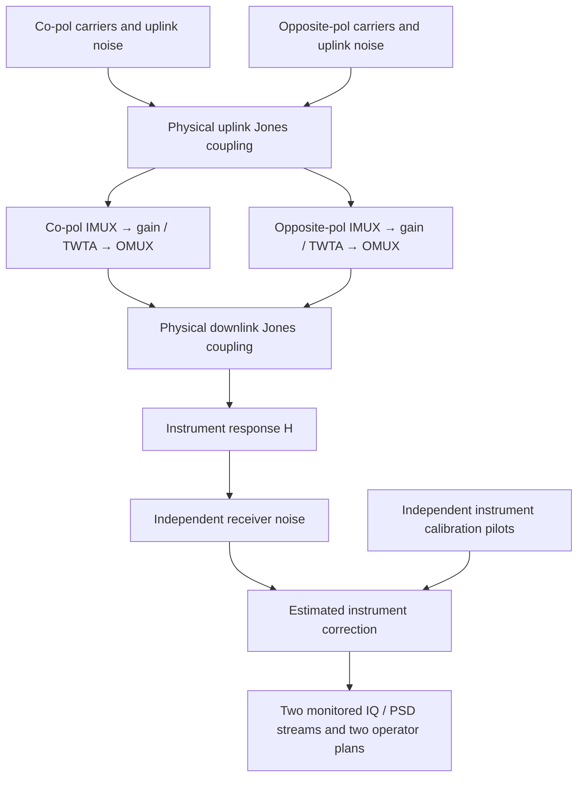

# D1-dev/1: dual-polarization physics and calibrated observations

Date: 2026-10-20. This milestone adds dual-polarization observations and a
controlled leakage-recognition experiment. Frozen A1 and B1-dev/1–2 remain
supported. This is not the final eight-known-class open-set benchmark.

Subsequent engine additions are documented in [P15](P15_phase_noise_and_events.md).
The D1 protocol below retains zero phase noise and no downlink event by default.

## Physical chain



`geosim/polarization.py` defines a power-conserving symmetric Jones model:

`J = [[c, exp(j phi) s], [-exp(-j phi) s, c]]`, with
`c²/s² = 10^(XPD/10)` and `c²+s²=1`.

Positive-infinite XPD is identity. XPD is a component's isolated-source
co/cross power ratio. When both feeds carry traffic, their aggregate received
power ratio is **not XPD**. The unitary approximation describes ideal basis
coupling, not arbitrary lossy antennas or a complete satellite XPD model.

`geosim/dual.py` generates separate carrier plans and streams, applies uplink
coupling before each payload's IMUX/TWTA/OMUX, then downlink coupling and the
instrument response. Interferer callables can inject into either uplink feed.
No downlink interferer or phase-noise model is added in this milestone.

Receiver noise uses each feed's pre-downlink-mixing OMUX output power as its
C/N reference, matching A1's output-C/N convention. It is not renormalized
after physical downlink or instrument mixing. Inverting the instrument also
transforms receiver noise; it does not remove it. This normalization is a
simulation assumption, not a measured receiver noise specification.

With identity coupling and instrument response, each output reduces to the
corresponding independent A1 run, including its RNG streams. With nonlinearity,
uplink and downlink mixing generally do not commute. Exact coherent
cancellation is allowed: zero-drive back-off statistics are `null`, with finite
spectra rather than invalid divisions.

## Independent calibration

For known complex reference pilots `X` and measured pilots `Y`, calibration
fits `Y = H X` by complex least squares. Pilot rank and response conditioning
are validated. Only the fitted **instrument** response is inverted; the two
physical propagation coupling matrices remain in the scene.

The dataset generator draws full-rank independent pilots using a separate RNG
namespace. The instrument has synthetic gain/phase imbalance and coupling;
small circular complex pilot noise prevents assuming a perfect estimate.
Its truth response is used to simulate pilot measurements, not supplied to
the correction routine. Calibration parameters, residual, condition numbers,
provenance and array/metadata checksums are persisted without pickle.

These are simulated calibration measurements. No real receiver or antenna was
calibrated in this work.

## Dataset and observable inputs

`geosim/dual_dataset.py` stores checksum-backed paired `clean` and `cross_pol`
scenes. The only class-conditioned change is uplink XPD: nominal 30 dB versus
10 dB. Downlink XPD is held at 35 dB. These are explicit development choices,
not source-backed operational distributions or established class boundaries.

Default instrument gains are +1.5/−1 dB, phases +0.2/−0.4 rad, and instrument
XPD 25 dB. Calibration uses 64 separate pilots with complex-noise standard
deviation 0.001. Each feed draws nominal IBO 9–13 dB and uplink/downlink C/N
15–30 dB. Operator plans differ between feeds, while all variants of a group
share their plans, thermal-noise RNG streams and link settings.

Train/validation/test group IDs start at 1000000/1100000/1200000. Path seeds are
`2*group` and `2*group+1`. Group variants never cross roles. Completed verified
resume preserves the original calibration and generation provenance. Changed
generation requests require a fresh directory; corrupt artifacts are rejected.

Raw stored shapes are `spec[N,2,128,512]` and `mask[N,2,512]`.
`geoml.data.preprocess_dual` creates four channels in this order:

1. Calibrated co-pol spectrum.
2. Calibrated opposite-pol spectrum.
3. Co-pol operator plan mask.
4. Opposite-pol operator plan mask.

Both spectra use the same co-pol planned-carrier power reference. Independent
normalization would erase relative polarization levels. Time pooling averages
linear power before taking dB. The matched `co` view uses only the co-pol
spectrum and its plan. Hidden XPD values and event labels never become model
inputs. `TrainConfig.input_mode` records `single`, `co`, or `dual`; checkpoint
loading respects input mode and remains compatible with legacy single-pol
metadata.

## Matched development experiment

`geoml.dual_experiment` fits the same small ResNet family with `co` and `dual`
views on identical scenario partitions and training budgets. It is a controlled
two-class test, not an open-set test. It does not establish that physical causes
are uniquely identifiable from spectra. Multi-seed experiments and additional
failure modes are needed before comparing recognition quality.

Weight selection and alarm calibration use distinct validation groups. Clean
calibration samples alone set a softmax-cross-pol alarm threshold at the
requested clean false-alarm rate. Classification accuracy uses argmax; alarm
rates use that separate frozen threshold. A tiny calibration sample does not
guarantee the requested false-alarm rate on new samples. Reported intervals
bootstrap scenario groups at fixed trained weights and thresholds.

```bash
source /workspace/.venvs/geosim/bin/activate
export OMP_NUM_THREADS=2 OPENBLAS_NUM_THREADS=2
python -m geosim.dual_dataset --out data/dual-pilot --n-seeds 6
python -m geoml.dual_experiment --config configs/dual_polarization.json --data data/dual-pilot --out runs/dual-pilot
python -m geoml.dual_experiment --config runs/dual-pilot/config.json --data data/dual-pilot --out runs/dual-pilot --reuse
python -m pytest -q
```

Outside the prepared cloud environment, first install `pip install -e '.[dev,ml]'`.
Generated data and model files remain ignored. Small metric/prediction summaries,
configuration and reproduction commands are committed. `results.json` records
the instrument calibration, generation assumptions, group counts, source/data
identities and per-view metrics.

Phase noise, the remaining known interference classes, dual-pol unknown-event
protocols and full-data/multi-seed evaluation remain future work.

## Validation evidence

The complete suite passed **355 tests**, including isolated-source XPD, power
conservation, coherent cancellation, 36/72 MHz A1 identity reduction,
nonlinear mixing order, calibration preservation of physical leakage,
shared-reference preprocessing, legacy checkpoint compatibility and artifact
corruption/reuse checks.

The physical run generated 36 paired observations (six scenario groups per
source role), trained each view for three epochs, and reloaded both models and
alarm calibrators. Verified dataset resume also completed. Model selection and
alarm calibration each used three separate validation groups; only three clean
examples set each alarm threshold. [Recorded results](../results/dual_development.md)
show 50% classification accuracy for both views. The data are too small to
support a recognition-quality comparison.

The independent 64-pilot synthetic calibration had relative matrix error
`||H_est-H_true||_F / ||H_true||_F = 0.00011955` and pilot residual RMS
`0.0010122`. This checks the simulated instrument estimator against its known
generating response; it is not a measurement of physical propagation XPD or
validation with real hardware.
