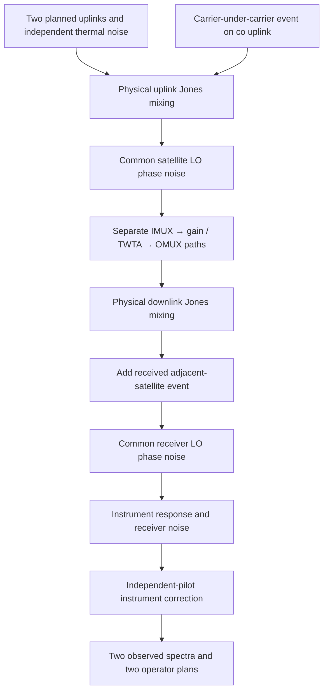

# E1-dev/1: phase noise and two interference mechanisms

Date: 2026-10-20. This extends the dual-polarization engine without changing
frozen A1. D1-dev/1 retains zero linewidth and no downlink event by default.
E1-dev/1 is a controlled three-class development task: `clean`,
`carrier_under_carrier`, `adjacent_satellite`. It does not merge the eight
proposed known classes or add dual-polarization open-set evaluation.

## Physical connections



`geosim.phase_noise.wiener_phase` uses an effective Lorentzian linewidth in Hz:
`Var(phi(t+dt)-phi(t)) = 2*pi*linewidth_hz*dt`. Each oscillator is common to both
polarizations. Satellite and receiver processes have distinct RNG namespaces,
independent of event labels and the existing carrier/noise streams. The first
simulated phase is zero; this fixes an arbitrary phase reference. A Gaussian
jump spans each unobserved snapshot gap, preserving the Wiener increment law
without generating the skipped 288 MHz samples. The walk includes filter warmup.
Phase rotation preserves instantaneous power; filters may subsequently change
spectral and output power. A static instrument calibration does not correct LO
phase noise. This model is not a measured single-sideband phase-noise mask.

The under-carrier factory places an independent modulated carrier wholly inside
one planned victim's ideal occupied band. Equal occupied width is allowed when
the narrowest supported victim cannot hold a narrower supported waveform.
C/I refers to total planned uplink power, which is one. Metadata also records
victim-relative C/I. Finite windows still have spectral leakage.

The adjacent-satellite factory draws an independent received in-band modulated
carrier. Its nominal interference power ratio is scaled by the wanted feed's
power after physical downlink mixing and before any downlink event, measured on
retained simulation samples. It bypasses the wanted satellite's TWTA/OMUX.
The receiver thermal-noise reference remains the pre-downlink-mixing OMUX
power. No event-dependent renormalization is applied. This is a scalar received
power hypothesis, not an orbital, interfering-satellite payload or antenna model.
Physical source and authorization cannot generally be uniquely inferred from
these aggregate PSD observations; the labels identify simulator causes.

## Paired data and matched experiment

`geosim.event_dataset` stores `spec[N,2,128,512]`, `mask[N,2,512]`, labels,
scenario IDs and separate simulator metadata. Each scenario's three labels share
carrier plans, link settings, physical coupling, receiver response, random
thermal-noise streams and oscillator realizations. All variants stay in one
role. Roles start at 2,000,000 / 2,100,000 / 2,200,000; validation is further
split by scenario into weight selection and alarm calibration. Independent
instrument pilots are fitted once and bound to the generation request.

Default generation assumptions are explicitly exploratory: satellite linewidth
100 Hz, receiver linewidth 50 Hz, C/I uniform 5–15 dB, IBO uniform 9–13 dB and
C/N uniform 15–30 dB per path. They are not measured GEO operating statistics.
The versioned JSON config exposes them for future sensitivity experiments.

`geoml.dual_experiment` supports both D1 and E1. Co-only and dual views use the
same partitions and training budget. The classifier sees spectra and operator
plans, never event parameters, true linewidths or hidden payload settings.
Classification uses argmax over three logits. Event alarm score is the sum of
non-clean softmax probabilities (`1-p(clean)`); only separate clean calibration
samples set its threshold. This is an event alarm in a closed-set task, not an
unknown rejection score. Family-specific and pooled event detection have
explicit counts. Confidence intervals resample whole scenario groups with
trained weights and thresholds held fixed.

## Reproduction

```bash
source /workspace/.venvs/geosim/bin/activate
export OMP_NUM_THREADS=2 OPENBLAS_NUM_THREADS=2
python -m geosim.event_dataset --config configs/interference_events_data.json --out data/events-pilot
python -m geoml.dual_experiment --config configs/interference_events.json --data data/events-pilot --out runs/events-pilot
python -m geoml.dual_experiment --config runs/events-pilot/config.json --data data/events-pilot --out runs/events-pilot --reuse
python -m geosim.event_dataset --config configs/interference_events_data.json --out data/events-pilot
python -m pytest -q
```

Outside the prepared environment install `pip install -e '.[dev,ml]'` first.
Use a fresh output directory after generator/config changes. Completed data,
shards, receiver calibration, model checkpoints and detectors are validated
before reuse. Raw data and model weights remain ignored; small results and
reproduction configs are versioned. Full-data/multi-seed evaluation, sensitivity
ablations, unified taxonomy and dual-pol unknown rejection remain outstanding.

## Validation evidence

The complete suite passed **542 tests**. New coverage includes sparse-window
phase variance, gap continuity, zero-linewidth RNG/numerical preservation,
power-preserving common-LO rotation, injection order, payload bypass, event
power references, instrument-calibration boundaries, paired data integrity,
historical reads, strict JSON and real three-class optimizer/checkpoint reuse.

The physical pilot produced **54 observations**: 18 each in train, validation
and test. The six validation scenarios were split into three weight-selection
and three calibration scenarios. Each model was trained for three epochs; only
three clean examples calibrated its event threshold. Verified generation
resume and both checkpoint/detector reloads succeeded.

[Recorded results](../results/events_development.md) show **33.3% classification
accuracy and 0.167 macro-F1 for both views**. Clean false alarms were 16.7% for
co-only and 66.7% for dual, while pooled event detection was respectively 16.7%
and 66.7%. The higher alarm rate also affects clean samples; these numbers do
not demonstrate a dual-polarization recognition advantage. This is a small
execution check with weak models, not a scientific recognition result.

[Physical metadata checks](../results/events_physics_check.json) cover all 18
paired scenarios. The adjacent event leaves payload/noise and pre-event wanted
reference powers exactly equal to clean. The under-carrier event changes
payload output power. Plans, phase settings, other link settings and paired
event C/I match. These checks supplement direct waveform-stage unit tests;
they do not validate the model against measured RF hardware.
