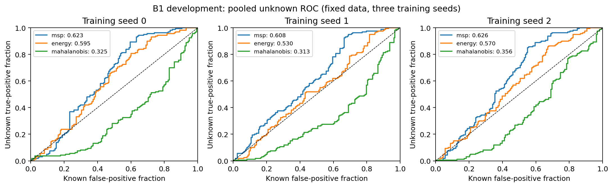
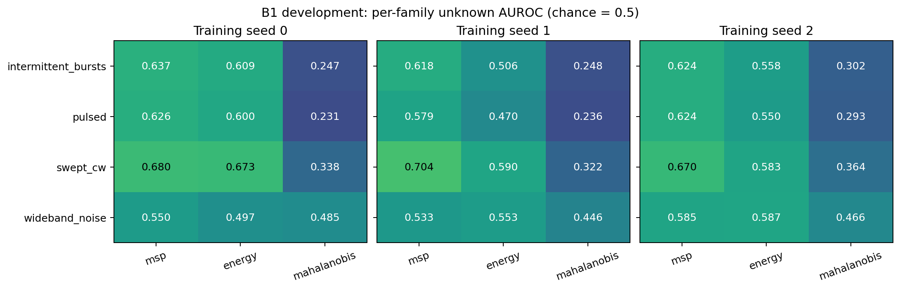

# CPU deney sonuçları — 4 Kasım 2026

**Gerçek çalıştırma tamamlandı.** İki CPU ve 8 GiB RAM ortamında veri üretimi ve üç
model eğitiminin toplam alt-süreç duvar süresi **355,07 saniye (5 dakika 55 saniye)**.
Grafik çizimi ve ana Python sürecinin açılışı bu toplamın dışındadır. Çıktı klasörü
model ve verilerle yaklaşık **96 MiB**. GPU kullanılmadı.

Bu deney projenin **tek-pol A1/B1-dev/2 geliştirme hattıdır**; sekiz sınıflı,
çift-pol B2 benchmark değildir. Ayarlar sonuçlardan önce `4f4b74a` commit'inde
kaydedildi: [ön kayıt](../../research/cpu_delivery/PREREGISTRATION.md),
[kod/kullanım](../../research/cpu_delivery/README.md),
[makinece okunabilir özet](cpu_delivery_2026-11-04.json).

## Ana bulgu

Bilinen dört sınıf için doğruluk üç tohumda **%69,62–%70,89**, ortalama **%70,25**.
Aynı modellerin bilinmeyen ayrımı güçlü değil:

| Skor | Ortalama AUROC | Tohum aralığı | Sabit eşikte ortalama bilinmeyen reddi |
| --- | ---: | ---: | ---: |
| MSP | 0,6191 | 0,6083–0,6259 | %2,29 |
| Energy | 0,5647 | 0,5297–0,5947 | %1,25 |
| Mahalanobis | 0,3314 | 0,3128–0,3564 | %1,67 |

Bilinmeyen pozitiftir; yüksek skor daha bilinmeyen demektir. Mahalanobis'in
olumsuz sonucu saklandı, skor yönü testten sonra çevrilmedi. Bilinen-sınıf
sınıflandırması ile açık-küme reddi ayrı başarı ölçüleridir: %70 doğruluk güçlü
bilinmeyen reddi anlamına gelmez. Ortalama/aralıklar aynı veride üç eğitim
başlangıcını özetler; güven aralığı veya anlamlılık testi değildir.

## Veri ve süreler

600 aday A1 gözleminden 596'sı üretildi; 4 unauthorized-carrier yerleşimi mevcut
fiziksel uygulanabilirlik kuralı nedeniyle kaydedilerek dışarıda kaldı (train 1,
validation 1, test 2). U1 tarafında 120 gözlem üretildi: **toplam 716 fiziksel
gözlem**. Tutulan swept-CW ailesi eğitim/validation kaynaklarında bulunsa da
optimizasyon, model seçimi ve kalibrasyondan çıkarıldı. Asıl kullanılan rol
sayıları aşağıdaki tabloda verilmiştir.

Bilinen veri: 269,89 s; ek bilinmeyenler: 57,59 s; tohum 0/1/2 eğitim,
kalibrasyon ve değerlendirme adımları yaklaşık 9,35/9,25/9,00 s. Tam hassasiyetli
ölçümler özet JSON içindedir. Tek çalıştırma zamanlaması donanımdan bağımsız süre
garantisi değildir. Kalibrasyon 79 bilinen örnekte, seçimden ayrı 20 gruptadır.
Testte 158 bilinen ve 160 bilinmeyen örnek vardır; her bilinmeyen aile 40 örnek.
AP'nin rastgele sıralama referansı bu karışımda 160/318 ≈ 0,503'tür.

## Grafikler





[ROC vektör PDF](../figures/cpu_delivery/cpu_unknown_roc.pdf) ·
[Aile grafiği vektör PDF](../figures/cpu_delivery/cpu_family_auroc.pdf).

## Tekrarlama ve kanıt denetimi

```sh
python research/cpu_delivery/run.py --out /workspace/geo-cpu-campaign-new
python research/cpu_delivery/audit.py
```

Üç eğitim çıktısının küçük sayısal sonuçları ve kaynak hash'leri
`docs/results/cpu_delivery_2026-11-04/` altında; ham gözlemler, tahmin listeleri
ve checkpoint'ler Git dışında tutulur. Denetim sonuç/şekil hash'lerini ve ROC/AP/OSCR
aritmetiğini kontrol eder; yeni RF verisi veya eğitim üretmez.

Çalıştırmada kullanılan `run.py` ayrıca `runner-used.py` olarak arşivlendi.
Sonraki kod sürümü Ctrl-C sırasında çocuk süreçleri de durdurur; geçmiş
çalıştırmanın kaynak kimliği değiştirilmedi. Yeni kodla eski çıktı kökünü
sürdürmek yerine yeni bir çıktı dizini kullanılır. Bu düzeltme model, veri
ve eşik semantiğini değiştirmez.

## Yorum sınırı ve sonraki iş

Bu çalışma CPU üzerinde yeniden üretilebilir bir deney ve olumsuz açık-küme
bulgusu sağladı. Daha fazla eğitim, farklı özellik veya eşik denenerek aynı testte
sonuç iyileştirilmeyecek. Sonraki geliştirme yalnız train/val-select verisiyle
planlanmalı; yeni doğrulama sorusu ve gerekirse yeni test protokolü sonuçlardan
önce yazılmalıdır. Önceki pilotların test grupları bu geliştirme prefix'inde
bulunabilir; burası hiç görülmemiş nihai B2 testi değildir. Geniş bant gürültüsünün
artan gürültü tabanıyla eşdeğerliği ve simülasyon varsayımları korunur. Ölçülmüş
GEO başarısı veya B2 H1/H2/H3 üstünlüğü gösterilmedi.

## Tüm tohumların ayrıntılı sonuçları

Tablolarda **Mahal.**, Mahalanobis skorunun kısaltmasıdır.

Single-polarization B1-dev/2. Not the full eight-class B2 benchmark.
Unknown is positive; larger scores mean more unknown-like. All three seeds and scorers retained.

| Seed | Scorer | Known accuracy | Unknown AUROC | AP | OSCR | Known acceptance | Unknown rejection |
|---|---|---|---|---|---|---|---|
| 0 | msp | 0.7025 | 0.6231 | 0.5529 | 0.5076 | 0.9873 | 0.0125 |
| 0 | energy | 0.7025 | 0.5947 | 0.5432 | 0.4625 | 0.9873 | 0.0000 |
| 0 | Mahal. | 0.7025 | 0.3252 | 0.4080 | 0.1809 | 0.9557 | 0.0375 |
| 1 | msp | 0.7089 | 0.6083 | 0.5689 | 0.4862 | 0.9747 | 0.0500 |
| 1 | energy | 0.7089 | 0.5297 | 0.5049 | 0.4003 | 0.9494 | 0.0187 |
| 1 | Mahal. | 0.7089 | 0.3128 | 0.3924 | 0.2007 | 0.9430 | 0.0063 |
| 2 | msp | 0.6962 | 0.6259 | 0.5549 | 0.4908 | 0.9747 | 0.0063 |
| 2 | energy | 0.6962 | 0.5699 | 0.5358 | 0.4345 | 0.9747 | 0.0187 |
| 2 | Mahal. | 0.6962 | 0.3564 | 0.4048 | 0.2195 | 0.9937 | 0.0063 |

## Actual populations

| Role | Samples | Scenario groups |
|---|---|---|
| train | 159 | 40 |
| validation | 80 | 20 |
| calibration | 79 | 20 |
| known_test | 158 | 40 |
| unknown_test | 160 | 80 |

## Unknown families

| Seed | Scorer | Family | n unknown | AUROC | Rejection |
|---|---|---|---|---|---|
| 0 | msp | intermittent_bursts | 40 | 0.6367 | 0.0000 |
| 0 | msp | pulsed | 40 | 0.6259 | 0.0000 |
| 0 | msp | swept_cw | 40 | 0.6797 | 0.0250 |
| 0 | msp | wideband_noise | 40 | 0.5502 | 0.0250 |
| 0 | energy | intermittent_bursts | 40 | 0.6095 | 0.0000 |
| 0 | energy | pulsed | 40 | 0.5995 | 0.0000 |
| 0 | energy | swept_cw | 40 | 0.6728 | 0.0000 |
| 0 | energy | wideband_noise | 40 | 0.4968 | 0.0000 |
| 0 | Mahal. | intermittent_bursts | 40 | 0.2465 | 0.0000 |
| 0 | Mahal. | pulsed | 40 | 0.2312 | 0.0000 |
| 0 | Mahal. | swept_cw | 40 | 0.3383 | 0.0000 |
| 0 | Mahal. | wideband_noise | 40 | 0.4847 | 0.1500 |
| 1 | msp | intermittent_bursts | 40 | 0.6176 | 0.0250 |
| 1 | msp | pulsed | 40 | 0.5790 | 0.0500 |
| 1 | msp | swept_cw | 40 | 0.7040 | 0.0750 |
| 1 | msp | wideband_noise | 40 | 0.5326 | 0.0500 |
| 1 | energy | intermittent_bursts | 40 | 0.5055 | 0.0000 |
| 1 | energy | pulsed | 40 | 0.4703 | 0.0000 |
| 1 | energy | swept_cw | 40 | 0.5897 | 0.0250 |
| 1 | energy | wideband_noise | 40 | 0.5532 | 0.0500 |
| 1 | Mahal. | intermittent_bursts | 40 | 0.2476 | 0.0000 |
| 1 | Mahal. | pulsed | 40 | 0.2358 | 0.0000 |
| 1 | Mahal. | swept_cw | 40 | 0.3218 | 0.0000 |
| 1 | Mahal. | wideband_noise | 40 | 0.4460 | 0.0250 |
| 2 | msp | intermittent_bursts | 40 | 0.6244 | 0.0000 |
| 2 | msp | pulsed | 40 | 0.6237 | 0.0000 |
| 2 | msp | swept_cw | 40 | 0.6703 | 0.0250 |
| 2 | msp | wideband_noise | 40 | 0.5854 | 0.0000 |
| 2 | energy | intermittent_bursts | 40 | 0.5584 | 0.0250 |
| 2 | energy | pulsed | 40 | 0.5505 | 0.0250 |
| 2 | energy | swept_cw | 40 | 0.5834 | 0.0000 |
| 2 | energy | wideband_noise | 40 | 0.5872 | 0.0250 |
| 2 | Mahal. | intermittent_bursts | 40 | 0.3021 | 0.0000 |
| 2 | Mahal. | pulsed | 40 | 0.2932 | 0.0000 |
| 2 | Mahal. | swept_cw | 40 | 0.3639 | 0.0000 |
| 2 | Mahal. | wideband_noise | 40 | 0.4663 | 0.0250 |

## Limits

Three seeds share data. Means/ranges are descriptive; no seed CI or AUROC CI.
Known acceptance and accuracy use all known test samples; rejection uses all unknown samples.
Wideband noise can be equivalent to a higher noise floor; pooled and per-family results differ.
No H1/H2/H3 B2 advantage, measured GEO transfer or production performance is established.
Negative results are preserved; no test-driven threshold, score-direction or model change was made.
