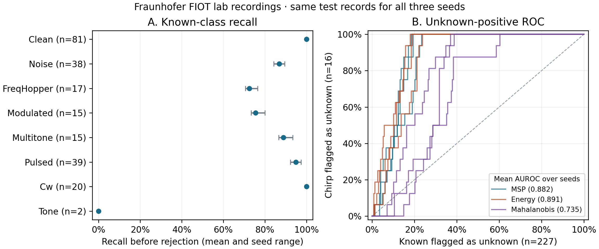

# Fraunhofer FIOT spektrogramlarında CNN sonuçları

24 Kasım 2026. Fraunhofer'ın ölçülmüş GNSS laboratuvar kayıtlarıyla PyTorch
SmallResNet üç kez baştan eğitildi. Her eğitim 227 bilinen test kaydından
**208'ini doğru sınıflandırdı (%91,63)**. Makro F1 ortalaması **0,784**.
[Deney kodu](../../research/public_data/fiot_cnn.py) ·
[Önceden sabitlenen reçete](../../research/public_data/FIOT_CNN_PROTOCOL.md)

Kaynakta görüntüler `512 × 243 × 3` RGB spektrogram olarak sunuluyor. Her ana
kayıttan bir görüntü alındı. RGB değerleri 255'e bölündü ve alan ortalamasıyla
`3 × 128 × 64` girdi tensörleri oluşturuldu. CNN girişinde sınıf, kayıt kimliği,
güç veya taşıyıcı maskesi yok. CNN'in sekiz çıkışı Clean (`None`), Noise,
FreqHopper, Modulated, Multitone, Pulsed, CW ve Tone.

| Rol | Kayıt |
| --- | ---: |
| Eğitim | 504 |
| Ağırlık seçimi | 163 |
| Ret eşiği kalibrasyonu | 163 |
| Bilinen test | 227 |
| Bilinmeyen test (Chirp) | 16 |

Yayımlanan eğitim listesindeki 48 Chirp kaydı geliştirmeye alınmadı.
Yayımlanan eğitim ve test ayrımı ana kayıt kimliğine göre korundu. Üç ağ ve
eşikler sabitlendikten sonra test görüntüleri yüklendi. Kullanılan roller
arasında aynı kayıt ya da eş dosya içeriği bulunmadı. Edinim oturumlarının
bağımsızlığı hakkında kaynak bilgi sağlamıyor.

| Skor | Bilinmeyen AUROC (ortalama) | Bilinen kabulü (ortalama) | Chirp reddi (ortalama) | Tohumlara göre reddedilen Chirp / 16 |
| --- | ---: | ---: | ---: | --- |
| MSP | 0,8820 | %90,75 | %35,42 | 6 / 16, 4 / 16, 7 / 16 |
| Energy | 0,8911 | %92,36 | %39,58 | 6 / 16, 5 / 16, 8 / 16 |
| Mahalanobis | 0,7355 | %92,95 | %0,00 | 0 / 16, 0 / 16, 0 / 16 |

AUROC'da Chirp pozitiftir. Yüksek skor daha bilinmeyen anlamına gelir.
Kalibrasyon hedefi bilinenleri %95 kabul etmektir. Test kabulü tabloda ayrı
gösterilir. Tohumlar aynı kayıtları paylaşır. Her modelde tek bir Chirp
örneği ret oranını 6,25 puan değiştirir. Her üç modelde iki Tone kaydının
ikisi de yanlış sınıflandırıldı. Bu ölçüm GNSS laboratuvar verisine aittir.
GEO simülasyonu ile verinin kaynağı, etiketleri ve model girdisi farklıdır.

Arşiv boyutu ve SHA-256 değeri kaynakla eşleşti. Seçilen 1.121 spektrogramın
toplam açılmış boyutu 1.673.787.520 bayt, seçili çıkarma süresi 17,5 saniyeydi.
Üç CNN'in veri yükleme, eğitim, kalibrasyon ve değerlendirmesi 59,4 saniye
sürdü (2 CPU iş parçacığı). Ölçülen süre indirmeyi ve grafik çizimini kapsamaz.
Yürütülen kod revizyonu `161835cb418edd9fdb3cb2efd470700ee6293d2f`.
[Sayısal sonuçlar](fiot_cnn_2026-11-24.json) ·
[Grafik PDF](../figures/fiot_cnn/fiot_cnn_results.pdf)
