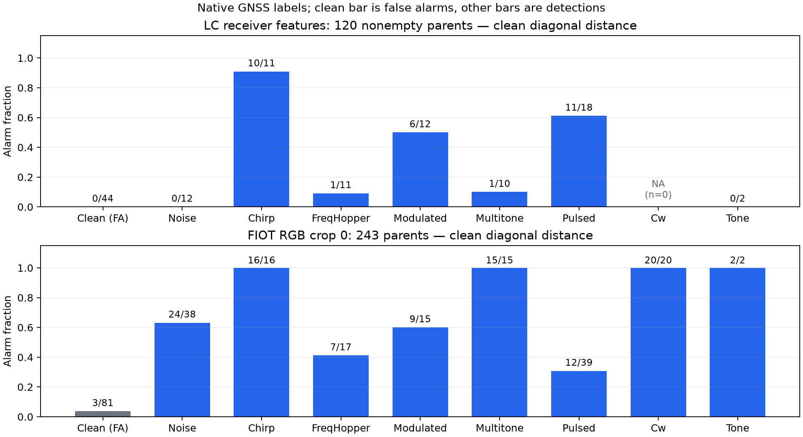

# Public research data: actual access and bounded detection results

2026-10-25. This work restores the data strategy in the
[original proposal](../../sources/original_proposal.md): public satellite tasks
for comparison, measured GNSS data for limited external evidence, and existing
measured-PA work for amplifier realism. **Existing data comes before full B2
generation.** No new numbered engineering milestone is introduced.

Base: `5efa287d0fcfd00438497931cce5cdc54f3c3e8d` (PR #42 already merged).
Before publication, remote main advanced to
`4ea511bb2664c840498fe8ce4bb5cb89583727cc` (PR #43, separate E18 fixes).
Its changes do not overlap this research code or the reused numerical metrics;
they are preserved when reconciling the delivery branch. No E18 experiment is
repeated as part of this data study.
Detector/protocol commit, recorded **before any detection metrics**:
`13f79f9ffc824029d91c74299cbfe83131ea4cc6`.
Protocol SHA-256: `01a31bdac05438c0e2a81819275030f4d51e6f56f7b58870b3fdb96a30b2ac22`.
No scoring, feature, direction or calibration rule changed after results.
Raw files remain outside Git; [aggregate JSON](public_data_baselines.json)
contains source hashes, fitting state, exact numerators/denominators and curves.

## What was actually obtained

Current official links, labels and licenses are in [P8](../plan/P8_dis_veri.md).

| Source/file | Actual bytes / SHA-256 | Outcome |
|---|---|---|
| SmartSpace on-board / NGSO | **0 raw files**, raw hashes null | Description/terms HTTP200; official SharePoint links returned Microsoft login HTML, anonymous shares API401 and direct403. No actual dataset experiment. A login page is not data |
| Fraunhofer LC `data.7z` | 2,216,728 / `466a4788ce9780d9374451eb548694869656b043f760ffaa2218254dd2bada54` | 744 receiver-feature NPY files; 736 publisher labels, eight unlabelled excluded |
| Fraunhofer FIOT `data.7z` | 364,187,305 / `f1a062ccfffdd4e0da31ed92af2f8c1c4386090170c3fa6644fee5caa3ffa2d8` | RGB spectrogram crops; only all1121 parent crop-0 files extracted; no IQ or calibrated PSD |
| Zenodo LC repository ZIP | 221,844 / `6eea6135438fdb9fa686e00be0e9e15e38cfe3074024b5529fa898f27051eec5` | MD5 also verified; metadata and LFS pointers, not raw examples |
| OpenDPD APA200 train input CSV | 2,209,901 / `2ca703c9e7eb39839db1fb01f91081a86e18535e53751c587cc71d2d71e9c625` | Actual I,Q file; matches the existing fitted artifact |
| OpenDPD DPA200 train input CSV | 570,842 / `05da7e48c14d1eadb003a43363d6b9f658a164b564b660f5edee21b9e9d4d0f3` | Actual I,Q file; matches the existing fitted artifact |
| Highway2 | 15.35-GB archive **not downloaded** | Metadata only; manageable laboratory release chosen |
| Chalmers WebLab | Official access/about pages HTTP200 | Live hardware service, not a downloaded dataset; no waveform upload/measurement |

The Fraunhofer source is pinned to author repository commit
`2ae2c4d092db5a86de3ecdc058d8c3f2cbf97c26`; media URLs and reproduction commands
are in the [README](../../research/public_data/README.md). Its Zenodo API says
CC BY-SA4, while README says CC BY-NC-SA4. This conflict remains unresolved;
local research follows the stricter noncommercial statement, with no raw-file
redistribution. OpenDPD code Apache-2.0 does not independently establish an
additional measurement-data license. SmartSpace permits research only.

## Labels, representations and leakage controls

SmartSpace on-board has **six location labels**: five zeros mean clean, five
one-hot vectors locate the interfered subband. It is not an eight-type classifier.
The public page supplies12000 train/3000 validation, no separate test. NGSO has
11500 clean train/1302 clean validation/4470 mixed test, each800 magnitudes;
its binary test-positive value is not documented. Import keys/axes and positive
value are explicit, never guessed. Appended label/INR/off-axis columns are refused.
These two satellite datasets are simulation-based according to the existing P1
primary-paper audit; public does not mean measured GEO RF. The loaders are
fixture-tested MAT import contracts, not raw-container validation while access
is blocked. Actual SmartSpace metrics are null with explicit reasons.

Fraunhofer native labels are0 clean,1 Noise,2 Chirp,3 FreqHopper,4 Modulated,
5 Multitone,6 Pulsed,7 CW,8 Tone. They are never relabelled as B2 classes.
LC is9/10×308 receiver telemetry; six summaries use only ss/SDR/kurtosis,
excluding position, PRN, azimuth/elevation, file ID, jammer metadata and power.
FIOT is512×243×3 int32 rendered RGB. Color level/gradient statistics are image
features, not energy in watts; no operator plan or dual polarization is supplied.

The publisher FIOT split is5268/1458 crops from878/243 parent IDs. All six crops
share one parent, and only crop0 is retained. No parent ID or nonempty byte hash
crosses train/test. LC similarly has zero parent/nonempty-hash overlap. IDs do
not establish independent acquisition days/sessions or jammer setups; those
generalization axes are unknown. Models are fitted **separately** per source;
this is not SmartSpace→Fraunhofer zero-shot transfer.

An initial256-parent access probe had just7 clean calibration and16 clean test
records. Before computing any detector scores, it was replaced with all1121
publisher parent crop-0 files to remove arbitrary subsampling and improve support.
The frozen final scope expanded1,673,787,520 B, below2GiB, in33.56 s wall/59.30 s
CPU on two cores, peak428028 KiB. Full10.04-GB archive expansion was not performed.
The original256 probe/audits were preserved separately; its sample counts are
not substituted for the final experiment.

## Fixed experiments and actual results

Training parent IDs are assigned to calibration by the frozen SHA-256 rule;
only clean calibration rows set the95% higher quantile, with strict `score >
threshold`. The remaining training rows fit statistics; there is no parameter
search. Clean center/scale/constant-column mask use fitting-clean only; the
supervised positive centroid uses fitting-training native positive labels only.
The test partition supplies no fitting, threshold or score-direction choice.

| Data | Available fitting/calibration/test groups | Clean fitting/calibration/test | Interference test |
|---|---:|---:|---:|
| LC nonempty | 339 /93 /120 | 151 /38 /44 | 76 |
| FIOT crop0 | 676 /202 /243 | 254 /69 /81 | 162 |

Calibration groups include positive records that are **not used** for thresholds.
All three LC scores yielded1/38 calibration false alarms (2.63%); FIOT scores
yielded3/69 (4.35%). **5% is the nominal target, not achieved statistical precision.**

| Data / fixed score | AUROC | AP | Detected / positive | False alarms / clean |
|---|---:|---:|---:|---:|
| LC: negative receiver-strength level | 0.9842 | 0.9903 | 55/76 (72.4%) | 0/44 |
| LC: clean diagonal distance | 0.9677 | 0.9812 | 29/76 (38.2%) | 0/44 |
| LC: binary centroid margin | 0.9142 | 0.9610 | 26/76 (34.2%) | 0/44 |
| FIOT: mean RGB level | **0.2590** | 0.5425 | 1/162 (0.6%) | 6/81 (7.4%) |
| FIOT: clean diagonal distance | 0.8578 | 0.9367 | 105/162 (64.8%) | 3/81 (3.7%) |
| FIOT: binary centroid margin | 0.5946 | 0.8156 | 65/162 (40.1%) | 7/81 (8.6%) |

Interference-positive AP prevalence is76/120 for LC and162/243 for FIOT.
AUROC scans grouped score ties; AP is the recall-weighted step integral.
Ranking FPR@95TPR is separate from the calibrated operating point: LC strength
0.0909; FIOT distance0.6667. The latter does **not** support95% detection at5% FAR.
No eight-class accuracy, open-set unknown claim or OSCR is inferred.

LC's publisher test has159 labels but39 empty arrays (15 clean/24 positive);
training has145 empty arrays. Thus120/159=75.5% test coverage. Empty recordings
are abstentions, not silently clean predictions. Counting empty positives as
undetected gives LC sensitivity lower bounds55/100,29/100,26/100 respectively.
Eight unlabelled LC files received no labels. LC class7 has no support (rate null);
both sets have only two usable Tone test records. Full per-class counts are in JSON.

The500 parent-ID bootstrap draws hold fitted scores/thresholds fixed, omitting
fitting/calibration uncertainty and unknown session dependence. AUROC95% intervals:
LC strength[0.9599,0.9978]; FIOT distance[0.8149,0.8989]. Zero observed LC alarms
produce a degenerate[0,0] bootstrap interval; it is **not proof of zero population
FAR**. Even assuming independent clean parents,0/44 has a one-sided95% binomial
upper bound about6.58%. No bootstrap interval certifies the target FAR.


Dots are operating thresholds calibrated before test scoring, not thresholds
chosen along the displayed test ROC. Separate source-specific models are shown.
[Vector PDF](figures/public_data_roc.pdf).



Class0 is false alarms, other classes are detections; absent CW in LC is NA,
not a zero performance measurement. The distance panel was declared as the same
fixed feature-based score in both sources, not selected as the winner of a search.
[Vector PDF](figures/public_data_per_class.pdf).

## Commands, resources and verification

Exact Python module command for each dataset is recorded in JSON `measurements`;
paths point to acquired files outside Git. Reproduction examples are in README.
Both runs used source commit13f79f9 above, Python3.12.14, NumPy2.5.4, SciPy1.18.1,
two OMP/OpenBLAS/MKL threads, `PYTHONHASHSEED=0`, `MPLBACKEND=Agg`, no GPU.

| Actually executed | Result |
|---|---|
| LC CPU run, all publisher labelled files | exit0;0.740 s wall,0.852 s CPU,26804 KiB peak RSS |
| FIOT CPU run, all parent crop0 files | exit0;23.117 s wall,23.214 s CPU,39184 KiB peak RSS |
| Public-data fixture tests | 74 passed,0 failed/skipped/warnings |
| Above plus existing pure ranking-metric regression | **93 passed,0 failed/skipped/warnings**,0.68 s |
| Compile research code; whitespace | exit0 |
| Independent model-agent review | Three pre-score issues fixed (native class names, RGB mean agreement, execution-bound protocol). Independent real-data arithmetic verified all six reports, thresholds, calibration counts and per-class denominators; no remaining material code finding |

Earlier test development had one failing leakage fixture: NumPy's one-character
string dtype truncated the intentionally shared parent ID. Corrected to object
strings; the overlap test now exercises the real shared ID. No detector result
was used to make that correction. The first plotting run emitted read-only font
cache notices; explicit temporary cache paths are used for reproduction. No data
or detector was changed. Figures read only aggregate JSON.

```bash
OMP_NUM_THREADS=2 OPENBLAS_NUM_THREADS=2 MKL_NUM_THREADS=2 PYTHONHASHSEED=0 \
  python -m pytest -q -rs research/public_data/tests tests/test_openset_metrics.py
MPLCONFIGDIR=/tmp/public-data-mpl XDG_CACHE_HOME=/tmp/public-data-cache \
  python -m research.public_data.plot_results docs/results/public_data_baselines.json docs/results/figures
```

The new public-data CI runs only these numerical fixtures, not real downloads,
B2 RF generation, model training or protected observations. The B2/full repository
suite was not run for this isolated directory; existing source/configs/pipelines
are unchanged. Final PR-head CI evidence is recorded in the PR, avoiding a
self-referential evidence-only source commit.

## What this supports, and the shortest paper path

1. **Public-data access is now an explicit prerequisite.** Obtain a functioning
   SmartSpace research share/authorized local copy, real variable keys and NGSO
   positive-label meaning. Run the two native tasks, retaining paired views and
   supplied splits; reserve training calibration rather than tuning on the
   on-board validation set and calling it untouched test. They provide satellite
   simulation comparison, not measurement-based GEO ground truth.
2. **Measured evidence exists now, with limits.** LC quality loss tracks native
   GNSS interference in usable recordings; coverage loss matters. FIOT image
   morphology supports a bounded held-parent detection result. Its brightness
   baseline fails, consistent with rendered RGB not being RF energy. Neither
   modality establishes unseen-session or cross-source transfer. Report the
   negative result, abstentions, counts and weak subtype support.
3. **Reuse completed PA realism.** `opendpd_mp.json` already contains train-fit,
   val-selected models (36 choices), APA validation/test NMSE−31.04/−30.64 dB and
   DPA−33.78/−33.89 dB. All12 relevant CSV Git blobs are unchanged at current
   OpenDPD970d696; two actual downloads match stored hashes. Reuse these and the
   existing P17/R1/NPR pilot evidence, with its measured-amplitude limits and
   bandwidth/nominal-IBO assumptions. No new PA fit or WebLab measurement. GaN/
   CMOS Doherty memory is not satellite TWTA saturation validation.
4. **Fill only the GEO-specific gap with separately scoped targeted simulation.**
   Public data cannot prove the original C2 plan/dual-pol/open-set claim or C3
   payload gap. A small predeclared linear/nonlinear and observable-availability
   comparison can test those mechanisms alongside the existing physical checks.
   Do not manufacture missing plans/polarization for public data, reuse exposed
   B2 held-out observations, or claim the full B2 benchmark is complete. Obtain
   any needed execution authorization before additional simulation; none ran here.

This is enough for a measured/public-data **evidence section**, not yet the full
original GEO recognition paper. SmartSpace access and the narrowly defined GEO
mechanism evidence remain the shortest missing dependencies. Full21350-observation
B2 generation is not the immediate prerequisite. Canonical compute gates stay
closed, scientific approvals intact and `benchmark_complete=false`.
