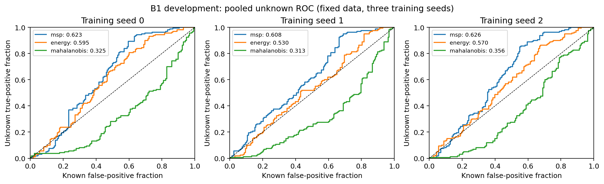
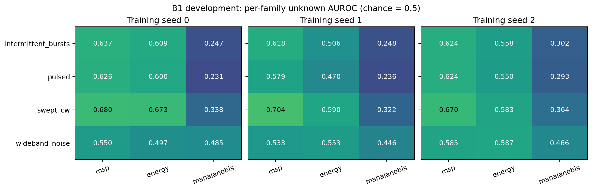

## Abstract

A satellite spectrum monitor can encounter interference types that were absent during training. We tested whether a compact convolutional neural network (CNN) could recognize four known conditions and flag unfamiliar signals in simulated geostationary (GEO) satellite downlinks. The PyTorch model receives a single-polarization spectrogram and a mask of the planned carrier bands. A nonlinear 36 MHz transponder simulation produced 716 observations. We trained three copies of the same network with different random seeds and calibrated three rejection scores using a separate set of known examples. Mean classification accuracy on 158 known test observations was **70.25%**. On a mixture of 158 known and 160 unknown observations, maximum softmax probability (MSP), energy, and Mahalanobis scored **0.619, 0.565, and 0.331 AUROC**, respectively. At the calibrated thresholds, each method rejected fewer than 3% of unknown observations on average. The CNN learned to distinguish known simulated conditions. Its confidence and features provided limited support for rejecting unfamiliar signals under this protocol.

**Keywords** — satellite interference, convolutional neural network, spectrogram, open-set recognition, GEO transponder

## 1. Introduction

A GEO bent-pipe transponder receives an uplink, filters and amplifies it, and retransmits it towards Earth. An interference monitor sees the downlink after this processing. A narrow tone, a carrier absent from the operator's plan, and distortion from an overdriven amplifier can produce different time and frequency patterns. Recognizing these patterns can help an operator decide which cause to investigate.

An ordinary classifier always returns one of its training labels. An open-set monitor can also flag an observation as unknown. The distinction matters because a model can classify familiar events accurately while still assigning high confidence to unfamiliar signals. We ask how well a small CNN trained on simulated downlink observations performs these two tasks. To separate recognition from rejection, we use one network architecture and apply three published scoring ideas to its outputs. The experiment measures known-class accuracy, unknown-score ranking, and rejection at thresholds fixed before test scoring.

## 2. Simulated observations

We used a 36 MHz single-polarization transponder with a simulated multicarrier uplink. The signal path includes input and output filtering, nonlinear amplification, and uplink and downlink noise. The amplifier uses a tabulated reference characteristic derived from DVB-S2 Annex H.7 [1]. The bandwidth and operating conditions are fixed by the A1 simulator protocol. Each observation contains 128 short spectrum snapshots spaced 10 ms apart, with 512 frequency bins per snapshot. The second input is the planned-carrier mask, representing frequency occupancy expected from the operator's plan. The simulator supplies this plan separately from the intervention and uses the same plan across the variants of a scenario.

The four training labels are **clean**, **continuous wave** (CW, a narrow tone), **unauthorized carrier** (an additional carrier outside the plan), and **overdrive** (amplifier operation at increased input drive). The unknown test set contains 40 observations from each of four families: swept CW, pulsed interference, intermittent bursts, and wideband noise. Swept CW is a frequency-varying tone. We excluded its training and validation variants from every step that learns model parameters, chooses a checkpoint, or sets a threshold.

The simulator generated 596 of 600 candidate base observations. Four unauthorized-carrier variants lacked a feasible carrier placement and were recorded as such. A separate generator produced the remaining 120 observations for pulsed interference, intermittent bursts, and wideband noise. The 716 generated observations include swept-CW variants that were set aside in the source training and validation splits. Table 1 counts the observations actually used. Grouping by scenario keeps examples that share a carrier plan and common simulation conditions together. In the test set, swept-CW variants share scenario groups with known test conditions. The three other unknown families use 40 additional groups.

**Table 1. Data used for model fitting and evaluation.**

| Role | Observations | Scenario groups | Purpose |
|:--|--:|--:|:--|
| Training | 159 | 40 | Fit the CNN and embedding statistics |
| Validation | 80 | 20 | Select the checkpoint |
| Calibration | 79 | 20 | Set rejection thresholds |
| Known test | 158 | 40 | Measure classification and known acceptance |
| Unknown test | 160 | 80 | Measure ranking and unknown rejection |

## 3. Deep learning model and rejection

The CNN input has shape **2 × 32 × 512**, with channels for relative spectrogram power and the carrier mask. We average every four adjacent snapshots in linear power before converting back to decibels. The reference is the mean power in the planned-carrier core bins of the same observation. Subtracting that reference makes the input sensitive to spectral shape and power relative to the carriers. The mask is repeated along the time axis. At inference, the model uses the spectrum and the plan supplied to the monitor. Training uses the simulator labels as targets.

We implemented SmallResNet in PyTorch using residual blocks [2]. A full-resolution convolutional stem gives narrowband features a learned representation before frequency downsampling. Four residual stages use 8, 16, 32, and 64 channels. The global mean and maximum of each final feature map form a 128-dimensional embedding. A linear layer produces four class logits. The complete model has **78,132 trainable parameters**.

The three runs used seeds 0, 1, and 2, with identical data and settings. Each fit used 10 epochs, batches of 16, cross-entropy, and AdamW with a OneCycle learning rate schedule peaking at 0.001 and weight decay of 0.0001. Frequency mirroring and circular time shifts were applied during training. The checkpoint with the highest macro-F1 on known validation examples was retained for evaluation. Macro-F1 averages class F1 with equal weight per class. Model selection and rejection calibration used disjoint validation groups.

We computed three unknown scores from each trained network.

1. **MSP** is one minus the largest softmax probability [3]. It increases when the classifier distributes probability across several labels.
2. **Energy** is the negative log-sum-exp of the four logits at temperature 1 [4]. It uses the magnitude of the logits as well as their relative values.
3. **Mahalanobis** is the squared distance to the nearest known-class mean in embedding space, scaled by a pooled covariance matrix [5]. We estimated class means and the pooled covariance on training embeddings and used shrinkage of 0.1.

In all three cases, a larger score means more unknown-like. For each seed and score, the threshold is the empirical 95th percentile of the 79 known calibration scores, rounded up to the higher observed value. A test score above the threshold receives the unknown flag. An accepted observation receives the class with the largest logit.

## 4. Results

Before applying rejection, the CNN classified 111, 112, and 110 of the 158 known test observations correctly for seeds 0, 1, and 2. Mean accuracy was **70.25%**, with a range of **69.62–70.89%**. The corresponding mean macro-F1 was **0.707**. As a reference, predicting a fixed most frequent class from training gives 40 correct predictions on this test set, or 25.32%. The learned classifier extracted useful structure from the simulated observations.

Table 2 reports open-set performance on the same known test set and all 160 unknown observations. AUROC measures the ability to rank unknown observations above known observations as the threshold varies. A value of 0.5 is the random-ranking reference. Known acceptance is the fraction of the 158 known observations whose scores fall at or below the frozen threshold. Unknown rejection is the fraction of the 160 unknown observations above it. Acceptance and classification accuracy measure different outcomes, since an accepted event can receive the wrong known label.

**Table 2. Open-set test results averaged over three training seeds.**

| Unknown score | AUROC | AUROC range | Known accepted | Unknown rejected |
|:--|--:|:--|--:|--:|
| MSP | 0.6191 | 0.6083–0.6259 | 97.89% | 2.29% |
| Energy | 0.5647 | 0.5297–0.5947 | 97.05% | 1.25% |
| Mahalanobis | 0.3314 | 0.3128–0.3564 | 96.41% | 1.67% |

The ROC curves show the ranking difference across all thresholds. MSP gave the highest pooled AUROC in each run. Its family-level AUROC ranged from a mean of 0.556 for wideband noise to 0.685 for swept CW. Mahalanobis ranked unknowns below knowns more often than above them on this test. The score direction specified before the experiment was retained. With the threshold fixed by known calibration examples, even MSP averaged fewer than four rejected examples out of 160 unknowns per run. The classifier's performance on familiar events therefore provides limited guidance about its ability to detect a new one.

{width=100%}

{width=100%}

All seeds share one set of generated scenarios. Means and ranges describe variation across optimization runs on those scenes. They do not provide sampling confidence intervals for new satellite observations.

## 5. Discussion and conclusion

The study shows that a compact CNN can distinguish four known conditions from simulated GEO spectrograms and carrier plans using modest CPU resources. The main open-set result is that the known-only rejection thresholds accept almost all unfamiliar examples. This remains true for MSP and energy, despite their pooled AUROC being above the random-ranking reference. A threshold chosen to keep familiar examples therefore yielded little practical separation in this experiment.

There are several reasons to keep the conclusion within the scope of this experiment. Training used one small simulated data set with one transponder bandwidth, reference amplifier, and polarization. Wideband noise can resemble a higher noise floor, which makes labels harder to infer from power spectra alone. The network's input and carrier-relative normalization use the available plan, so an experiment with missing or inaccurate plans would test a different condition. Some scenario groups in this development split may overlap earlier pilots. Field measurements and newly generated, independent test scenarios would be needed to quantify transfer and validate an operational rejection threshold.

On the conditions studied here, the CNN supports classification of familiar events. An open-set monitor would need stronger evidence of unknown rejection under its operating threshold.

## Code and reproducibility

Install Python 3.12 and activate a virtual environment in a Git checkout. Run the following from the repository root, giving the experiment a fresh output directory outside the checkout.

```text
python -m pip install torch==2.15.0+cpu --index-url https://download.pytorch.org/whl/cpu
python -m pip install -e ".[dev,ml]"
python research/cpu_delivery/run.py --out ../geo-cnn-run
python research/cpu_delivery/audit.py
```

The runner generates the data, trains and evaluates the three models, and saves `summary.md`, `summary.json`, and the figures. The audit command verifies the archived aggregate evidence used in this paper. The recipe was fixed in commit `4f4b74a` and is recorded in `configs/cpu_delivery.json`. The source and result identities, scored populations, and all seed-level results are under `docs/results/`, alongside `CPU_DELIVERY_2026-11-04.md`. The 4 November run used Python 3.12.14, NumPy 2.3.5, and PyTorch 2.15.0+cpu. Its data generation and model subprocesses took 355 seconds in total on two CPU cores with 8 GiB of memory. This timing excludes final plot and report generation. [Project repository](https://github.com/mythril33/Payload-Aware-Open-Set-Interference-Recognition-for-GEO-Transponders).

A fresh CPU run on 24 November at revision `a95bdc1` regenerated the same scenario populations and reproduced all pooled and per-family score rows exactly. Its subprocesses took 523 seconds. This repeat checks reproducibility on the same scenario seeds.

## References

1. ETSI. *Digital Video Broadcasting (DVB). Second generation framing structure, channel coding and modulation systems. Part 1, DVB-S2*. EN 302 307-1 V1.4.1, Annex H.7, 2014.
2. He, K., Zhang, X., Ren, S., and Sun, J. *Deep Residual Learning for Image Recognition*. CVPR, 2016. doi:10.1109/CVPR.2016.90.
3. Hendrycks, D. and Gimpel, K. *A Baseline for Detecting Misclassified and Out-of-Distribution Examples in Neural Networks*. ICLR, 2017. arXiv:1610.02136.
4. Liu, W., Wang, X., Owens, J., and Li, Y. *Energy-based Out-of-distribution Detection*. NeurIPS, 2020. arXiv:2010.03759.
5. Lee, K., Lee, K., Lee, H., and Shin, J. *A Simple Unified Framework for Detecting Out-of-Distribution Samples and Adversarial Attacks*. NeurIPS, 2018. arXiv:1807.03888.
