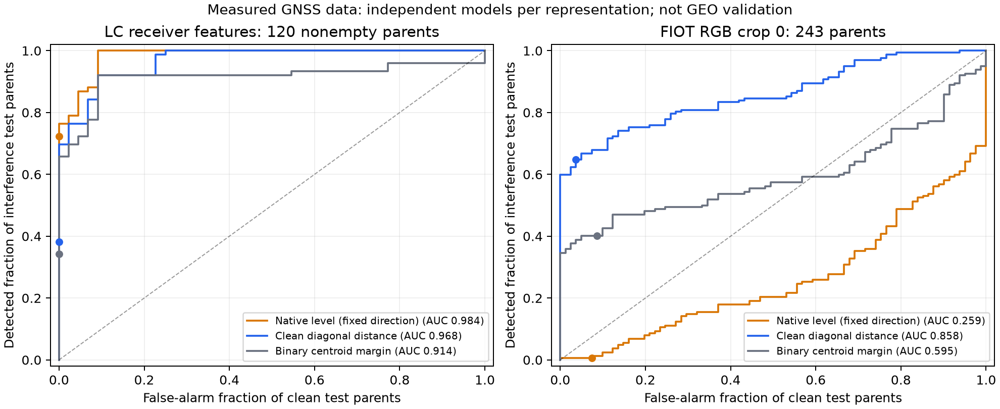
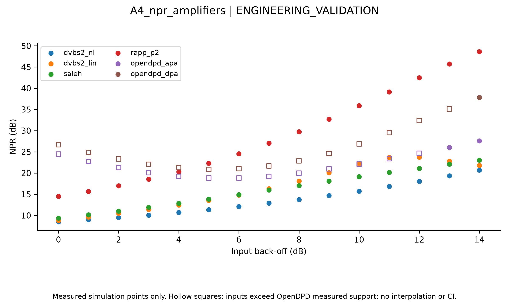
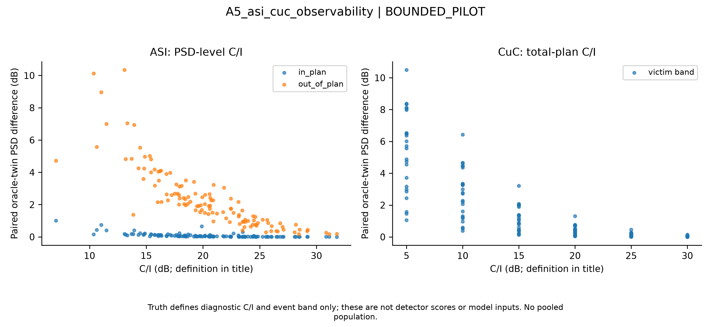

# Introduction

Satellite interference monitoring is an inference problem constrained by its observation point. A receiver may expose channel-quality telemetry, a rendered image, calibrated spectra, or complex samples. These are different experimental objects. A detector that responds to changes in a receiver's reported strength need not operate on an image whose colors were produced by an undocumented rendering pipeline. Likewise, an uplink interferer passing through a satellite amplifier is physically different from a downlink mixture added after that amplifier. Treating all such data as interchangeable can make a benchmark look more operationally meaningful than its evidence permits.

Prior satellite studies already investigate on-board detection and cancellation, neural interference detection, and prediction of received spectra [@politis2017weak; @henarejos2019interference; @pellaco2019spectrum]. Public SmartSpace tasks address on-board interference locations and NGSO-to-GSO interference detection [@daoud2023dataset; @saifaldawla2024genai]. Measured GNSS studies already combine multiple modalities and examine model reliability and data discrepancies [@brieger2022multimodal; @heublein2024discrepancies]. Consequently, neither the use of elementary detection scores nor the observation that data representations matter is a new algorithmic contribution.

Our narrower question is operationally concrete: **what can actually be reproduced from the released files, with publisher splits preserved and a threshold chosen without inspecting test performance, and which satellite claims remain unsupported?** We examine the consequences of empty receiver records, repeated image crops, uncalibrated RGB values, limited calibration populations, and distinctions between hardware measurements and reference-channel simulation. These issues are easy to lose when results are reduced to a single accuracy number.

The study makes three bounded contributions. First, it documents and checks the actual released LC/FIOT representations, recording-level splits, availability coverage, and native labels. Second, it presents all three frozen detection scores and clean-calibrated operating points, retaining a strongly negative image-level result and explicit conditional uncertainty. Third, it connects those empirical limits to separately identified measured-amplifier support and GEO observability diagnostics. This connection is an interpretation across evidence types, **not an executed cross-domain transfer experiment**.

The original project proposed a reference-traceable generator (C1), a plan-conditioned dual-polarization open-set recognizer (C2), and a quantified payload gap (C3). Here C1 contributes limited simulation methodology; confirmatory C2 and C3 claims are not made. This manuscript is positioned as a reproducibility/comparative-methods paper. Its suitability for a particular venue depends on whether that venue values the release-level audit and calibrated negative evidence; combining existing baseline results alone would not support a claim of a new recognition method.

# Related work and scope of comparison

## Satellite interference observations

Politis and colleagues study weak satellite interference detection after signal cancellation [@politis2017weak]. Such work motivates residual-domain detection but does not make every cancellation residual equivalent: observation point, receiver knowledge, reconstruction errors, and payload distortion matter. Henarejos and colleagues investigate deep-learning interference detection and classification [@henarejos2019interference], while Pellaco and colleagues predict spectra for satellite interference detection [@pellaco2019spectrum]. These studies establish prior satellite-learning approaches; we do not claim to introduce satellite anomaly detection.

The SmartSpace on-board release provides clean and interfered subband-location labels; the NGSO release supplies clean training/validation data and a mixed test population [@daoud2023dataset; @saifaldawla2024genai; @smartspaceDatasets]. Their tasks differ from an eight-type GEO open-set benchmark. The available source descriptions do not justify assuming operator carrier plans, paired polarization observations, calibrated absolute RF power, or measured GEO field data. We provide no numerical comparison with their reported methods because the official raw downloads were inaccessible to this study.

## Measured GNSS and amplifier evidence

Brieger and colleagues introduce multimodal GNSS interference classification and reliability analysis; the LC/FIOT source release cites that work [@brieger2022multimodal; @fraunhoferLCdataset]. Heublein and colleagues examine supervised/unsupervised robustness and real-world data discrepancies [@heublein2024robustness; @heublein2024discrepancies]. Their analysis is direct prior work, not evidence that our elementary scores are novel. Our distinct emphasis is the exact released-file representation, coverage, crop-parent separation and clean-threshold behavior of a reproducible bounded comparison. We do not reproduce their full model suite or claim a method-level improvement over it.

OpenDPD supplies measured power-amplifier data and modeling tools [@wu2024opendpd]. We reuse an existing train-fitted, validation-selected memory-polynomial artifact, rather than repeating its estimation. The devices are solid-state Doherty amplifiers, not satellite traveling-wave tube amplifiers (TWTAs). ETSI reference transponder descriptions and digitized reference responses serve a different role in the GEO simulation [@etsi2014dvbs2; @etsi2021dvbs2guide]. Saleh's model is a documented analytical alternative [@saleh1981twta]; it is not substituted for the project's default digitized reference response.

## What is and is not compared

The measured GNSS experiments compare three scores **within each source**. LC and FIOT models are fitted separately. Measured PA fits assess reproduction of amplifier outputs; their NMSE is not a detection metric. GEO diagnostics assess controlled physical contrasts; they are not field measurements or learned recognition benchmarks. We neither pool these populations nor rank the three evidence streams on a shared accuracy scale. The prior literature verification record in `paper/literature_audit.md` distinguishes primary full-text checks, publisher metadata, dataset descriptions, and inaccessible source documents.

# Data, labels, access, and legal constraints

## Measured GNSS receiver telemetry and images

The Fraunhofer laboratory release is pinned to the author-repository snapshot identified in the cited release and evidence supplement [@fraunhoferLCdataset].
The actual binary archives, rather than Git LFS pointer files, were obtained. LC contains 744 NPY files, of which 736 appear in the published label lists. Eight unlabelled files are excluded without imputation of class labels. Nonempty LC arrays have 308 columns and nine or ten rows; 184 labelled arrays have zero rows. No inference is made about why a recording is empty.

FIOT files are $512\times243\times3$ integer RGB spectrogram images. The three channels are colors, not polarizations. They are neither raw IQ nor calibrated power spectral densities. The publisher's 5,268/1,458 train/test crop split corresponds to 878/243 parent IDs with six crops per parent. We retain only crop index zero for every parent. This prevents treating repeated views as independent samples and bounds processing; it does not demonstrate independent acquisition sessions.

**Table T1a. Measured GNSS populations. Counts are recording parents after crop selection.**

| Source | Published train/test | Usable train/test | Empty train/test | Test clean/positive |
|---|---:|---:|---:|---:|
| LC receiver features | 577 / 159 | 432 / 120 | 145 / 39 | 44 / 76 usable |
| FIOT RGB, crop 0 | 878 / 243 | 878 / 243 | 0 / 0 | 81 / 162 |

LC's full labelled test set contains 59 clean and 100 positive records. Its empty test records comprise 15 clean and 24 positive cases. Empty records are **abstentions**, not correct clean predictions. Thus LC usable test coverage is $120/159=75.5\%$. Native labels are retained: 0=None/clean, 1=Noise, 2=Chirp, 3=FreqHopper, 4=Modulated, 5=Multitone, 6=Pulsed, 7=Cw, and 8=Tone. The released LC population has no class-7 support; both usable test sets have only two Tone records. The labels are not remapped to the GEO taxonomy.

No parent ID or nonempty file hash overlaps the retained train/test partitions. This catches crop repetition and exact duplicate bytes, not all physical dependencies. Acquisition day, session and jammer-setup independence cannot be established from the supplied identifiers. In particular, we do not describe this split as an unseen-site, unseen-session or unseen-emitter evaluation.

## Satellite comparison data and amplifier measurements

**Table T1b. Additional sources and observation boundaries. Counts here are not pooled with T1a.**

| Source | Published representation/split | Actual use and boundary |
|---|---|---|
| SmartSpace on-board | Full/reduced FFT magnitude or complex data; 12,000 train and 3,000 validation; clean plus five subband locations | Zero raw files obtained; no separate test described; no measured result here |
| SmartSpace NGSO | 800 magnitude values; 11,500 clean train, 1,302 clean validation, 4,470 mixed test | Zero raw files obtained; numeric test-positive convention unverified; no result here |
| OpenDPD APA/DPA | Measured paired input/output IQ, native train/validation/test files | Existing PA fit artifact reused; no new fitting or measurement |
| GEO reference simulation | Controlled multicarrier observations and separately versioned pilots | Existing committed summaries only; no new generation or protected observations read |

On 26 October 2026 the two official SmartSpace download links redirected to Microsoft sign-in HTML. An HTTP200 login response is not an acquired dataset. A functioning research share or owner-granted folder read/download permission is needed. Whether external Entra guests, particular institutional accounts, MFA or expiry rules apply remains an owner-side question. An access-request draft exists; it was not sent as part of this manuscript task. Neither MAT keys nor paired-view/group identities can be verified without the files. Appended INR, off-axis parameters and labels would not be legitimate detector features.

The LC/FIOT Zenodo API license field states CC BY-SA 4.0, whereas the source README/description states CC BY-NC-SA 4.0. This discrepancy is unresolved and must be clarified for the intended publication. Local research followed the more restrictive noncommercial statement; this is not a legal resolution. SmartSpace states research-only use. OpenDPD repository code carries Apache-2.0, but the inspected data descriptions do not separately settle all measurement-data rights. We redistribute no third-party raw archives, NPY files or CSVs. All plotted figures in this package are our derived aggregate figures. License clarification is a publication blocker, not something numerical verification can remove.

# RF physics and GEO simulation methodology

## Reference channel and observation point

The simulator represents a bent-pipe channel with input multiplexing (IMUX), nonlinear amplification and output multiplexing (OMUX), with independently specified uplink/downlink disturbances. Schematically, for one path,

$$
y(t)=h_{\mathrm{OMUX}}*\mathcal{A}\!\left[h_{\mathrm{IMUX}}*(x(t)+i_{\mathrm{up}}(t)+n_{\mathrm{up}}(t))\right]+i_{\mathrm{down}}(t)+n_{\mathrm{down}}(t).
$$

Here $*$ denotes filtering and $\mathcal{A}$ the amplifier response. This ordering explains why uplink and downlink interference are not physically interchangeable. Dual-polarization variants additionally model coupling, oscillator phase noise, monitor response and calibration. The experiments summarized below do not all include those blocks: the older ASI/CuC diagnostics use a single-polarization, fixed-link configuration without phase noise. Their limitations are retained instead of retroactively attributing the full later chain to them.

The default reference filters are FIR responses derived from ETSI Annex E tables, and the default nonlinear response is digitized from the DVB-S2 H.3 curve [@etsi2014dvbs2; @etsi2021dvbs2guide]. Generic filter approximations and Saleh are alternatives, not the defaults. Digitization, finite sampling and simplified waveform construction limit fidelity. The implementation does not establish complete DVB-S2 framing or measured satellite agreement. Back-off is defined against the configured single-carrier saturation reference with fixed gain; a multicarrier output back-off need not equal input back-off.

## Cancellation and observability diagnostics

The P20 `obs-cancel/1` receiver reconstructs planned carriers from receiver-observed co-polarized IQ and operator carrier descriptors, then subtracts the reconstructed sum. It uses timing estimation, constellation decisions, complex-gain refinement and remodulation. It does **not** consume transmitted symbols, actual carrier activity, true IBO/XPD, source parameters or event labels. Decision errors, nonlinear distortion and finite-block effects remain in its residual. It is distinct from the later P21b receiver, which is not silently substituted.

An offline physical diagnostic may compare event/no-event twins generated with otherwise identical latent conditions. Its contrast is

$$\Delta_{\mathrm{PSD}}=10\log_{10}\!\left(\overline{P}_{\mathrm{event}}/\overline{P}_{\mathrm{twin}}\right).$$

The twin is unavailable to an operational monitor. Truth-selected victim bands are therefore permitted only as **labelled diagnostic regions**, never model inputs. The resulting contrast is not a detector score, probability of detection or source-identification result. Likewise, ASI's PSD-referenced C/I and CuC's total-plan C/I use different denominators and cannot be combined on a common level axis.

The standalone noise-power-ratio (NPR) check drives only the amplifier with notched band-limited noise. NPR is the ratio of mean in-band PSD outside the notch to PSD inside its center, in decibels. It excludes IMUX/OMUX effects. Single-waveform NPR trends provide consistency information, not an independently measured satellite performance curve.

## Reused measured-amplifier model

The memory-polynomial model uses delayed complex input samples multiplied by amplitude powers. Coefficients are fitted from the source training split; model order/memory are selected using validation NMSE, followed by a test calculation. Input is normalized by training-input RMS, and output by the training-derived best complex linear gain times that RMS. NMSE is $10\log_{10}(\sum_n|y_n-\hat y_n|^2/\sum_n|y_n|^2)$ on the normalized target. The project uses the smallest model within the registered validation tolerance. The recorded model choices are not changed here. Amplitudes beyond measured support are clipped in the nonlinear basis, so extrapolation is explicitly limited. Nominal mapping of measured input RMS to an IBO reference and bandwidth-based delay scaling are modeling assumptions, not measured TWTA physics.

# Measured GNSS detection methodology

## Fixed scope and feature definitions

The detector code and protocol were committed as `13f79f9ffc824029d91c74299cbfe83131ea4cc6` before the first detection metrics. The protocol SHA-256 is recorded in the evidence manifest. There was no subsequent search over features, score directions, thresholds or model checkpoints. This is a repository timestamped commitment, not an independently registered clinical-style preregistration. Before scoring, an initial access probe was expanded from 256 FIOT parents to all available crop-zero parents because the probe contained little clean calibration support; that change and its timing are disclosed in the original report.

LC uses six summaries, in this fixed order: mean and population standard deviation of positive receiver `ss` values; fraction of positive `ss` entries; population standard deviation of timestep mean positive `ss` (a timestep with no positive entry contributes zero); mean SDR; and mean kurtosis. The corresponding zero-based column slices are $[57,98)$, $[180,244)$ and $[244,308)$. The native `ss` statistic is not asserted to have calibrated watt units. Position, PRN, azimuth/elevation, recording IDs, jammer identity and jammer-power metadata are excluded from model inputs.

FIOT uses eight image summaries: the three RGB means, the three population standard deviations, and the mean absolute first difference along each array axis. Gradients operate on stored array axes; no physical time/frequency spacing is inferred. Averaging RGB values describes image brightness. Squaring pixels would not recover RF power; the release does not supply the calibration and rendering inverse needed for that interpretation.

## Fitting and calibration separation

Only publisher training IDs are divided into fitting and calibration populations. A parent is assigned to calibration when the first eight hexadecimal digits of SHA-256 of `public-calib-v1:` concatenated with its ID, divided by $2^{32}$, are below 0.25. All variants of a parent remain together. No test label, feature, result or image determines this assignment.

After excluding empty LC records, fitting/calibration/test group counts are 339/93/120 for LC and 676/202/243 for FIOT. Fitting-clean counts are 151 and 254; clean-calibration counts are 38 and 69. Calibration includes additional positive records that are **not used for thresholds or fitting**. Each representation is fitted separately. The source test partition is used only for the frozen evaluation; this manuscript reads already committed aggregates without reopening observations.

## Three scores, with fixed directions

Let $\mathbf{x}$ be a feature vector. Clean fitting records determine component means $\mu_j$ and population standard deviations $\sigma_j$. Components with $\sigma_j\leq10^{-12}$ are removed from distance calculations. On the $d$ retained components, write $z_j=(x_j-\mu_j)/\sigma_j$. The scores are:

1. **Native level** $s_L$: negative mean positive `ss` for LC; mean of the three RGB means for FIOT. Neither direction is reversed after evaluation.
2. **Clean diagonal distance** $s_D=d^{-1}\sum_j z_j^2$.
3. **Binary centroid margin** $s_C=s_D-d^{-1}\sum_j(z_j-c_j)^2$, where $\mathbf{c}$ is the mean standardized feature vector of positive **fitting** records only.

The margin is a supervised binary baseline. It is not an eight-class classifier or an open-set rejector. Larger values are defined to be more interference-like for all three scores. All three are co-reported; none becomes a primary winner because of its held-out ranking. There is no fitting stage shared across LC and FIOT, and no cross-source inference experiment.

# Evaluation metrics and statistical protocol

The positive class is native label $\ne0$ (any labelled GNSS interference); the negative class is native label 0. For clean-calibration scores $u_1,\ldots,u_n$, the operating threshold is the empirical 0.95 quantile with the `higher` convention. If the sorted scores are zero-indexed, its index is $\lceil0.95(n-1)\rceil$. A sample alarms only when $s>\tau$; equality is accepted as non-alarm. Nominal $P_{\mathrm{FA}}=0.05$ is a target, not an estimate with 5% precision. Ties and finite calibration size determine the actual alarm count.

Detection probability is the number of positive records alarming divided by the number of usable positive records. False-alarm rate is the number of clean records alarming divided by usable clean records. We report counts as well as rates. LC coverage is reported separately, with a lower-bound convention treating empty positive records as undetected. Empty clean records do not become correct negatives.

AUROC uses grouped score ties and trapezoidal integration. Average precision (AP) is the recall-weighted step integral of precision, not a trapezoidal area under a precision-recall plot. Positive prevalences are $76/120$ and $162/243$; AP depends on them. FPR@95TPR is the first grouped ROC point attaining at least 95% positive recall. It is a **ranking summary**, not a calibrated operating point and not a threshold selected for deployment. OSCR, multiclass accuracy and unknown-class rejection metrics are undefined for this binary task and remain null.

Conditional uncertainty is summarized using 500 parent-ID bootstrap draws, seed 20261025, retaining all selected observations of each resampled parent. Percentile 2.5/97.5 bounds hold the fitted model and threshold fixed. They exclude fitting, calibration and acquisition-session uncertainty, and make no independent-session guarantee. No method-pair significance test or superiority test was predeclared. Six methods-by-source rows are descriptive comparisons without a confirmatory winner claim.

# Results

## Measured GNSS detection and operating points

**Table T2. All frozen measured-data results. TP/P and FP/N are detected-positive and false-alarm counts, respectively. F95 is ranking FPR@95TPR.**

| Source | Score | AUROC | AP | F95 | TP/P | FP/N |
|---|---|---:|---:|---:|---:|---:|
| LC | Native level | 0.9842 | 0.9903 | 0.0909 | 55/76 | 0/44 |
| LC | Clean distance | 0.9677 | 0.9812 | 0.2273 | 29/76 | 0/44 |
| LC | Centroid margin | 0.9142 | 0.9610 | 0.7727 | 26/76 | 0/44 |
| FIOT | Native RGB level | 0.2590 | 0.5425 | 1.0000 | 1/162 | 6/81 |
| FIOT | Clean distance | 0.8578 | 0.9367 | 0.6667 | 105/162 | 3/81 |
| FIOT | Centroid margin | 0.5946 | 0.8156 | 0.9877 | 65/162 | 7/81 |

Each LC score produces one alarm among 38 clean calibration records (2.63%); each FIOT score produces three among 69 (4.35%). LC thresholds in table order are -35.583691, 21.949992 and 13.709591; FIOT thresholds are 141.264784, 3.110923 and 0.166145 in the corresponding native score units. These numeric values are representation-specific and are not interchangeable between methods or sources.

For LC, conditional detection rates are 72.4%, 38.2% and 34.2%. Including all 100 published positive test records, the corresponding lower-bound sensitivities are 55%, 29% and 26%. The 39 empty records therefore materially change how a headline result should be interpreted. Observing no alarms in 44 usable clean test records is not proof of zero population false alarms: even under independent clean parents, the one-sided 95% binomial upper bound is approximately 6.58%.

FIOT's positive-direction brightness score has AUROC below chance. We retain its prescribed direction and outcome; retrospective sign reversal would be test-informed method revision. Clean-distance detection is $105/162=64.8\%$ with $3/81=3.7\%$ test false alarms. Its ranking F95 of 0.6667 does not support a claim of 95% detection at 5% FAR. The centroid baseline does not uniformly improve the operating point merely because it uses positive training labels.

**Table T2b. Conditional 95% parent-bootstrap AUROC intervals, in the same score order as T2.**

| Source | Native level | Clean distance | Centroid margin |
|---|---|---|---|
| LC | [0.9599, 0.9978] | [0.9357, 0.9899] | [0.8542, 0.9616] |
| FIOT | [0.1974, 0.3229] | [0.8149, 0.8989] | [0.5206, 0.6681] |

The degenerate LC FAR bootstrap interval [0,0] reflects a sample with no observed alarms, not a population guarantee. The evidence supplement also supplies conditional AP/detection/FAR intervals and family denominators. The following reused figures retain the original plotted populations and axes.

{width=95%}

{width=95%}

## Measured amplifier support

**Table T3. Reused OpenDPD memory-polynomial evidence. NMSE is in dB; measured outputs are not satellite measurements. Device technology/frequency attribution follows the preserved project source audit (P17), rather than a newly verified hardware measurement or a claim that the current OpenDPD guide documents every device detail.**

| Data/device | Order / memory setting | Validation NMSE | Test NMSE | Support limit |
|---|---|---:|---:|---|
| APA: GaN Doherty, 3.5 GHz | 5 / 3 | -31.04 | -30.64 | Measured amplitude envelope; no TWTA saturation validation |
| DPA: CMOS digital Doherty, 2.4 GHz | 5 / 16 | -33.78 | -33.89 | Memory setting reaches tested grid edge |

The artifact's basis convention uses amplitude powers below the stored order setting; the label “order 5” is the code's setting, not a claim that the highest exponent is five. These results demonstrate that the existing artifact reproduces its native test measurements under its normalization. They do not establish a unique physical nonlinear channel model, out-of-support amplitude accuracy or GEO hardware generalization. Bandwidth-rescaled memory and mapping input RMS to nominal IBO 11 dB remain assumptions. No new PA fit, WebLab measurement or hardware experiment is included.

## Simulated GEO observability and physical consistency

**Table T4. Controlled simulated diagnostics. These rows are separate populations, not a common detection test.**

| Diagnostic | Population/configuration | Existing result | Interpretation boundary |
|---|---|---|---|
| Reference nonlinear TWTA NPR | One notched-noise seed, amplifier alone | 15.7 to 20.7 dB at IBO 10 to 14 dB; slope about 1.25 dB/dB | No complete-channel or measured-device validation |
| ASI geometry/visibility | 120 single-pol groups, fixed IBO 11 dB and C/N 25 dB | Median PSD-referenced C/I 20.3 dB; in-plan contrast weak relative to spill | Antenna/pointing distributions assumed; event/no-event twin is oracle diagnostic |
| CuC visibility | 24 groups at each of six levels; same fixed-link setting | Median contrast 0.373 dB at total-plan C/I 20 dB; 0.041 dB at 30 dB | PSD contrast is not operational probability of detection |
| P20 cancellation | 64 scenes, 8 groups, 8 scenes/class across four roles | Mean active-carrier core-depth range 12.78 to 16.47 dB; paired CuC median contrast 0.986 to 6.461 dB, 8/8 improve | Diagnostic bands use truth offline; no learned-model performance claim |

{width=95%}

{width=95%}

The H.2 linearized-reference NPR curve turns down at low drive; the existing investigation attributes this to sparse digitized phase/transfer behavior. It is retained as a model artifact, not described as a discovered device phenomenon. The NPR and visibility plots are reused from committed, hash-bound summaries; no figure regeneration reads RF observations or reruns the simulator.

# Physical interpretation and representation limits

The native LC level score associates degraded receiver-reported strength with the supplied interference labels. That association may exploit receiver-specific behavior and does not prove a universal interference-energy mechanism. The FIOT result demonstrates why replacing such a statistic with a similarly named image statistic is unsafe: RGB levels depend on the rendering pipeline, and high physical interference power need not imply a larger stored color mean. A below-chance score is not evidence that all image features fail; nor does a stronger distance ranking validate a physical power interpretation.

The GEO diagnostics explain a different limitation. A weak carrier underneath a stronger planned carrier can produce little PSD contrast. Cancellation may expose contrast, but its residual also contains receiver error and payload distortion. An amplifier-induced product is not necessarily an external interferer. ASI/unauthorized distinctions can additionally depend on plan context or geometry, neither of which exists in the released GNSS inputs. Missing observables cannot be supplied by relabeling or synthetic metadata appended to the measured examples.

The measured PA fits support sensitivity to an alternative nonlinear response only within their native data support and stated mapping assumptions. A solid-state Doherty response and a TWTA reference curve differ in device technology and operating region. Their qualitative comparison is useful for checking an assumption; their juxtaposition is not evidence that a model transfers to a satellite. Similarly, neither successful GNSS detection nor a controlled GEO diagnostic establishes cross-dataset generalization.

# Discussion and preserved negative findings

**Table S1. Historical exploratory findings retained without conversion to confirmatory results.**

| Source | Result | Why it cannot establish the original full claim |
|---|---|---|
| A1 Pilot A, two training seeds and about 6% planned data | Linear-trained accuracy 78.7% on linear versus 76.8% on nonlinear test; intervals overlap | A statistically confirmed accuracy payload gap is unsupported |
| R1, one training seed, common four-class models | IBO-shift clean alarms 14/60 for linear-trained versus 1/60 for nonlinear-trained; accuracies 79.1%/83.7% | Exploratory fixed-threshold transfer, not multi-seed confirmation |
| R1 five-class model | Shifted-condition clean alarm rates about 18–27%; Rapp overdrive 59/60 predicted clean | Labels based on drive cause need not be identifiable across amplifier families |
| A1 plan intervention, one training seed | A 0.5 MHz plan shift yields 28/30 clean alarms versus 1/30 original | Plan dependence/sensitivity is not a trained plan-versus-no-plan benefit |
| Canonical P20 tiny neural pilot | 16 training and 16 known-test observations; 12.5% known accuracy | Pipeline execution and observability checks do not establish eight-class recognition |

S1 reports separate historical experiments, not newly computed estimates. It does not pool their samples or compare a five-class model against a four-class one as a controlled payload-gap test. The canonical three-view design contains operator plans in every view; it can test added polarization/residual observations but cannot by itself identify learned plan benefit. That would need a separately specified retrained no-plan control. Unseen carrier-loading generalization also lacks completed confirmatory evidence.

The practical outcome is a smaller claim than the initial project ambition. An honest reproducibility paper can document where released representations and thresholds support conclusions and where they do not. It must not recast these results as a superior recognizer. A stronger paper retaining the full C2/C3 claims would require new predeclared experiments, adequate calibration/test support and separate execution authorization. Those experiments were not performed for this manuscript.

# Threats to validity

**Acquisition dependence.** Parent-ID and hash separation do not rule out shared sessions, receiver settings, jammer hardware or acquisition schedules. Parent bootstrap may therefore understate uncertainty. A true session-held-out claim needs additional source metadata and a separately frozen analysis.

**Missingness and selection.** LC empties may be nonrandom. Conditional detection is not population sensitivity; the reported lower-bound convention is deliberately conservative and still does not characterize the missing observations. Choosing crop zero reduces correlation but may discard informative temporal segments. No crop was selected by detector outcome.

**Calibration uncertainty.** Clean populations of 38 and 69 records offer coarse empirical threshold support. A nominal 5% rule and matching empirical count do not certify deployment FAR. Fixed-threshold bootstrap omits recalibration uncertainty and training variability. The positive centroid also depends on the available mixture of training interferers.

**Multiplicity and post hoc interpretation.** All three directions and feature definitions were frozen before the first metrics. Presenting their outcomes does not authorize picking a winner for a future test on the same held-out data. The cross-evidence physical discussion is explanatory and post hoc; it is not a preregistered causal identification result.

**Representation and label validity.** Rendered RGB images may encode display choices. Receiver telemetry can encode proprietary processing. Native jammer labels are causes in a GNSS experiment, not general satellite classes. A PSD-only distinction can be physically nonidentifiable even with correct labels.

**Historical source and exposure.** Old pilot results are bound to their original source/protocol identities; changed source cannot legitimize historical checkpoint reuse. The B2 scientific register discloses prior test exposure and prospective exclusion sensitivity obligations. This paper makes no pristine-B2-test claim and opens no protected observations. Previously exposed simulator summaries are descriptive evidence, not a fresh confirmatory held-out test.

**Reference-model fidelity.** Digitized reference curves, filter scaling, finite blocks, assumed antenna/pointing distributions, fixed-link diagnostics and simplified framing bound realism. Measured PA records do not close the gap to a measured GEO transponder. Known reference-curve artifacts remain visible.

**Access, rights and replication.** Inaccessible SmartSpace files prevent independent numerical comparison. Fraunhofer's license discrepancy and separately unspecified data rights limit what can be redistributed. Committed fitted-state summaries and source hashes improve auditability but do not substitute for lawful raw-data access or missing acquisition metadata. Human authorship, rights review and venue suitability remain publication decisions.

# Conclusions

This study shows why interference-detection claims must name their observable, available population and calibration rule. The LC comparison is conditioned by substantial empty-record coverage; FIOT preserves a negative RGB-level finding alongside stronger feature-distance ranking. A ranking result is not a fixed-FAR guarantee, and native GNSS evidence does not validate GEO deployment. Existing PA fits and controlled satellite simulations provide complementary, separately scoped evidence about amplifier support and physical observability.

The completed comparison supports an auditable reproducibility/comparative-methods contribution. It does not establish a new recognition algorithm, measured GEO field validity, cross-source transfer, eight-class open-set superiority or a statistically confirmed payload gap. The immediate publication work is rights clarification, author/venue decisions and revision of this complete draft, rather than another architecture or an unbounded synthetic campaign.

# Reproducibility and data availability

The manuscript baseline is repository commit `7f58150bbcb674cb9985bcfa4ed56391f3b91c8a`, containing merged PRs 44 and 45. The public-data detector/protocol were fixed at `13f79f9ffc824029d91c74299cbfe83131ea4cc6`. The acquisition uses the pinned Fraunhofer author commit stated above; OpenDPD fitting uses source commit `cb4c5ea40632a977f2725575534d3f062fcbb652`. Full file/figure hashes, machine-readable pointers, numerators, units and source identities are in `paper/evidence.json`. `paper/audit_evidence.py` checks committed aggregates without raw observations, simulation, fitting or network access.

Original public-data runs used Python 3.12.14, NumPy 2.5.4, SciPy 1.18.1 and two numerical threads. LC took 0.740 s wall with peak RSS 26,804 KiB; FIOT took 23.117 s with peak RSS 39,184 KiB. These are historical single-run measurements, not newly repeated benchmarks. The source recipe and bounded download/extraction instructions are in `research/public_data/README.md`; no raw dataset is embedded in the manuscript. Existing scientific figures are copied byte-for-byte with their provenance retained.

Raw LC/FIOT files must be obtained from the cited owners subject to clarified terms. OpenDPD's original measurements remain at its source repository. SmartSpace access requires a functioning authorized share; its results remain unavailable. Neither scripts that produce data nor model fitting are required to compile this paper or verify its aggregate evidence. This manuscript task performs only documentation, source-metadata verification, aggregate arithmetic and rendering checks. No full B2 generation, training, GPU probe, LOKO, D-5 sensitivity or protected held-out evaluation is executed or authorized. Scientific ratification is not compute permission; the canonical benchmark remains incomplete.

# References

::: {#refs}
:::
